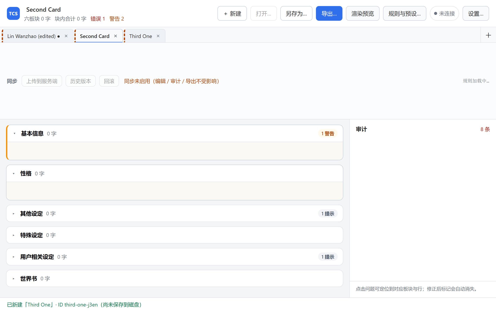
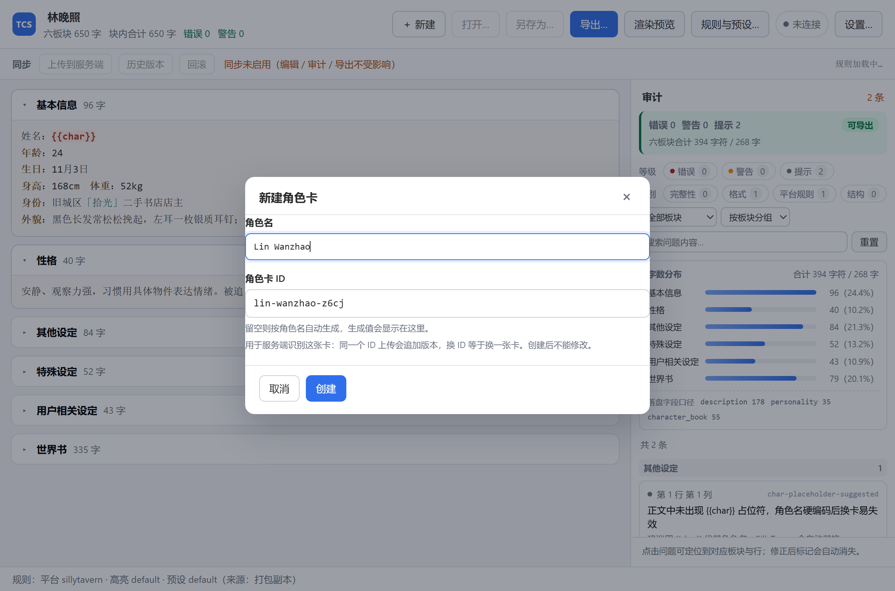
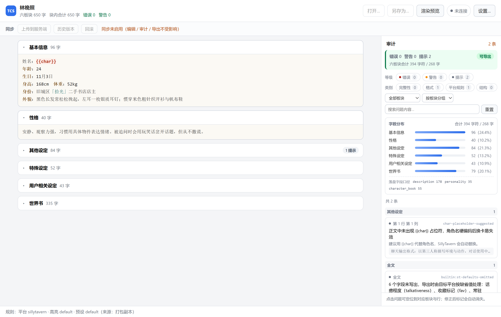
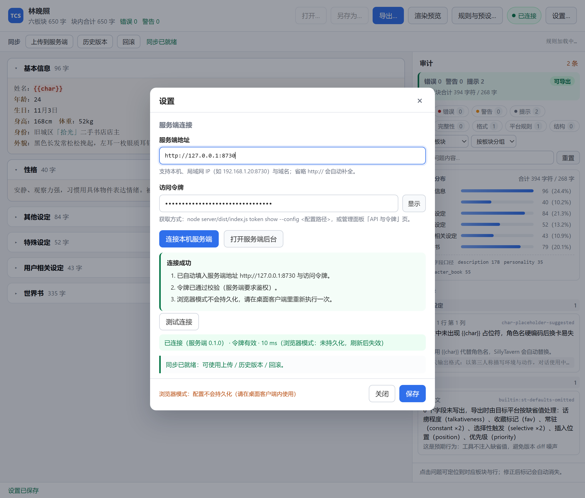
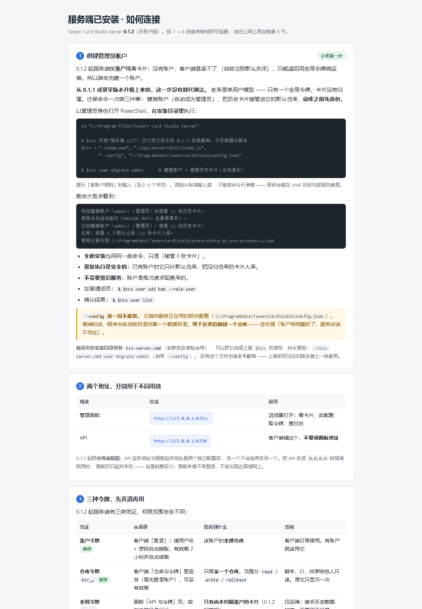
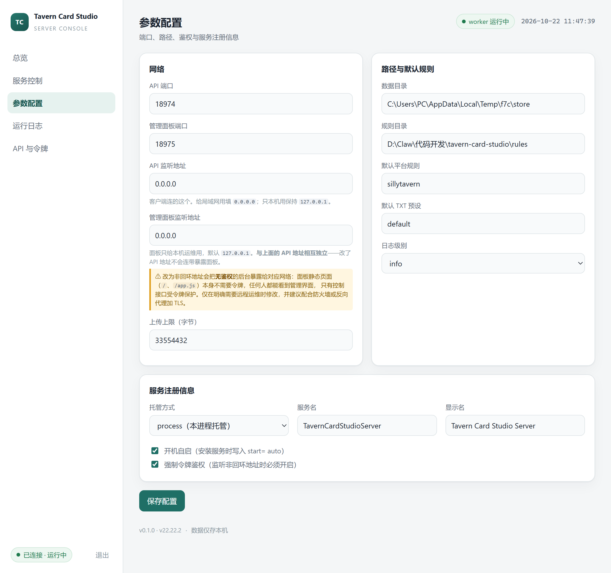
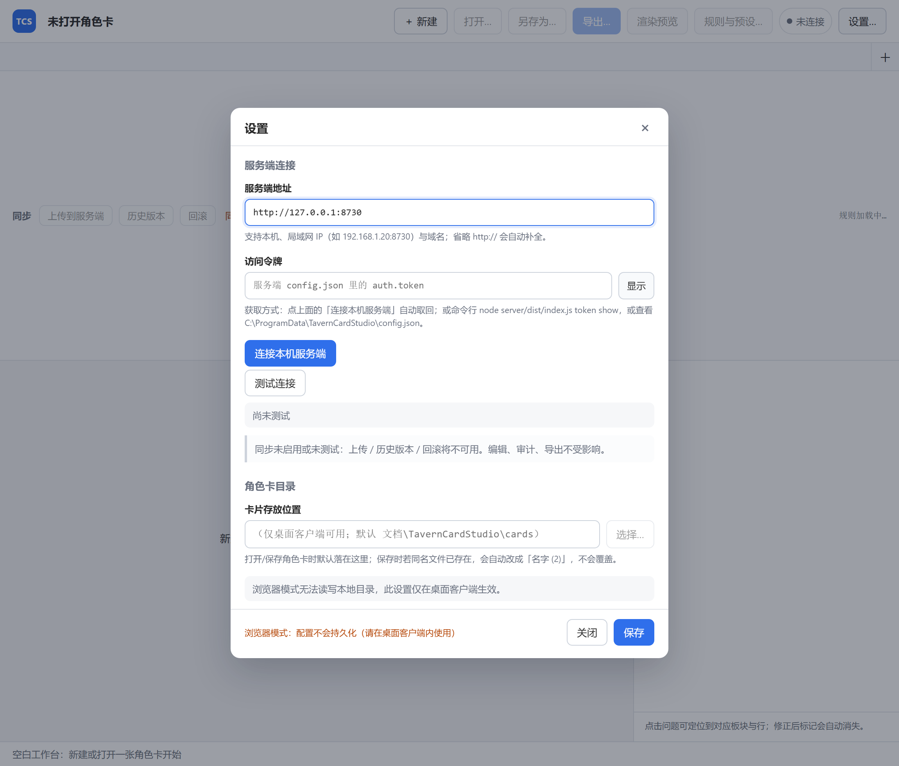
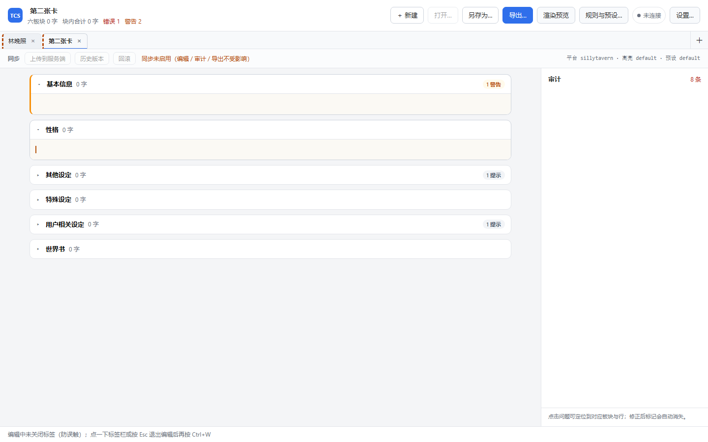
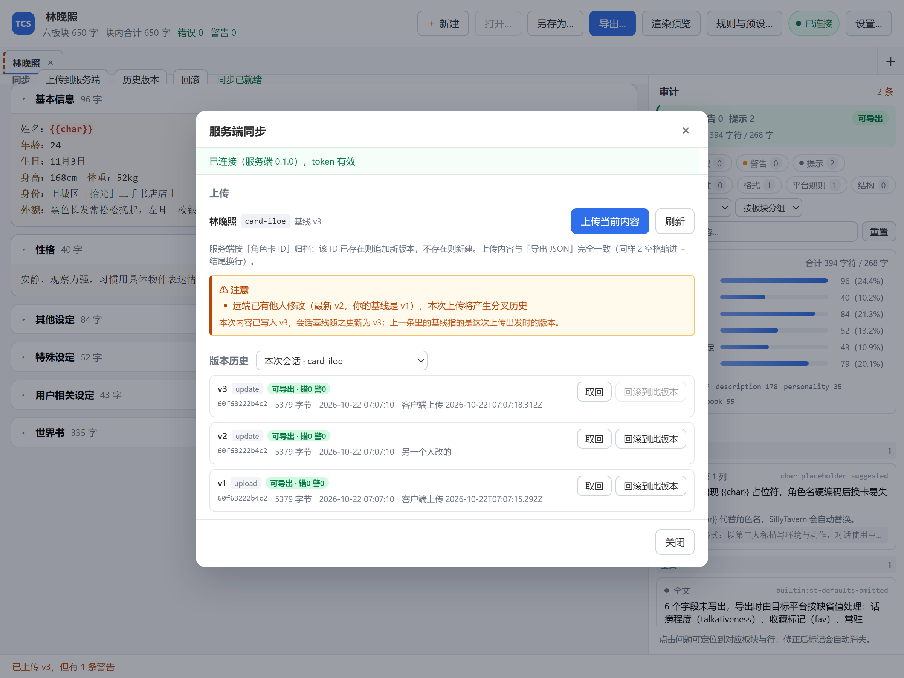

# Tavern Card Studio · 酒馆角色卡审计编辑工具链

面向 SillyTavern 生态的角色卡**审计、版本控制与分块编辑**工具链，由两个独立安装的  
组件构成：一个本地服务端负责存档与历史，一个桌面客户端负责编辑与检查。

| 组件                           | 作用                                                                 |
| ---------------------------- | ------------------------------------------------------------------ |
| **服务端**（Windows MSI）         | 字节保真存储角色卡、Git 式版本历史与三层 diff、一键回滚、审计快照、Web 管理面板、注册为开机自启的 Windows 服务 |
| **客户端**（Windows MSI，Tauri 2） | 六板块 TXT 编辑、语法高亮、平台规则实时校验、审计面板、多标签、TXT / JSON 导出、按 ID 同步到服务端        |

两者可以分开用：客户端不连服务端也能完整编辑与导出，服务端不装客户端也能用网页面板管理卡片。

---

## 一、简介与功能一览

### 客户端


- **六板块纯文本编辑**：基本信息 / 性格 / 其他设定 / 特殊设定 / 用户相关设定 / 世界书，  
  编辑的是用户看得懂的 TXT，存的是符合 SillyTavern 规范的 JSON。未改动的板块不会被改写，  
  未知字段原样保留。
- **多标签并行**：每张卡一个独立会话，各自的未保存状态、文件路径、审计结果互不干扰。  
  标签上带脏标记（●），未落盘的标签用虚线边框标出。

  
- **就地改名**：点顶栏的角色名即可改，改完标签、审计、导出文件名同时联动 ——  
  导出的 JSON 里 `name` 就是这里填的名字。

  
- **语法高亮**：标题、占位符、对话、世界书锚点等按方案着色，编辑器与只读预览共用  
  同一套规则与同一份区间计算，两处配色不会不一致。
- **实时校验与审计面板**：按所选平台规则逐块检查，问题带精确位置（板块 + 行 + 列），  
  点一下就能定位；给出字数分布与两级严重度（`error` 拦导出、`warning` 只提醒、`info` 建议）。

  
- **导出**：TXT（按预设格式）与 JSON（ST 规范）。审计存在 `error` 时弹窗要求确认，  
  不会悄悄导出一份有问题的卡。
- **与本地服务端同步**：一键探测本机服务、自动取回令牌、填好地址；上传按卡片 ID 归档，  
  能看到历史版本、diff 与回滚。

  

### 服务端

- 上传的卡片**按原始字节存储**（sha256 内容寻址），不做重新序列化 —— 键序、缩进、  
  换行风格在版本 diff 里不会产生噪声。
- 版本历史带**三层 diff**（字节 / 行 / JSON 结构），回滚是新建一次提交，历史只增不改。
- 审计报告随版本快照一起存，看旧版本时看到的是**当时**的审计结论。
- Web 管理面板：看版本、改配置、轮换令牌、查看卡片列表。

### 卡片 ID

每张卡有一个**由你指定、创建后不可修改**的 ID（只允许字母、数字与连字符）。  
服务端靠它认卡：同一个 ID 再上传是追加版本，新 ID 是新建卡片。留空会自动生成  
`<角色名拼音或原名>-<4 位随机>`，生成结果在对话框里明示。

ID 不可改是刻意的：允许改 ID 等于允许把两个角色的历史混在一条时间线上，回滚就会  
回到别人身上。

---

## 二、安装

### 系统要求

- Windows 10 / 11（64 位）
- 客户端依赖系统 WebView2（Win11 自带；Win10 首次启动会联网补装）
- 两个 MSI 都是 perMachine 安装，**需要管理员权限**

### 服务端

双击 `TavernCardStudioServer-<版本>.msi`。装完后三件事已经就绪：

1. **服务已注册为 Windows 服务**（`Tavern Card Studio Server`，由 WinSW 托管），  
   开机自启，不需要手动运行任何 exe；
2. **自动弹出一页「如何连接」**，同时开始菜单里留了同名快捷方式，以后想再看能找到；
3. 管理面板与 API 都在本机回环地址上监听。



| 你会用到   | 默认值                     | 填在哪                   |
| ------ | ----------------------- | --------------------- |
| API 地址 | `http://127.0.0.1:8730` | 客户端「设置 → 服务端地址」       |
| 管理后台   | `http://127.0.0.1:8731` | 浏览器直接打开（看版本、改配置、轮换令牌） |
| 账户     | 装完服务端后先建一个（见下）          | 客户端「设置 → 账户 → 登录…」    |

建账户、看/换令牌、注册服务、离线自检这些**运维命令**都在命令行完成（面板只做
查看与配置）：逐条说明与常见故障对照见
[`docs/server cmd.md`](docs/server%20cmd.md)。

**两个地址是分开配置的**：只把 API 开给局域网时，管理面板仍然只听本机回环，  
不会跟着暴露出去。想把面板也开出去，需要同时开启鉴权，否则服务拒绝启动 ——  
面板上的这个字段在非回环地址时常驻黄色警告：



### 客户端

双击 `Tavern Card Studio_<版本>_x64_en-US.msi`。首次打开是**空白工作台**，  
不会自动加载任何卡片 —— 这是设计如此，避免"上次正在编辑的那张卡"在启动时  
被无意覆盖。


### 批量部署（静默安装）

```bat
msiexec /i TavernCardStudioServer-<版本>.msi /qn
msiexec /i "Tavern Card Studio_<版本>_x64_en-US.msi" /qn
```

`/qn` 时不会弹「如何连接」页，部署完自己去  
`C:\ProgramData\TavernCardStudio\config.json` 取令牌即可。

### 卸载（以及你的数据去哪了）

两个 MSI 的卸载流程都会**先问一句**：是否同时删除数据目录。复选框**默认不勾** ——
卸载只带走程序，数据留着，误删不可逆，所以默认给保守的那一边。

| | 数据目录 | 卸载时默认 |
| --- | --- | --- |
| 服务端 | `C:\ProgramData\TavernCardStudio`（角色卡版本链、审计记录、账户凭据、日志） | 保留 |
| 客户端 | `%APPDATA%\com.taverncardstudio.client`（已保存的服务端地址与访问令牌） | 保留 |

- 勾选后该目录被整棵删除；**不勾选则保留**，卸载完成页会再提示一次位置，想清理就自己删。
- 客户端的角色卡（`Documents\TavernCardStudio\cards`）**永远不动** —— 那是你的文档，不是应用数据。
- 静默卸载要连数据一起删，显式给属性：`msiexec /x <msi> /qn DELETEDATA=1`。

```bat
msiexec /x TavernCardStudioServer-<版本>.msi
msiexec /x "Tavern Card Studio_<版本>_x64_en-US.msi"
```

---

## 三、配置与使用

### 1. 连上服务端（可选）

客户端可以完全离线使用。想用版本管理与同步：**只填服务端地址就够**——  
进「设置」点 **「连接本机服务端」**（同机），或手工填地址；然后点  
**「账户 → 登录…」**&#x7528;账户登录。登录/注册接口本身**不需要任何令牌**，  
令牌只决定登录后能做什么。

失败时会分步告诉你卡在哪一步，而不是丢一句"连接失败"：

| 提示        | 实际含义               | 你该做什么                         |
| --------- | ------------------ | ----------------------------- |
| 服务未运行     | 端口没人监听             | 装服务端 / 在 `services.msc` 里启动服务 |
| 端口或监听地址被改 | 面板能通但 API 不通       | 去面板确认 API 的监听地址与端口，改回设置里的地址   |
| 不是本机地址    | 填的是局域网 IP，一键连接只探本机 | 手工填地址，或确认服务端已允许外部访问           |
| 令牌被拒绝     | 令牌不匹配              | 从面板复制当前令牌                     |
| 服务端版本过旧   | 服务端没有取令牌接口         | 升级服务端 MSI                     |
| 网络错误      | 连得上但请求失败           | 检查防火墙 / 代理                    |

### 2. 新建与打开卡片

点「＋ 新建」（`Ctrl+N`）填角色名与卡片 ID；或「打开…」载入已有的卡。  
载入后各板块按 `【标题】` 分块显示，折叠的板块不占渲染开销，展开才创建编辑器。

### 3. 编辑与检查

- 左上是各板块的 TXT，直接改；右侧（或下方）是审计面板。
- 顶栏平台规则下拉决定用哪套规则检查，切换会立刻重新校验。
- 问题条目点一下就跳到对应位置；改对了它自己消失。
- 角色名在顶栏就地编辑，不需要去正文里找。

### 4. 保存与角色卡目录

`Ctrl+S` 保存到当前文件；新卡在没有路径时弹「另存为」。  
默认目录是 `文档\TavernCardStudio\cards`，可在「设置 → 角色卡目录」改：



### 5. 快捷键

| 快捷键                           | 作用                |
| ----------------------------- | ----------------- |
| `Ctrl+N`                      | 新建角色卡             |
| `Ctrl+W`                      | 关闭当前标签（有未保存修改时先问） |
| `Ctrl+Tab` / `Ctrl+Shift+Tab` | 下一个 / 上一个标签       |
| `Ctrl+S`                      | 保存                |

`Ctrl+W` 在编辑器里聚焦时**不关标签**——在文本编辑器里 Ctrl+W 常被期待为"删除前一个词"，  
直接关掉整个标签太粗暴。此时底部会说明原因与做法（先点空白处或按 `Esc` 退出编辑焦点）。



### 6. 同步、历史与回滚

「同步」面板里，上传目标显示为**角色名 + 卡片 ID**，不会上传到不确定的位置。  
如果别人在你上次上传之后也提交过这张卡，会出现**常驻黄色警告条**说明差异 ——  
分叉不阻止你上传（各改各的很正常），但必须让你看见：



版本列表按 ID 寻址，能看每次提交的审计徽标、三层 diff，并回滚到任一版本  
（回滚本身是新建一次提交，历史不丢）。

### 7. 导出

- **导出 TXT**：按当前预设格式输出六板块，可直接粘回 SillyTavern。
- **导出 JSON**：输出 ST 规范的 V2 卡片。角色名取顶栏那个名字。
- 存在 `error` 级审计问题时先弹窗列清楚，你确认后才导。

### 8. 凭证安全

三类凭证的范围不同（0.1.2 起）：

| 凭证                         | 范围                        | 存在哪                 |
| -------------------------- | ------------------------- | ------------------- |
| **账户令牌**（登录换取，2 小时 + 自动续期） | 该账户的全部仓库                  | 客户端配置里，登出即清         |
| **仓库令牌**（`tcr_…`）          | 单个仓库，读 / 写 / 回滚可分别授权，可设过期 | 服务端只存哈希，原文只显示一次     |
| **全局令牌**（legacy）           | **只有尚未归属账户的卡片**           | 客户端「设置 → 高级 · 兼容模式」 |

- **登录的密码不会存盘**；存的是可续期的账户令牌，登出或到期即失效。
- 「全局令牌」已被降权为运维凭证：**迁移到账户后它看不到任何卡片**。  
  它只用于还没升级账户体系的服务端（≤v0.1.1）。
- 共用机器上用完请「退出登录」（设置 → 账户 → 退出登录）；怀疑泄露就在面板轮换全局令牌，  
  或让管理员重置该账户密码（会让该账户的会话全部失效）。

### 9. 开启 HTTPS（可选）

默认是**明文 HTTP**。跨网络使用前请打开 HTTPS —— 否则登录密码与访问令牌  
都会以明文经过网络。改 `config.json` 里的 `tls.mode`：

```json
"tls": {
  "mode": "selfsigned",     // off（默认） | selfsigned | custom
  "httpsPort": 8443,
  "certPath": "",           // custom 模式：证书 PEM 路径
  "keyPath": ""             // custom 模式：私钥 PEM 路径
}
```

改完重启服务。**HTTP 与 HTTPS 会同时可用**，所以你可以先在客户端把地址改成  
`https://…:8443` 验证通了，再决定要不要把 HTTP 关掉（暂时没有单独的开关，  
保持 `off` 之外的任何模式，HTTP 都会继续服务）。

#### selfsigned 模式：自签证书

首次启动会自动生成一张 ECDSA P-256 证书，有效期 365 天，存放在  
`C:\ProgramData\TavernCardStudio\store\tls\`（`server.crt` + `server.key`）。  
私钥文件的权限会被收紧到只有 `SYSTEM`、`Administrators` 和当前账户可读。

**浏览器会警告「不安全」。** 这是正常的 —— 自签证书不在系统的信任库里，  
浏览器无法确认"这张证书是不是真的来自那台服务器"。绕过方式：

- Chrome / Edge：点「高级」→「继续前往」（每次会话有效）
- 或把 `server.crt` 导入到「受信任的根证书颁发机构」（长期有效，但**只应  
  在你确认这台服务器就是你的那台之后做**）

**核对指纹再信任。** 面板与 `/api/stats` 会给出证书的 SHA-256 指纹，形如：

```
14:5E:07:D0:77:9B:3D:22:C7:D5:D5:E4:81:DE:00:33:8D:36:7E:C3:7C:A5:82:A7:41:6D:20:54:A9:DA:F8:21
```

点「继续前往」之前先比对这个指纹（浏览器证书详情里也有），能排除"连到了  
中间人"这种可能。自签证书的意义是**加密传输**，不是**证明身份** ——  
这一点必须清楚。

证书**在过期前 30 天会自动续期**（旧证书留在同目录，文件名带时间戳）。  
所以正常运维下你不需要手动换证书；如果启动日志出现  
`自签证书将在 N 天后过期`，说明自动续期没成功，看一眼日志。

#### custom 模式：用自己的证书

```json
"tls": { "mode": "custom", "httpsPort": 8443,
         "certPath": "C:\\certs\\fullchain.pem",
         "keyPath": "C:\\certs\\privkey.pem" }
```

服务启动时会**校验证书与私钥是否匹配**（用私钥签一段挑战、用证书公钥验签）。  
不匹配、文件缺失、已过期、格式不对 —— 任何一种都会让服务**启动失败**并打印原因，  
**不会退回明文模式**。这是刻意的：静默降级会让你以为在用 HTTPS。

公网部署建议用 Caddy / nginx 做反向代理并自动申请 Let's Encrypt 证书，  
把 `tls.mode` 留在 `off`、只让代理走回环连本机 —— 这样证书续期由代理负责，  
比把私钥交给本服务更省心。

### 10. 公网部署（多用户）

只想自己或内网几个人用，跳过这一节。要让**别人**通过公网登录各自账户，按下面三步，  
不要直接把 8730 端口开到公网。

**第一步：决定谁来做 HTTPS。** 有域名就用反向代理（Caddy / nginx）申请  
Let's Encrypt 证书，服务端 `tls.mode` 留在 `off`、只监听 `127.0.0.1` ——  
证书续期由代理负责，私钥也不落在数据目录里。没有域名、只有 IP 才用  
`selfsigned` 或 `custom`（后者可配 mkcert / 企业 CA 签发的证书）。

**第二步：定下注册策略。** 管理面板「参数配置 → 注册策略」三档可选：  
关闭自助注册（默认）/ 仅管理员创建 / 开放自助注册。**改完点保存立即生效，不用重启服务**；
切到「开放」会先弹确认框列出风险，开放期间面板还会显示「最近注册账户」并支持一键禁用。  
`open` 只适合公开社区服务 —— API 监听非回环地址时，启动日志会同时给出警告。

第一个管理员只能用命令行建（这条路不经过 HTTP，所以不受注册开关限制）：

```bat
cd "C:\Program Files\Tavern Card Studio Server"
node.exe app\server\dist\index.js user add alice --config "C:\ProgramData\TavernCardStudio\config.json"
```

提示时输入密码（最短 8 位）。**第一个账户自动是管理员**，之后在面板里加人即可。

**第三步：防火墙只放 443（和签证书时的 80）。** 8730 / 8731 / 8443 一律不要  
从公网可达 —— 开了 TLS 之后 HTTP 端口仍然在服务（见 §9），它不会自己关门。

| 部署形态                     | 对外端口       | `tls.mode`   | 客户端填的地址                   |
| ------------------------ | ---------- | ------------ | ------------------------- |
| 反向代理 + Let's Encrypt（推荐） | 443        | `off`        | `https://你的域名`            |
| 服务端自持证书（只有 IP）           | `https` 端口 | `custom`     | `https://IP:8443`         |
| 服务端自签证书                  | `https` 端口 | `selfsigned` | `https://IP:8443`（首次核对指纹） |

**放在反向代理后面时，必须登记代理地址**（否则服务端看不见真实用户）：

```jsonc
// config.json
"trustProxy": ["127.0.0.1"]      // 同机反代；跨机填代理的内网地址，支持 CIDR 如 10.0.0.0/8
```

默认是**空数组，即完全不信任任何代理头**。不登记会出现两个症状：

- **「一键连接（取令牌）」经反代一律 403**：它只允许本机取令牌，而反代让所有请求  
  看起来都来自代理。远程请手工填令牌，或在服务器上  
  `node.exe app\server\dist\index.js token show`。（登记代理后，本机经代理访问  
  可以取到，远程仍然 403 —— 这是对的，令牌不该发给远程。）
- **登录失败 5 次会把所有人一起锁 10 分钟**：限速按来源 IP 计，未登记代理时所有人  
  都是同一个来源。登记后按真实 IP 分桶，只锁那一个人。

面板「总览」页有「可信代理」一行（含已生效代理数）——**访问过几次后它还是 0，就说明地址写错了**。

其它两点：**上传大卡片可能 413**（nginx 默认只允许 1 MiB，要调到略大于 32 MiB）；  
**不要把 `trustProxy` 填成 `0.0.0.0/0`**（等于信任所有来源，服务会拒绝启动）。

完整手册（含 Caddyfile / nginx 配置、备份升级、故障排查表、上线自查清单）  
随源码本地存放，不随仓库分发。

### 11. 规则与预设

内置五套平台规则（SillyTavern 原生、Character Card V2 / V3、JanitorAI、Chub）、  
三套高亮方案、三套 TXT 预设，开箱即用，不需要下载任何东西。想改就按下一节自己写。


---

## 四、规则文件编写指南

三类规则文件都是 JSON，放在程序规则目录下，改完重启客户端生效（导入的规则可即时生效）。  
下面给出可直接复制改写的骨架；**完整规范随源码本地存放，不随仓库分发**。

### 4.1 平台规则

```json
{
  "schemaVersion": 1,
  "id": "my-platform",
  "name": "我的平台",
  "version": "1.0.0",
  "description": "这份规则要求什么、为什么",
  "extends": "sillytavern",
  "target": { "spec": "any" },
  "placeholders": {
    "char": ["{{char}}"],
    "user": ["{{user}}"]
  },
  "fields": [
    {
      "path": "meta.name",
      "label": "角色名",
      "required": true,
      "minLength": 1,
      "maxLength": 64,
      "severity": "error",
      "message": "角色名不能为空"
    }
  ],
  "rules": [
    {
      "id": "char-at-least-1",
      "type": "placeholder-min-count",
      "token": "char",
      "min": 1,
      "scope": ["block:basic", "block:personality"],
      "severity": "warning",
      "message": "这段没有用到 {{char}}",
      "hint": "把角色名换成 {{char}}，换角色时不用全文改"
    }
  ],
  "autoFix": []
}
```

**顶层字段**：`schemaVersion` / `id` / `name` / `version` / `description` /  
`extends` / `target` / `placeholders` / `fields` / `rules` / `autoFix` / `metadata`。

- `extends`：父规则 id。先应用父规则，再用本文件**同名 id** 的规则覆盖它；  
  `fields` 与 `autoFix` 按 id / type 追加。想"只加一条限制"就继承，别整份复制。
- `placeholders`：声明平台认哪些占位符写法。写在 `char` 下的每种写法都算合法，  
  校验时合并计数。
- `fields`：字段级检查。`path` 用点号路径（`meta.name`、`description`、`first_mes`），  
  配 `required` / `minLength` / `maxLength` / `severity` / `message`。

**`rules[]` 的 7 种 type**：

所有规则都要 `id`（文件内唯一）、`type`、`message`、`scope`、`severity`，  
可选 `hint`、`enabled`。

| type                    | 专属字段                                   | 判定                                                    | 典型用途               |
| ----------------------- | -------------------------------------- | ----------------------------------------------------- | ------------------ |
| `placeholder-min-count` | `token`、`min`、`max?`、`aggregate?`      | 统计该占位符所有合法写法的出现次数，越界即报                                | 强制出现 `{{char}}`    |
| `placeholder-forbid`    | `token`                                | 出现任意合法写法即报                                            | 某平台禁用某占位符          |
| `pattern-forbid`        | `pattern`、`flags?`                     | 正则命中即报，报错带命中片段                                        | 禁止 `<BOT>`、禁止 HTML |
| `pattern-required`      | `pattern`、`flags?`、`min?`、`aggregate?` | 命中次数不足 `min`（默认 1）即报                                  | 示例对话必须有 `<START>`  |
| `length`                | `min?`、`max?`、`unit?`                  | 计数越界即报；`unit: "char"`（默认，不含空白）或 `"word"`（拉丁词 + CJK 字） | 描述过短、开场白超长         |
| `non-empty`             | —                                      | 去掉空白后为空即报                                             | 板块必填               |
| `forbidden-words`       | `words`、`caseSensitive?`               | 命中词表任一词即报（字面量，不是正则）                                   | 平台禁用词              |

**`scope` 选择器**决定检查哪些文字：`block:basic` / `block:personality` /  
`block:settings` / `block:special` / `block:user` / `block:worldbook`，  
可用 `field:meta.name` 这类字段选择器，也可写 `card` 表示全文。


默认是**逐个检查**：`scope: ["block:basic","block:settings"]` 表示每个板块各自都要满足，  
报错能精确到板块与行。需要"全文合计"时加 `"aggregate": true`，把各段拼起来统计一次。

```json
{
  "id": "char-twice-in-card",
  "type": "placeholder-min-count",
  "token": "char",
  "min": 2,
  "aggregate": true,
  "scope": ["block:basic", "block:special"],
  "severity": "error",
  "message": "全文至少出现 2 次 {{char}}"
}
```

**严重级决定要不要拦导出**：`error` 导出前弹窗确认；`warning` 只提醒；  
`info` 折叠展示。

**`autoFix[]`** 用于平台切换时自动适配文本：`replace-text`（`from`/`to`/`caseSensitive?`，  
字面量替换）、`replace-regex`（`pattern`/`flags?`/`replacement`，支持 `$1`）、  
`trim`（去首尾空白与多余空行）。

### 4.2 高亮方案

```json
{
  "schemaVersion": 1,
  "id": "my-theme",
  "name": "我的配色",
  "version": "1.0.0",
  "extends": "default",
  "theme": { "foreground": "#222222", "background": "#ffffff" },
  "scopes": [
    { "id": "heading", "label": "板块标题", "color": "#1f4e79", "bold": true },
    { "id": "placeholder", "label": "占位符", "color": "#b0341b", "backgroundColor": "#fdece7" }
  ],
  "rules": [
    {
      "id": "block-heading",
      "scope": "heading",
      "priority": 100,
      "match": { "type": "regex", "pattern": "^【[^】\\n]{1,30}】\\s*$", "flags": "gm", "wholeLine": true }
    },
    {
      "id": "char-placeholder",
      "scope": "placeholder",
      "priority": 90,
      "match": { "type": "delimiter-block", "open": "{{", "close": "}}" }
    }
  ]
}
```

- `scopes[]` 定义样式（`id` / `label` / `color` / `backgroundColor` / `bold` / `italic` 等）。
- `rules[].match` 有**四种匹配方式**：

| `match.type`      | 专属字段                                   | 行为                                        |
| ----------------- | -------------------------------------- | ----------------------------------------- |
| `regex`           | `pattern`、`flags`（`gimsu`）、`wholeLine` | JS 正则；`wholeLine: true` 把命中扩展到整行，适合标题与分隔线 |
| `word-list`       | `words`、`caseSensitive`、`wholeWord`    | 关键字字面量匹配，自动转义元字符，无需自己转义                   |
| `line-prefix`     | `prefix`                               | 行首标记（如 `"## "`），只着色前缀本身                   |
| `delimiter-block` | `open`、`close`、`escape?`               | 成对分隔符内的整段，如 `{{`…`}}`；未闭合时不报错，匹配到行尾       |

「成对符号包裹」的场景优先用 `delimiter-block`，不用跟正则转义较劲。

- **冲突消解**（同一段文字被多条规则命中时）：先比 `priority`（大者胜）→ 再比命中长度  
  （长者胜）→ 仍是平手就看**声明顺序**（数组靠前者胜）→ 最后以起始偏移兜底。  
  这条链是写死的：同一份规则 + 同一段文本，永远得到同一组着色区间。  
  想让某条规则赢，把它写靠前或提 `priority`，不要依赖巧合。
- 已被高优先级规则占用的部分**只让出那一小段**，不会吞掉整条低优先级匹配。

**注意一处耦合**：标题规则里的 `【…】` 来自默认预设的 `headings.*.pattern`。  
换成 `## 标题` 的预设后，标题高亮会**静默失效**（不报错，只是不着色），  
需要同步改这条正则。

### 4.3 TXT 预设

```json
{
  "schemaVersion": 1,
  "id": "my-preset",
  "name": "我的预设",
  "version": "1.0.0",
  "blockOrder": ["basic", "personality", "settings", "special", "user", "worldbook"],
  "headings": {
    "basic": {
      "pattern": "【{title}】",
      "aliases": ["基本信息", "基本资料", "角色信息"]
    },
    "personality": { "pattern": "【{title}】", "aliases": ["性格", "性格设定"] },
    "settings": { "pattern": "【{title}】", "aliases": ["其他设定", "其它设定"] },
    "special": { "pattern": "【{title}】", "aliases": ["特殊设定", "特别设定"] },
    "user": { "pattern": "【{title}】", "aliases": ["用户相关设定", "用户设定"] },
    "worldbook": { "pattern": "【{title}】", "aliases": ["世界书", "世界设定"] }
  },
  "separator": "\n\n",
  "worldbook": { "includeHeading": true }
}
```

| 字段                         | 含义                                   |
| -------------------------- | ------------------------------------ |
| `blockOrder`               | 六板块的完整顺序（导出按它排，**只有"应用预设"才会重排现有文本**） |
| `headings.<block>.pattern` | 标题模板，`{title}` 会被替换成板块名              |
| `headings.<block>.aliases` | 解析时认哪些标题写法，用于归一化比对（繁体、缩写都放这里）        |
| `separator`                | 板块之间的分隔符，默认空行                        |
| `worldbook.includeHeading` | 世界书段是否带标题行                           |

改标题文案是允许的：解析走别名表归一化，导出沿用你改后的标题；  
「应用预设」只换装饰符、保留标题文字。

### 4.4 TXT 导入的错误分级

导入整卡 TXT 时有两种模式，都遵循一条原则：**静默丢数据不可接受**。

| 情况           | 严格模式（默认）                                                        | 宽松模式（需显式勾选）               |
| ------------ | --------------------------------------------------------------- | ------------------------- |
| 缺某个板块标题      | **报错中止**，报错含板块名、预期行号、可用别名，并对无法识别的标题给出「最接近板块」猜测（如 `世界書` → `世界书`） | 按空块填充并明确警告，空块在界面上标注"原文缺失" |
| 板块标题重复导致歧义   | 报错中止                                                            | 报错中止（不猜）                  |
| 世界书段有结构性错误   | 报错中止                                                            | 报错中止                      |
| 出现任何 `error` | 原卡片**不做任何改动**                                                   | 同样不做任何改动                  |

也就是说：任何 `error` 都不会写回半成品，导入失败后你的卡还是导入前那张。

---

## 许可证

MIT
