# Tavern Card Studio · 酒馆角色卡审计编辑工具链

面向 SillyTavern 生态的角色卡**审计、版本控制与分块编辑**工具链，由三个独立安装的  
组件构成：一个本地服务端负责存档与历史，一个桌面客户端负责编辑与检查，
一个安卓客户端负责在手机上读、聊与同步。

| 组件                           | 作用                                                                 |
| ---------------------------- | ------------------------------------------------------------------ |
| **服务端**（Windows MSI）         | 字节保真存储角色卡、Git 式版本历史与三层 diff、一键回滚、审计快照、Web 管理面板、注册为开机自启的 Windows 服务 |
| **桌面客户端**（Windows MSI，Tauri 2） | 八板块 TXT 编辑、语法高亮、平台规则实时校验、审计面板、多标签、TXT / JSON / PNG 导出、按 ID 同步到服务端  |
| **安卓客户端**（APK，v0.1.7 新增）     | 四页结构（聊天 / 卡片 / 仓库 / 我的）、自研聊天页、**语音输入三档**、改开场白与场景、从仓库下载卡 |

三者可以分开用：桌面客户端不连服务端也能完整编辑与导出，服务端不装客户端也能用网页面板
管理卡片，安卓客户端不连服务端也能聊天（但需要自己配大模型 API）。

> **安卓端不是桌面端的缩小版。** 它不做卡片编辑器与审计：手机屏幕放不下
> "八板块 + 审计 + 预览"三栏并排，硬塞进去是一个谁都看不清的界面。
> 它的定位是「卡在桌面写，在手机看和聊」。
> 详细说明见 [安卓端使用教程](client/src-tauri/gen/android/docs/android-user-guide.md)。
>
> **手机端固定竖屏**（v0.2.0 起）。消息列表、输入框、底部标签栏都是按竖屏
> 长边滚动设计的：横过来之后输入框会被压得很矮，键盘一弹几乎看不见。
> 所以不跟随系统旋转 —— 手机横过来，界面仍然是竖的。

---
## 更新说明

### v0.2.1（2026-11-21）

两处修正。

**安卓端切到后台后，任务列表里看不到 App。** 任务被启动入口带上了「不进最近任务」
的标记，于是切出去就没法从任务列表回来，只能回桌面点图标。现在两个入口都做了处理：
通知栏那条跳转改为显式构造（不再复用桌面启动器的意图），App 每次回到前台也会
把任务重新放回列表。

**「最大回复长度」原来有两个入口。** 「我的 → API 连接」和「聊天设置 → AI 响应配置」
各有一格，写的是同一个引擎设置，而前者覆盖后者 —— 所以在一处改完去另一处看，
数值对不上，还会互相覆盖。现在只保留「AI 响应配置」那一处，它是唯一入口。
API 连接页只负责接口源、模型名和服务地址。

### v0.2.0（2026-11-17）

这一版给角色卡加了一层它自己本来就该有的东西：**每个角色可以带一套自己的提示词**。
另外修掉一个只在桌面端出现、但很容易被误判成"服务端没起"的连不上问题。

#### 新增：提示词跟着角色走

以前提示词是**全局一份**。换个角色聊，同一套提示词跟着过去——写卡的人
没法为某个角色单独加一条"这个人说话就这样"，也没法只给这个角色关掉某条。

现在这类内容可以存在角色卡里，跟卡走：

- **桌面端**：左栏第九块「角色提示词」。分两段——「专属条目」是这个角色
  独有的条目；「覆盖全局」是按名字改全局条目的正文与开关。
- **安卓端**：提示词页多了「全局 / 本角色」两档。切到「本角色」时，
  改什么都只落在这一个角色上，不动全局。

存放位置是卡片 PNG 里的 `data.extensions.tcs.prompts`。**只存差异**：关掉的
记成"关掉"，改过的存正文，没动过的**不写**。所以一张没改过提示词的卡不会
凭空空长出这个键，导出给别人跟原来一模一样。

ST 本身不认这个键，但它**导出和导入都不会丢掉不认识的键**，所以卡片在两个
工具之间来回搬不会丢东西。这一条是查过 ST 源码确认的，不是推测。

#### 修好的

**导出的卡不带刚改的提示词**

写完卡再导出，拿到的是**改之前**的字节——分享用了一份缓存，而那份缓存从来
没被清过。这个缺陷最误导人的地方在于：它会让你以为"提示词根本没存进卡里"，
于是回头去查写入链路，而那一段其实是好的。

现在所有写卡都走同一个出口，写完立刻清缓存。

**新加的提示词不生效**

新建条目时"插入深度"的默认值我们写成了 0，而 ST 的默认是 4。0 的含义是
"排在最后一条消息之后"——落到实际对话里，这条提示词就是一条末尾的 system
消息，多数情况下看不出效果。现在与 ST 对齐改成 4。

**上限三个数互相矛盾**

界面同时说"每条 4000 字符、总量 24000、最多 20 条"。20 × 4000 = 80000，
远大于 24000，那个"每条 4000"永远用不到。现在只保留真实生效的总量上限，
超了会顺带说清"最长的那一条有多长"，让你知道该删哪条。

#### 桌面端：自签证书不再一律拒连

用自签证书的服务端，桌面客户端以前**一律连不上**，而界面写的是
「无法连接（地址不通、端口未开、或服务端未启动）」——同一时刻浏览器和
`curl -k` 都能打开。证书问题被报成端口问题，把人引去查防火墙。

现在会先说清"证书没通过系统校验（多半是自签证书）"，再问你要不要继续：

- 点「继续」→ 记住这个地址（按主机 + 端口记），以后不再问
- 点「取消」→ 同步不可用，但**编辑、审计、导出照常能用**（它们不依赖服务端）

**"连不上"和"证书不对"不会混。** 客户端先按正常校验试一次，失败后再跳过
校验试一次：第二次能成才是证书问题。所以端口填错时**不会**弹证书确认框。

#### 世界书：中英文混排的字段行不再被丢弃

有些平台的世界书正文里，中文标签用全角冒号（`关键词：`），而从 ST 抄来的
字段名用半角（`constant: false`、`顺序: 250`）。以前格式预设只能声明**一种**
分隔符，另一种的行会被**整行丢掉**，而且只报一句不起眼的警告。

后果比"少几个字段"严重：条目名（写在 `comment` 里）也一起丢了，于是界面上
所有条目都显示成「第 1 条」，审计还按缺省值判出「这条永远不会被触发」——
一条并不存在的缺陷会被报上几十次。

现在 `fieldSeparator` 可以写成数组，两种冒号都认：

```json
"fieldSeparator": ["：", ": ", ":"]
```

顺带两条：条目只有 `comment` 没有 `name` 时用 comment 当名字（与 JSON 导入
路径一致）；初始场景解析仍然认旧的 `@@开场白` / `@场景` 标记 —— 换预设后
旧文本里的标记不会被当成正文。

#### 换一份格式预设，导入后立刻生效

以前导入「初始场景格式」或「对话示例格式」预设，界面说「导入成功」，
**但格式一个字都没变** —— 生效项指向的还是被替换掉的那一份。要生效必须再去
下拉里手动选一次，而界面上没有任何地方告诉你这件事。

现在这两个板块的预设**导入即启用**，提示也写成「已设为当前使用」。
TXT 预设 / 世界书格式 / 平台规则 / 高亮方案仍然只是加进候选（它们会改变
导出与解析口径，静默切走风险更大），需要在下拉里自己选。

另外顺手修掉一条更隐蔽的：导入角色卡时，对话示例的说话人写法**会被立刻改回
ST 写法**（`用户：` → `{{user}}:`）。原因是卡到达后要按当前格式重排一遍板块，
而那一步只带了初始场景的格式，没带对话示例的 —— 少了那份格式就等于"不转换"。
现在两处格式都带上了。

自定义规则的完整规范见 [规则与预设编写指南](docs/custom-rules.md)。

#### 打开卡片不再替换当前卡

以前「打开…」不管选的是哪张卡，都会把**当前标签**的内容整张换掉，
想同时对照两张卡就没法做（开第二张＝丢掉第一张的编辑）。

现在打开会先看名字：没有同名标签就**新开一个**，有同名才覆盖那一个，
而覆盖一张还有未保存修改的卡之前会问一句。详见
[2. 新建与打开卡片](#2-新建与打开卡片)。TXT / JSON / PNG 三种入口规则一致。

#### 测试

3821 通过 / 0 失败。本轮另外验了真实自签服务上的两段判定（8/8）、
桌面端证书判据（24 例），以及这套外部平台语法的 13 条判据（含三次串行变异验证）。

### v0.1.10（2026-11-15）

这一版有两件事：**v0.1.9 计划过但没做完的两个功能补上了**，
另外修掉一个会**静默吃掉你聊天记录**的缺陷。

#### 新增

**聊天记录导出 TXT**

聊天文件页每一行多了「导出」。它把整段对话转成一份 TXT（说话人按
`is_user` 判定、时间能解析就转本地格式、候选回复不导出但会注明数量），
然后走系统分享面板——微信、QQ、文件管理器都能接。

**卡片分享三渠道**

长按角色卡，弹框里是「微信 / QQ / 更多」三个按钮。**三个都走同一个系统
分享面板**，不是 SDK 直达：微信开放平台的分享权限要企业主体 + 已认证应用
才申请得到，个人开发者拿不到。所以多一步，但今天就能用。

「小程序」那个按钮**明确标着暂不支持**，点了只给一句话。

#### 修好的（都很要紧）

**聊天记录会凭空消失**

最严重的一条。复现方式是「正常聊 → 杀进程 → 重进」，而它的机理很隐蔽：

```text
冷启动时界面先拿开场白顶上（否则你要对着空屏等一分钟）
而这时 localStorage 里已经有上次的文件名
  ⇒ 保存逻辑认为"有名字了，可以直接写"
  ⇒ 把「只有开场白」的内容整份覆盖到真实文件上
  ⇒ 随后读回来的"成功"，读到的是那份只剩开场白的文件
```

**每启动一次覆盖一次。** 现在恢复正常之前一律不写盘，另加一道
独立校验（没读过文件 + 手里只有开场白 ⇒ 绝不覆盖）。

**「清理空聊天」会误删有内容的聊天**

ST 有**两个含义完全不同的"0 条"**：真的空，和"末行解析失败但可能有内容"。
原来只判条数，于是"一条消息的聊天"被当空壳删掉。现在要求 ST 明确说
「这是空聊天」+ 体积也吻合，任何一条拿不准就不删。

**聊天文件改不了名字**

`/api/chats/rename` 与 `/api/chats/delete` 对文件扩展名的处理不一样：
delete 缺了就补，rename **完全不补**。按 delete 的直觉写 rename 就
100% 返回 400。现在两个字段都补，并且改名后当场按新名字读一次——
读不回来立刻告诉你，而不是等你第二天发现记录没了。

**引擎启动失败时，界面把原因说错了**

原来固定显示「可能是安装包不完整」。实测那次真因是模拟器不兼容，
用户按提示卸载重装只会重复失败。现在从引擎日志尾部捞第一条真实错误
显示出来。

**诊断日志自己前后矛盾**

「onDestroy（正常退出）」和四秒后的「上次进程没有正常退出」同时出现。
原因是退出标记用 `apply()` 异步落盘，进程先死了。已改同步写。
另外 JS 侧不再断言"非正常结束"——安卓正常退出也不会触发 `pagehide`，
那条推断本来就不成立。

#### 测试

3684 通过 / 0 失败。安卓端真机验证：iQOO V2507A（Android 16）。

### v0.1.9（2026-11-10）

这一版几乎全是在修「安卓端装上去用不了」。真机取证后找到的根因，大多是
配置层面的静默失败——不报错、不崩，只是结果不对，而且界面上什么都不说。

#### 修好的（安卓端）

**release 包装上就连不上引擎**

`build.gradle.kts` 里只有 debug 放行明文 HTTP，release 禁止。而引擎是
`http://127.0.0.1:8000`。于是 release 包的健康探测被系统拦掉：

```text
IOException Cleartext HTTP traffic to 127.0.0.1 not permitted
```

引擎其实在正常服务，App 却判定"没就绪"，干等两分钟后才放你进去。

现在用 `network_security_config.xml` **只对本机回环放行**，其它域名仍按系统
默认禁止明文——没有为了一个本机连接，去打开全局明文。

**引擎明明好了，界面还在"正在加载世界"**

两个原因叠在一起：

· 探测跑在主线程上，抛 `NetworkOnMainThreadException`，被吞掉后当成"没就绪"
· 那个探测每 10 秒跑一次（内存占用的刷新循环），于是**每 10 秒把"已就绪"
  踩回未就绪**

现在"已就绪"只由两个明确的地方设置，不再靠循环里的顺手探测。

**等了 30 秒就说引擎起不来**

探活上限从 30 秒提到 120 秒。30 秒这个数只对热启动成立；升级安装、数据变多、
或者新装后 ST 要编译一遍前端库（红米实测 33 秒）都会超。而它报的
"引擎起不来"把排查方向完全带偏了。

顺带：超时后来引擎自己起来了，界面也能跟上（后台有个看守在等），
不用你手动重试。

**超时提示说「世界没能打开」**

超时和失败是两件事。超时意味着"我们等够了，但它还在启动"——说成"没能打开"
会让人去重启，而重启恰好把正在启动的引擎杀掉。现在超时只说"还在启动"。

**填了 API key 却报 key 错误**

App 从来没有把 key 写进引擎，而界面显示"已保存"。直连引擎取证时，
62 个 key 槽位全是 `null`。

现在保存后会**回读确认**：引擎里读不到这个名字，就当场告诉你没写进去，
而不是让你带着一个空 key 去发消息。

顺带修了两处：key 只会写一次（原来两处各写一遍，而引擎的写入是追加语义，
每保存一次就多一条历史）；错误提示会给三种可能，并且明确提到"额度用完"——
那是用户最容易漏判的一种。

**卡里的世界书导不进来**

调错了接口。`/api/worldinfo/import` 是**浏览器上传文件**用的，它第一行就检查
`request.file`，JSON 请求永远是 400——一次也没成功过，而那个 400 被一个空
catch 吞掉了。

真正能收 JSON 的是 `/api/worldinfo/edit`。切换过去之后，一张 22 条世界书的卡
导入正常。

**删掉底部回复后点「重新生成」，回复异常**

`popLastAssistant` 原来是从末尾往前找第一条角色回复。删掉底部那条之后，
它会把**更早的那条**弹走，留下两条连续的用户发言——多数接口不接受这种形状，
于是回复异常、紧接着报错。

现在只认最后一条。最后一条是你的发言时，会告诉你"直接点发送就行"，
而不是弹走别的消息。

**空角色库时提示"内置测试角色会自动补进来"**

那个测试角色早就删了。这句话让人等一个永远不会来的东西，刷一百次刷新也还是空。
现在指向卡片页那个真的存在的导入入口。

#### 文案

界面与错误提示里不再出现 `SillyTavern` / `ST`。用户不需要知道背后是什么，
只需要知道"聊天服务没起来"还是"key 不行"。

#### 测试

3511 通过 / 0 失败。真机验证：红米 Note 8 Pro（Android 11 / MIUI 12.5）与
iQOO V2507A（Android 16）两台均正常启动、世界书导入正常。

---

## 一、简介与功能一览

### 客户端

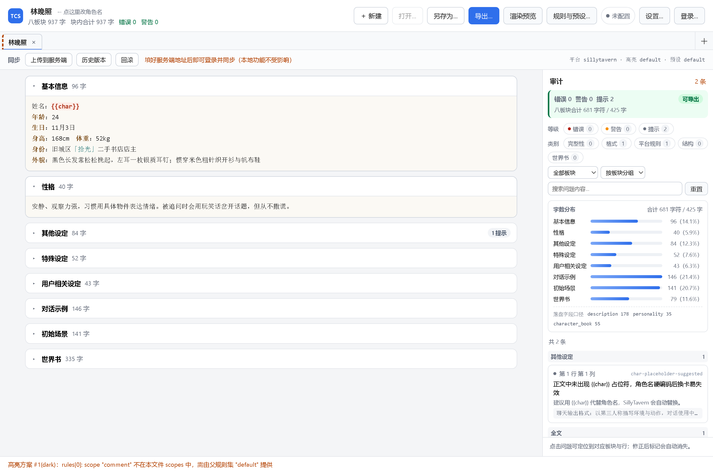

- **八板块纯文本编辑**：基本信息 / 性格 / 其他设定 / 特殊设定 / 用户相关设定 / **对话示例** /
    
  **初始场景** / 世界书，编辑的是用户看得懂的 TXT，存的是符合 SillyTavern 规范的 JSON。
    
  未改动的板块不会被改写，未知字段原样保留。

  后两个板块直接对应 SillyTavern 的独立字段，不挤进 `description`：
    
  对话示例写 `mes_example`，初始场景写 `first_mes` + `scenario`。
    
  **初始场景是复合板块**（v0.1.7 起）：一个「初始场景」里按 `@@` 子标题分两段 ——
    
  `@@开场白`（写 `first_mes`，多条用分隔行切分进 `alternate_greetings[]`）
    
  与 `@@情景`（写 `scenario`）。老 TXT 里没有 `@@` 标记的，整段按开场白处理，
    
  情景留空，不会错位（见 [规则文档的「初始场景与对话示例预设」](docs/custom-rules.md#初始场景与对话示例预设)）。

  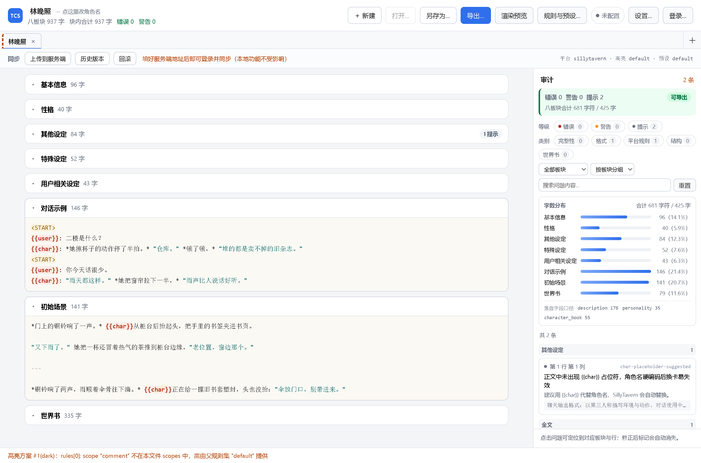
- **多标签并行**：每张卡一个独立会话，各自的未保存状态、文件路径、审计结果互不干扰。  
  标签上带脏标记（●），未落盘的标签用虚线边框标出。

  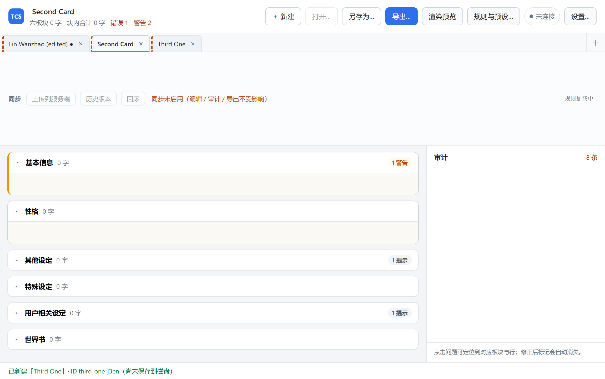
- **就地改名**：点顶栏的角色名即可改，改完标签、审计、导出文件名同时联动。
  导出的 JSON 里 `name` 就是这里填的名字。

  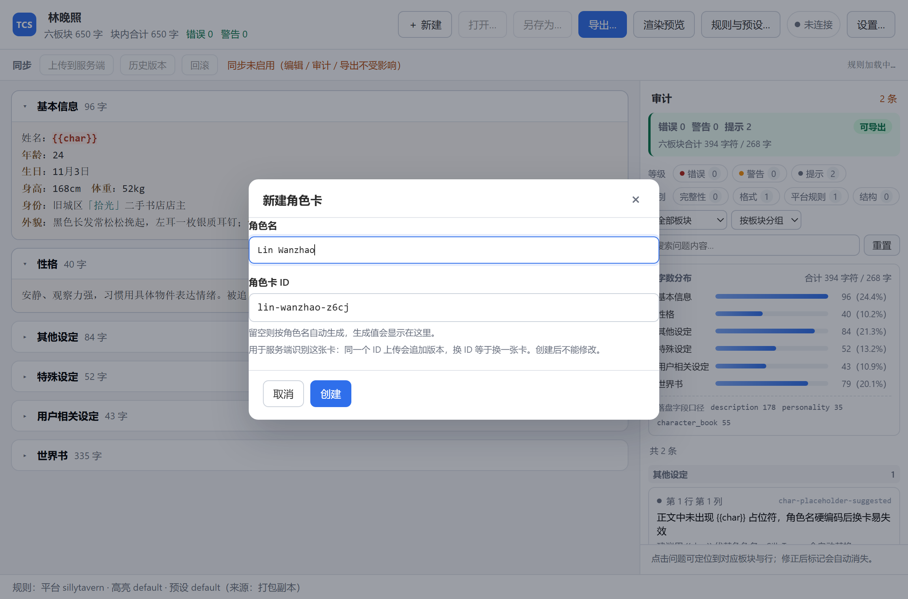
- **语法高亮**：标题、占位符、对话、世界书锚点等按方案着色，编辑器与只读预览共用  
  同一套规则与同一份区间计算，两处配色不会不一致。默认方案里世界书的结构标记
    
  （`@@ENTRY` / `@@CONTENT` / `@@END` / `keys:` / `name:`）、对话示例的 `<START>`、
    
  初始场景的多条开场白分隔行都有各自的配色，不再和普通正文混成一片。
- **实时校验与审计面板**：按所选平台规则逐块检查，问题带精确位置（板块 + 行 + 列），  
  点一下就能定位；给出字数分布与两级严重度（`error` 拦导出、`warning` 只提醒、`info` 建议）。

  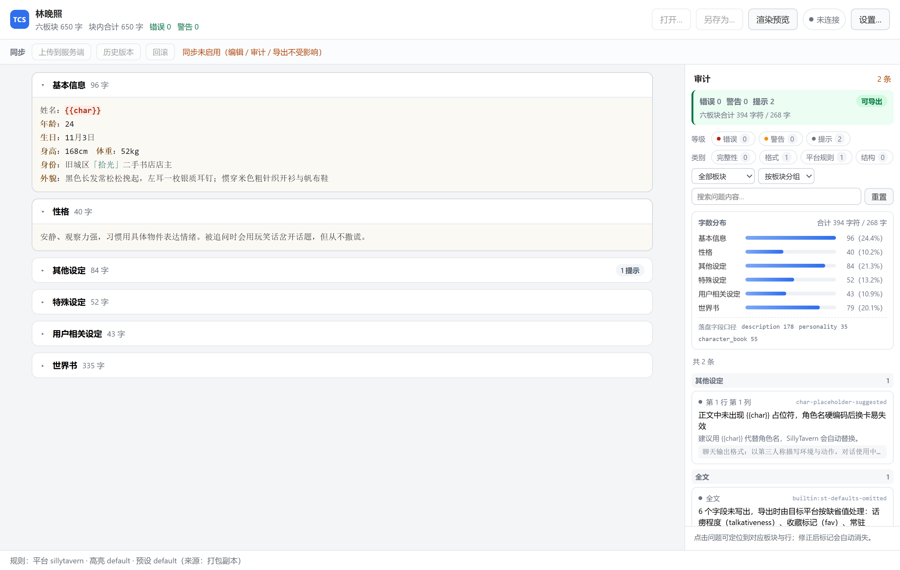
- **导出**：TXT（按预设格式）、JSON（ST 规范）与 **PNG 角色卡**。审计存在 `error` 时弹窗要求确认，  
  不会悄悄导出一份有问题的卡。三种格式都**包含世界书**：TXT 里是一个【世界书】段
    
  （内容按你在编辑器里写的原文输出，不擅自改写格式）。
- **导出 PNG 卡**：选「PNG 角色卡」后先挑一张卡面。内置默认卡面 / 当前卡的原图 /  
  图库缩略图 / 浏览选一张。图库是卡片目录下的 `card-faces`（设置里可一键打开），  
  把 png / jpg / webp 拷进去就会出现在候选里；jpg / webp 导出时转成 PNG，  
  长边超过 4096px 会等比压缩并明确告知。  
  **图像本身不会被重新编码**（像素逐字节不变），卡数据写进 `ccv3`（V3）或 `chara`（V2）  
  数据块，重复导出不会累积重复块。

  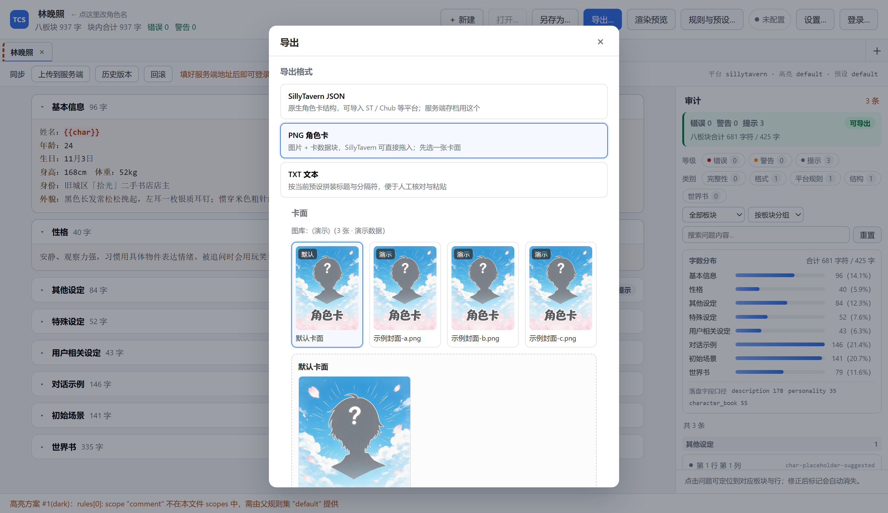
- **导入**：TXT、JSON 与 **PNG 卡**都能开；一个标签都没开时点「打开…」会先自动建卡。
    
  PNG 卡优先读 `ccv3`，没有再读 `chara`；一张不含卡数据的普通 PNG 会被当作**封面图**  
  而不是"导入失败"。
    
  TXT 导入**原文零丢失**。认出多少算多少，认不出的按原序整体放进【其他设定】，
    
  前面加一行分隔符（规则见 [4b](#4b-导入-txt原文一个字都不会丢)）。
- **另存为**也能选**三种格式**（ST JSON / TXT / PNG 卡），产物与「导出」完全一致。
    
  与导出的差别只有一处：另存为会把这张卡**绑定到那个文件**，此后 `Ctrl+S` 就写它。
    
  而且**记住你选的格式**，另存为 PNG 之后再保存不会往 `.png` 里写 JSON。
    
  见 [4. 保存与角色卡目录](#4-保存与角色卡目录)。
- **在 SillyTavern 中测试**（v0.1.5 新增）：顶栏按钮（或右键卡片标签）把当前卡**直接推成
    
  PNG 角色卡**放进本地 ST 的角色目录。自动找安装位置、没在运行就先问你一句再启动、
    
  同名不覆盖（自动加序号）、推完顺手打开 ST 页面，回去按一次 F5 就能在角色列表里看到。
    
  机器上还没有 ST 时，面板里有三步指引与**一键下载解压**
    
  （不会替你装 Node.js，那一步需要管理员权限）。见
    
  [7b. 推送到本地 SillyTavern](#7b-推送到本地-sillytavern)。
- **ST 地址可配置**：设置里的「SillyTavern 地址」支持改主机与端口（默认 `127.0.0.1:8000`），
    
  **保存前会真的连一次**。连不上就不给存，并说清是"端口没服务"还是"被代理/防火墙拦住"；
    
  确实还没开 ST 时可以显式勾选跳过检测。只支持本机地址（远程 ST 请用浏览器打开）。
    
  见 [7c](#7c-设置sillytavern-地址)。
- **边写卡边看**：顶栏「在 SillyTavern 中测试」打开右侧常驻面板，把本机 ST 嵌进来。
    
  关闭即停（不留后台端口）、可拖宽且记住宽度、面板内直接推送并自动刷新。
    
  见 [7d. 边写卡边看](#7d-边写卡边看右侧-sillytavern-面板)。
- **导入的预设会记住**：平台规则、高亮方案、TXT 预设、世界书格式、初始场景格式、
    
  对话示例格式六类，导入一次、切换一次，**下次打开还在**。
    
  包括上次选中的是哪一份。见 [规则文档的「导入的预设会保存在本地」](docs/custom-rules.md#导入的预设会保存在本地)。
- **与本地服务端同步**：一键探测本机服务、自动取回令牌、填好地址；上传按卡片 ID 归档，  
  能看到历史版本、diff 与回滚。**一个标签都没开时，取回和回滚会直接替你建一张卡**  
  （卡片 ID 沿用服务端那张，所以下一次上传是追加版本，不是新建一张）。

  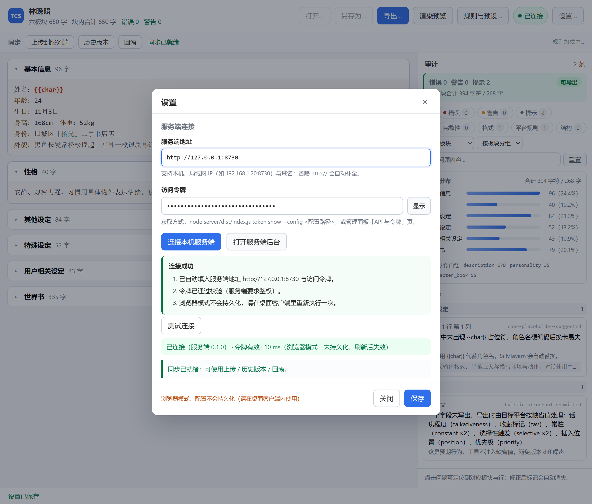

### 服务端

- 上传的卡片**按原始字节存储**（sha256 内容寻址），不做重新序列化：键序、缩进、  
  换行风格在版本 diff 里不会产生噪声。
- 版本历史带**三层 diff**（字节 / 行 / JSON 结构），回滚是新建一次提交，历史只增不改。
- 审计报告随版本快照一起存，看旧版本时看到的是**当时**的审计结论。
- **卡面（封面图）单独存一份，不跟版本走**：每张卡最多一张封面，换封面**不产生新版本**，
    
  回滚到旧版本也不会把封面一起带走。理由很实际。换封面往往只是为了好看，
    
  不该跟设定绑在一起；而且同一张封面存 50 份纯属浪费（实测 50 个版本：
    
  每版存一份 PNG 要 34.8 MB，只存一份封面只要 0.9 MB）。
- Web 管理面板：看版本、改配置、轮换令牌、查看卡片列表。

#### 封面图什么时候进仓库

**导入 PNG 卡时不会立刻上传封面，下次「上传到服务端」时才进仓库。**

这是刻意这样设计的，不是省了一步：

- **导入只是本地动作**。你可能导进来只是看一眼、或者马上改设定，
    
  这时候没有任何理由先花几百 KB 上传一张可能马上要换的封面。
- **上传才是"我要把这张卡交给你保管"的那一刻**。到那时才把封面一起交上去，
    
  语义清楚。而且上传时客户端会先比对封面摘要。**封面没变就只传 JSON**，
    
  不会每次都把整张图重传一遍。
- **仓库里只留一份封面**。所以同一张卡传 20 次、封面没改过，服务端那边始终是一张图。

取回或回滚时会把封面一起取下来。至于**本地没有封面**的卡（老卡、或者你删了图），
  
导出和推送会按「原图 → 图库封面 → 内置默认」的顺序自动兜底，不需要你手动指定。

#### 封面会被压到 250KB，但只压"进仓库的那一份"

选一张图当封面时，客户端会当场算给你看：**「压缩后约 180 KB（原图 4.2 MB）✓」**。
  
长边 2500px 以内的图通常都能进 250KB，超了会自动降尺寸；实在压不下去
  
（比如满屏噪点的照片）会直接告诉你"换一张更简洁的"，而不是硬塞一张糊图。

这条 250KB 只约束**仓库里存的那一份**。另外两处各有各的规矩：

| 产物             | 格式                                    | 上限                       |
| -------------- | ------------------------------------- | ------------------------ |
| 仓库里的封面         | WebP（平涂插画若是 PNG 且本来就 <250KB，原样保留不重编码） | 250KB 硬限                 |
| SillyTavern 头像 | PNG，512×512，256 色                     | 500KB 软上限（超了只提示）         |
| 导出的 PNG 卡      | PNG，封面原尺寸 + 卡数据                       | 不受 250KB 限制（超 5MB 会提示一句） |

为什么要分三套：仓库那份是**长期存储**，要省；另外两份不进仓库，按用途各取所需。
  
照片在 PNG 里是压不到 250KB 还能看着无损的，所以压缩红利放在仓库层（WebP），
  
格式合规放在出口层（转 PNG）：各管一段。

#### 没有封面也是正常状态

从 TXT 或 JSON 起手的卡没有图，仓库列表里会明确显示「无卡面」。
  
上传时如果你没选封面，卡片内容照样入仓，封面留空；之后在「我的卡片」里
  
随时能补一张，或者把已有的移除。**补和移除都不产生新版本**。

#### 导出时撞到同名文件会问你

导出 PNG 卡时如果目标位置已有同名文件，客户端会读那份文件里嵌的卡片 ID 判断身份：

- **同一张卡、本地没有未保存的改动** → 直接覆盖（不会多出一个 `西奥 (2).png`）；
- **同一张卡、本地有改动** → 问你：覆盖 / 另存为编号副本 / 先看差异；
- **是另一张卡** → 自动另存为 `西奥 (2).png` 并告诉你"本地已有同名不同卡"；
- **那份文件没有卡片 ID**（很早版本导出的或从别处来的）→ 问你，不擅自覆盖。

### 安卓客户端（v0.1.7 新增）

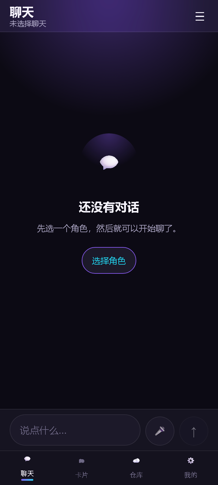

安卓端只做四件事：聊天、语音、改开场、从仓库取卡。四个页面：

| 页面 | 能力 |
|---|---|
| 聊天 | 选角色、换人设、编辑复制删除消息、重新生成、语音输入 |
| 卡片 | 改场景 / 开场白 / 备用开场白。**不能切换聊天角色**，那个在聊天页 |
| 仓库 | 登录（账户或仓库令牌）、下载卡、看历史版本 |
| 我的 | 配模型接口、配语音识别、聊天设置 |

几件容易搞错的事：

语音输入分三档。点麦克风进语音态，按住大圆说话，左右滑选「说话 / 内心动作 / 消息」。
符号在本地拼（`"…"` / `(…)` / `「…」`），不让模型猜你要哪种。上滑取消。
松手就释放麦克风，不等转写。

卡片页那个"选一个角色"是选**要改哪张卡**，跟聊天用谁没关系。想看本机有哪些角色、
想换聊天角色，去聊天页点左上角 ☰。

只改三项内容。场景、开场白、备用开场白最常需要随手改，而且改坏了一眼能看出来。
性格、世界观这类改坏了在手机上看不出后果，该回电脑上改。

首启要等 60~90 秒。内置了一整套角色引擎（含 Node.js 运行时），
首启把 400 MB 从 APK 里解出来。之后每次启动 10~20 秒，完全离线可用。

v0.1.8 起可以直接从手机导入卡片：卡片页最上面那条「从手机导入卡片」，
选 PNG 卡或 JSON 卡就行，不用登录仓库。同名卡会先问一句再覆盖。

JSON 卡文件里没有图，导入时会问一句封面：从相册选一张（自动裁成 512×512），
或者按卡名生成一张带首字的渐变图。同一个名字永远同一个颜色，
不同名字颜色不同 —— 角色列表里扫一眼就能分开。手机端没有单独的换封面入口，
封面在导入那一刻定了。

只支持 arm64。Android 7.0 及以上。32 位老机型和 x86 设备（模拟器、云手机）装不上。

#### 手机端的思考链开关

聊天设置里有两个容易混的东西，它们管的事完全不一样。

第一个是开关本身：模型要不要先想再答。打开后请求里会多带厂商规定的字段。
不同厂商字段名不同，App 按模型名自动认，认不出就让你手选参数族，不瞎猜。
四族分别是 `thinking.type`（GLM、Kimi、豆包这类）、`enable_thinking`（百炼、
硅基流动）、`reasoning_effort`（OpenAI、xAI）、`think`（Ollama 本地）。

有些型号关不掉思考，比如 GLM-5.3、Kimi 的 k2.7-code、Gemini 2.5 Pro 和 3/4 系、
Claude 带 `-thinking` 后缀的。遇到这类型号开关会显示成不可用并说明原因，
不会让你点了没反应。

思考长度旋钮的含义也随厂商变：有的填数值上限，有的选低中高档位。

第二个是"显示完整思考链"。它只控制气泡里显不显示想的过程，不影响请求，
也不影响花多少钱。默认关。

两个分开是刻意的。很多人只想让模型好好想，但不想看它想的过程，尤其在手机上，
一段完整思考链经常比回复本身还长。

完整手册（安装、四页逐项说明、语音手势、八个语音预设、思考链机制、排错表）：
**[安卓端使用手册](client/src-tauri/gen/android/docs/android-user-guide.md)**

### 卡片 ID

每张卡有一个**由你指定、创建后不可修改**的 ID（只允许字母、数字与连字符）。  
服务端靠它认卡：同一个 ID 再上传是追加版本，新 ID 是新建卡片。留空会自动生成  
`<角色名拼音或原名>-<4 位随机>`，生成结果在对话框里明示。

ID 不可改是刻意的：允许改 ID 等于允许把两个角色的历史混在一条时间线上，回滚就会  
回到别人身上。

---

## 二、安装

### 系统要求

**Windows（服务端与桌面客户端）**

- Windows 10 / 11（64 位）
- 客户端依赖系统 WebView2（Win11 自带；Win10 首次启动会联网补装）
- 两个 MSI 都是 perMachine 安装，**需要管理员权限**

**安卓（安卓客户端）**

- Android **7.0（API 24）及以上**
- CPU 架构 **arm64-v8a**（2015 年后的正规手机都是；32 位老机型与 x86 设备装不上）
- 存储预留 **1 GB**（安装包 159 MB + 首启解包约 400 MB）

### 服务端

双击 `TavernCardStudioServer-<版本>.msi`。装完后三件事已经就绪：

1. **服务已注册为 Windows 服务**（`Tavern Card Studio Server`，由 WinSW 托管），  
   开机自启，不需要手动运行任何 exe；
2. **自动弹出一页「如何连接」**，同时开始菜单里留了同名快捷方式，以后想再看能找到；
3. 管理面板与 API 都在本机回环地址上监听。

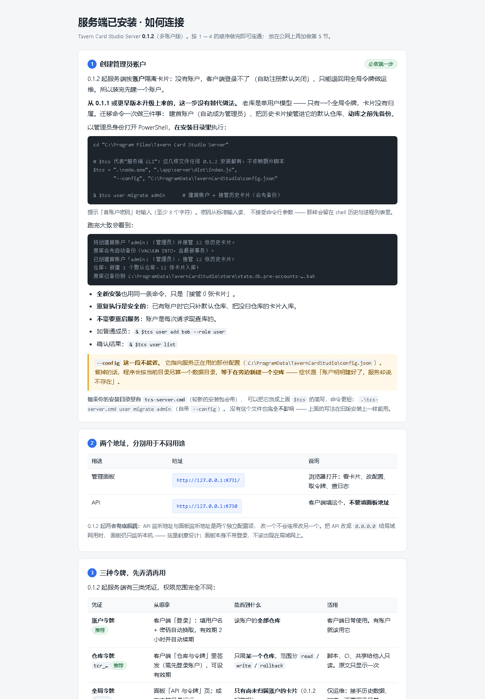

| 你会用到   | 默认值                     | 填在哪                   |
| ------ | ----------------------- | --------------------- |
| API 地址 | `http://127.0.0.1:8730` | 客户端「设置 → 服务端地址」       |
| 管理后台   | `http://127.0.0.1:8731` | 浏览器直接打开（看版本、改配置、轮换令牌） |
| 账户     | 装完服务端后先建一个（见下）          | 客户端「设置 → 账户 → 登录…」    |

建账户、看/换令牌、注册服务、离线自检这些**运维命令**都在命令行完成（面板只做
  
查看与配置）：逐条说明与常见故障对照见
  
[`docs/server-cmd.md`](docs/server-cmd.md)。

**想自己写程序对接服务端**（做插件、接 CI、用自己的编辑器），见
  
[`docs/server-developer.md`](docs/server-developer.md)：端口与绑定、四种凭证与
  
`Authorization` 头格式、逐端点的请求/响应/错误码与 curl 示例、`cardId` 语义、
  
错误码总表与 404/403 约定、限速规则、TLS 与反向代理的 `trustProxy` 配置、
  
角色卡与世界书的数据格式。

**要把服务端放到云服务器 / 挂在反向代理后面**，见
  
[`docs/Cloud Deployment Manual.md`](docs/Cloud%20Deployment%20Manual.md)：Caddy、nginx、
  
Apache 三选一（含 Apache 双 vhost 完整配置）、`trustProxy` 必配的两个事故场景、
  
上线自查清单与排障速查。

**两个地址是分开配置的**：只把 API 开给局域网时，管理面板仍然只听本机回环，  
不会跟着暴露出去。想把面板也开出去，需要同时开启鉴权，否则服务拒绝启动。
面板上的这个字段在非回环地址时常驻黄色警告：

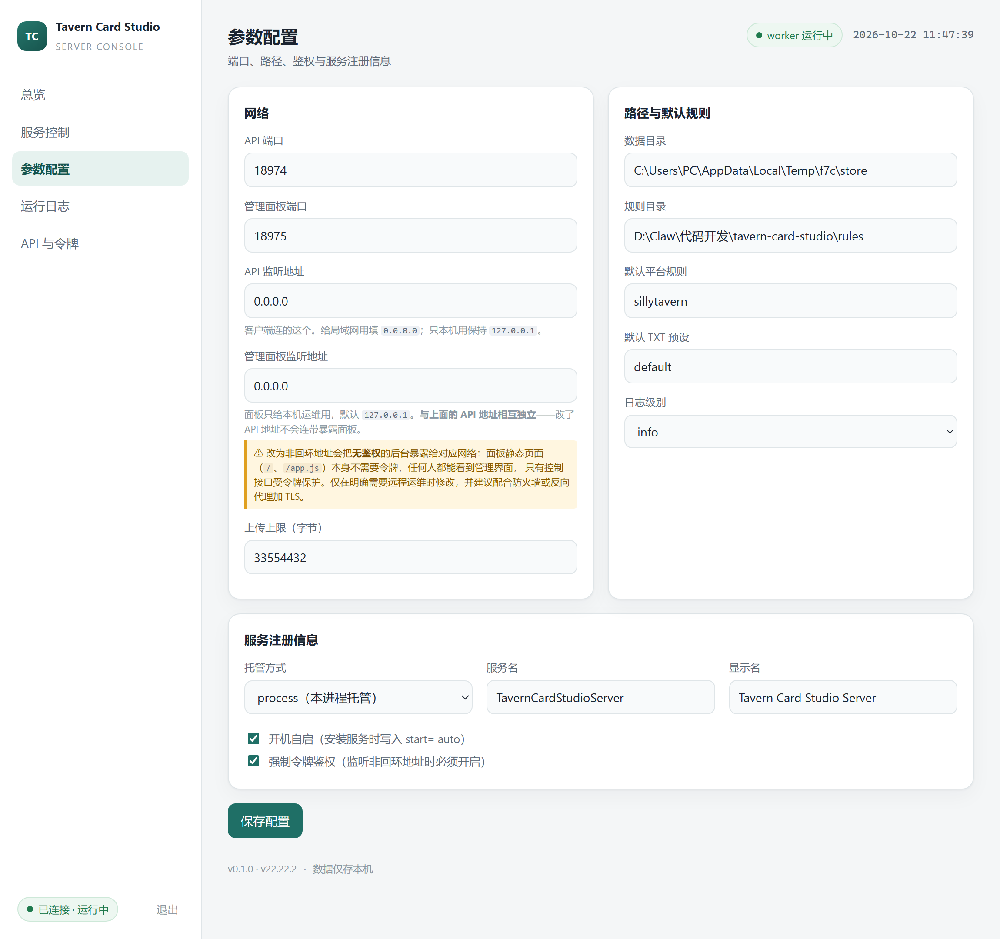

### 客户端

双击 `Tavern Card Studio_<版本>_x64_en-US.msi`。首次打开是**空白工作台**，  
不会自动加载任何卡片。这是设计如此，避免"上次正在编辑的那张卡"在启动时  
被无意覆盖。

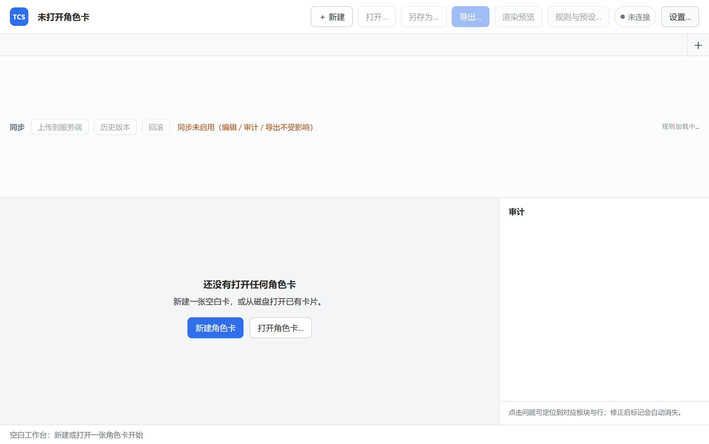

### 安卓客户端

安卓端不在应用商店，手动装一次：

1. 把 `tavern-card-studio-<版本>-arm64-release.apk` 传到手机（微信、QQ、数据线都行）
2. 在文件管理器里点它。系统会拦一次「未知来源应用」，去设置允许该来源，返回继续
3. 装完点「打开」

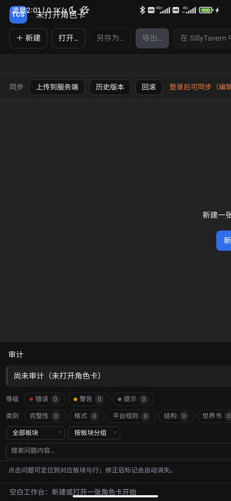

首次启动要等 60~90 秒。它要把内置的角色引擎（约 400 MB，含 Node.js 运行时）
从 APK 里解出来。启动画面会显示进度百分比和当前阶段，不是转个圈让你猜。
中途别杀进程，杀了下次要从头解。

之后每次启动 10~20 秒，完全离线可用（除了聊天要连你配的模型接口）。

> 装过 v0.1.7 早期开发包的会提示签名冲突，需要先卸载再装。
> 卸载会删掉 App 数据，请先在旧版的仓库页把角色卡上传到服务端。
> 从正式版往后升级不会再有这个问题。

安卓端只申请两个权限：麦克风（语音输入）和网络（连仓库与模型接口）。
没有通讯录、定位、相册、后台读取。

完整的安装细节、四个页面逐项说明、语音手势、排错对照表见
**[安卓端使用教程](client/src-tauri/gen/android/docs/android-user-guide.md)**。

### 从旧版本升级（跨版本直接装，不用先卸载）

**直接双击新包安装即可**，不要手动卸载旧版。两个 MSI 都配了 Windows Installer 的
  
**MajorUpgrade**：安装时自己把旧版移除，「应用和功能」里始终只有**一条**记录，
  
版本号就是刚装的那个。

- 升级**不动你的数据**：服务端数据在 `C:\ProgramData\TavernCardStudio`、客户端配置在
    
  `%APPDATA%\com.taverncardstudio.client`、角色卡在 `Documents\TavernCardStudio\cards`，
    
  都不在安装目录里，升级只换程序文件。
- **回退（装回旧版）会被拒**：先卸载新版再装旧版。安装器会提示
    
  “A newer version of Tavern Card Studio (Server) is already installed.”，
    
  这是有意的。旧版程序配新版的数据库/配置，出问题比"装不上"难查得多。
- **同一个版本号重打包**（只有维护者会遇到的场景）：客户端 MSI 会照常替换文件；
    
  服务端 MSI 对"版本号相同"的安装视为维护操作，不铺文件，需要
    
  `msiexec /i TavernCardStudioServer-<版本>.msi REINSTALL=ALL REINSTALLMODE=amus`
    
  或先卸载再装。

装完怎么确认版本对了：客户端「设置… → 诊断」里有一行**客户端版本**，服务端看启动横幅
  
（`tcs-server --version`）或面板页脚。

### 批量部署（静默安装）

```bat
msiexec /i TavernCardStudioServer-<版本>.msi /qn
msiexec /i "Tavern Card Studio_<版本>_x64_en-US.msi" /qn
```

`/qn` 时不会弹「如何连接」页，部署完自己去  
`C:\ProgramData\TavernCardStudio\config.json` 取令牌即可。

### 卸载（以及你的数据去哪了）

两个 MSI 的卸载流程都会**先问一句**：是否同时删除数据目录。复选框**默认不勾**。
  
卸载只带走程序，数据留着，误删不可逆，所以默认给保守的那一边。

|     | 数据目录                                                    | 卸载时默认 |
| --- | ------------------------------------------------------- | ----- |
| 服务端 | `C:\ProgramData\TavernCardStudio`（角色卡版本链、审计记录、账户凭据、日志）  | 保留    |
| 客户端 | `%APPDATA%\com.taverncardstudio.client`（已保存的服务端地址与访问令牌） | 保留    |

- 勾选后该目录被整棵删除；**不勾选则保留**，卸载完成页会再提示一次位置，想清理就自己删。
- 客户端的角色卡（`Documents\TavernCardStudio\cards`）**永远不动**。那是你的文档，不是应用数据。
- 卸载还会顺手清掉**安装目录里的运行期残留**（在安装目录里直接跑过启动器留下的
    
  `data\`、`logs\`、缓存与顶层 `*.log`），删了什么、多少字节、哪些没删掉及原因都记在
    
  `C:\ProgramData\TavernCardStudio\logs\uninstall-cleanup.log`。**只清这几类**：安装目录里
    
  你自己放的文件一律保留（日志里标 `KEPT`），安装清单内的文件由 Windows Installer 删。
- 静默卸载要连数据一起删，显式给属性：`msiexec /x <msi> /qn DELETEDATA=1`。

```bat
msiexec /x TavernCardStudioServer-<版本>.msi
msiexec /x "Tavern Card Studio_<版本>_x64_en-US.msi"
```

---

## 三、配置与使用

### 1. 连上服务端（可选）

客户端可以完全离线使用。想用版本管理与同步：**只填服务端地址就够**。
进「设置」点 **「连接本机服务端」**（同机），或手工填地址；然后点  
**「账户 → 登录…」**用账户登录。登录/注册接口本身**不需要任何令牌**，  
令牌只决定登录后能做什么。

失败时会分步告诉你卡在哪一步，而不是丢一句"连接失败"：

| 提示        | 实际含义               | 你该做什么                         |
| --------- | ------------------ | ----------------------------- |
| 服务未运行     | 端口没人监听             | 装服务端 / 在 `services.msc` 里启动服务 |
| 端口或监听地址被改 | 面板能通但 API 不通       | 去面板确认 API 的监听地址与端口，改回设置里的地址   |
| 不是本机地址    | 填的是局域网 IP，一键连接只探本机 | 手工填地址，或确认服务端已允许外部访问           |
| 令牌被拒绝     | 令牌不匹配              | 从面板复制当前令牌                     |
| 服务端版本过旧   | 服务端没有取令牌接口         | 升级服务端 MSI                     |
| 网络错误      | 连得上但请求失败           | 检查防火墙 / 代理                    |

### 2. 新建与打开卡片

点「＋ 新建」（`Ctrl+N`）填角色名与卡片 ID；或「打开…」载入已有的卡。  
载入后各板块按 `【标题】` 分块显示，折叠的板块不占渲染开销，展开才创建编辑器。

**「打开…」会先看名字，再决定落到哪：**

| 情况 | 结果 |
|---|---|
| 这个名字**没有**已打开的标签 | **新建一个标签**并载入，当前卡不动 |
| 这个名字**已经打开** | 覆盖那一张（不在当前标签时会自动切过去） |
| 那张卡还有**未保存的修改** | 先问一句「要覆盖同名卡吗」，取消就什么都不做 |

以前不管名字是什么，打开都直接替换当前卡 —— 想对照两张卡就会丢内容。
现在打开＝新开标签，只有同名才覆盖。

这条规则只管「打开…」（TXT / JSON / PNG 三种都算）。下列动作不受影响：
新建按钮、同步取回/回滚（按卡片 ID 落位）、纯图片设封面（那是改当前卡、
不是打开一张卡）。

**TXT 的名字只能从文件名推**（TXT 里没有名字字段），所以 `西奥.txt` 打开时
若已有「西奥」标签就会覆盖它；想留两份就把文件复制成 `西奥-旧.txt` 再打开。

### 3. 编辑与检查

- 左上是各板块的 TXT，直接改；右侧（或下方）是审计面板。
- 顶栏平台规则下拉决定用哪套规则检查，切换会立刻重新校验。
- 问题条目点一下就跳到对应位置；改对了它自己消失。
- 角色名在顶栏就地编辑，不需要去正文里找。
- **卡片信息…**：作者、角色版本、创作说明、标签、系统提示、历史后指令、
    
  世界书名称与说明。这八个字段写在卡的 JSON 里、不属于八个板块，所以单独一个入口。
    
  [卡片信息](assets/v016-09-card-info-dialog.png)
  - 从示例卡起手时，这几个值会跟着示例卡过来。打开这个对话框时它会提示
      
    「这几个值看起来是从示例卡带过来的」。**只提示、不拦你**，改掉或清空即可。
  - 清空「世界书名称 / 说明」等于**从 JSON 里删掉这两个键**（而不是留空字符串）。
  - 顶部出现「以下几项可能不是你填写的内容」时，只列字段名、不贴值。
      
    值就在下面的输入框里，改掉或留空即可，不会拦你保存。
  - 世界书条目的**标题**：我们的 TXT 把显示名写成 `name`，而 SillyTavern 的
      
    世界书面板读的是 `comment`。导出时会自动把 `name` 补进 `comment`
      
    （已有 `comment` 不覆盖），所以导进 ST 后条目名不会空白。
      
    补了几条会写在导出说明里。
  - 底部的**「设为新卡默认值」**把作者这类每张卡都一样的字段存起来，
      
    以后「＋ 新建」自动带上；它**不改当前这张卡**（两件事分开，免得"我只想改这张"
      
    变成"以后都这样"）。


### 4. 保存与角色卡目录

`Ctrl+S` 保存到当前文件；新卡在没有路径时弹「另存为」。  
默认目录是 `文档\TavernCardStudio\cards`，可在「设置 → 角色卡目录」改：

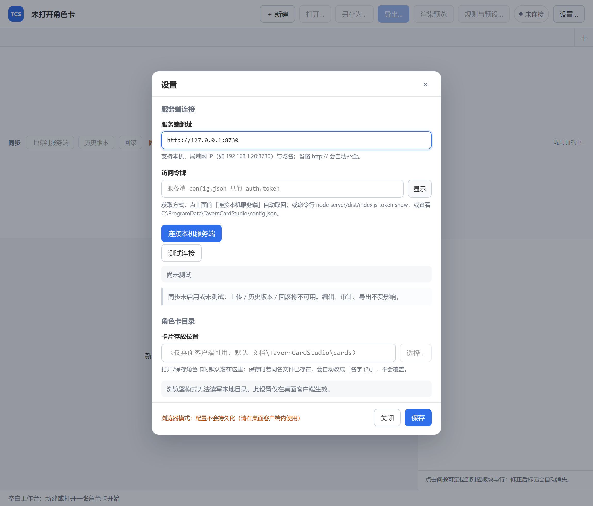

**「另存为」可以选三种格式**，产物与「导出」**完全一致**（同一条构建链路）：

| 格式          | 扩展名     | 适合                               |
| ----------- | ------- | -------------------------------- |
| ST 角色卡 JSON | `.json` | 工作副本。无损往返，能继续编辑、能导入 ST / Chub |
| TXT 文本      | `.txt`  | 按当前预设拼装标题与分隔符，人工核对或粘贴到别的平台       |
| PNG 角色卡     | `.png`  | 卡数据写进图片，一张图既是封面也是卡               |

- 选 PNG 时封面取**这张卡自己的**：PNG 卡导入的原图（像素不重编码）→ 图库上次
    
  记住的那张 → 内置默认图。想挑图库里的任意一张请走「导出」，那里有完整的卡面选择。
- **格式会记住**：另存为 PNG 之后，这张卡再按 `Ctrl+S` 写回的就是 PNG（状态栏会说明）。
    
  不这样的话，在 `.png` 路径里写出一个 JSON 文件，平台读不出来还像文件坏了。
- 勾「以后都用这个格式保存」可以跳过每次询问。

### 4b. 导入 TXT：原文一个字都不会丢

真实世界的 TXT 很少老老实实写满八个板块标题。所以导入的口径是
  
**无论认出几个板块，原文都完整保留**：

- **一个板块都没认出来**：整篇原文**逐字节**放进【其他设定】，
    
  状态栏告诉你「未识别到任何板块，原文已整体放入【其他设定】，请自行分块」；
- **认出至少一个**：认出的进各自板块；认不出的片段（标题行 + 正文整体）按原顺序
    
  接在【其他设定】已有内容的下方，前面加一行分隔符：

```
════════════ 以下内容为未识别的板块数据，请自行排版 ════════════
```

分隔符只会出现一次。之后再导出、再导入，这个结构原样保留，不会越导越多分隔符，
  
也不会把片段重复叠一份。

三条边界，都是"原文不丢"的直接推论：

- **第一个标题之前的开头**（前言）没有标题可挂，也作为一个片段进【其他设定】；
- **世界书不参与这套搬运**：TXT 里有世界书标题就走世界书自己的结构化解析（`@@ENTRY` / `@@CONTENT` 那套格式），
    
  它正文里的"标题式行"属于世界书自己的格式，搬走会把世界书拆坏；
- **你手写在分隔符下方的段落**（包括没有标题的）在再次导入时原样保留，不会再补一个分隔符。

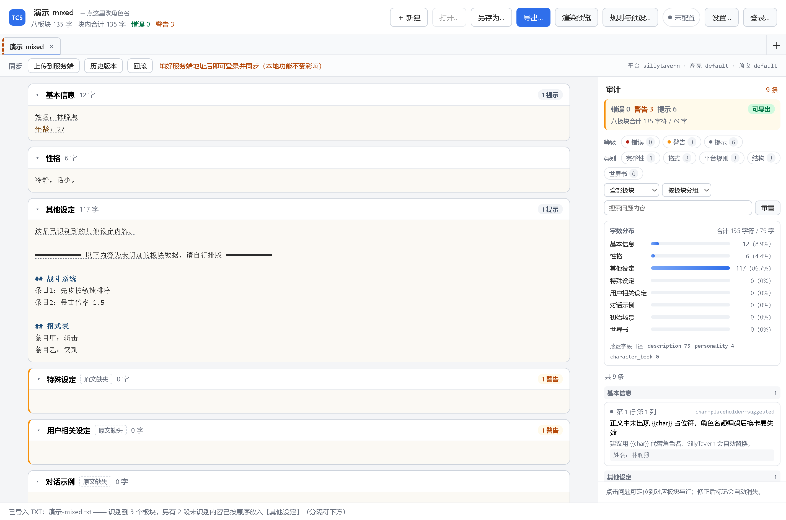

**零标签时也能直接开 TXT / JSON**：点「打开…」选文件会自动建一张卡，
  
角色名取文件名（去掉扩展名、清掉非法字符、重名自动加 ` (2)`），随后按上面的规则导入。
  
一个标签都不开也能开工。

### 4c. 改角色名

左上角角色名**点一下就能改**。第一次用时旁边有一行浅灰小字指路，
  
点过之后就消失（设置里「重置」可以再让它出现）：

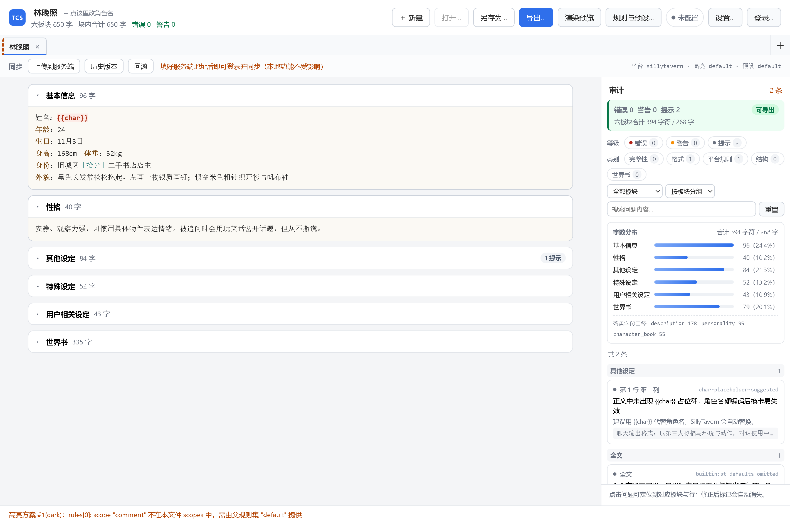

### 5. 快捷键

| 快捷键                           | 作用                |
| ----------------------------- | ----------------- |
| `Ctrl+N`                      | 新建角色卡             |
| `Ctrl+W`                      | 关闭当前标签（有未保存修改时先问） |
| `Ctrl+Tab` / `Ctrl+Shift+Tab` | 下一个 / 上一个标签       |
| `Ctrl+S`                      | 保存                |

`Ctrl+W` 在编辑器里聚焦时**不关标签**。在文本编辑器里 Ctrl+W 常被期待为"删除前一个词"，  
直接关掉整个标签太粗暴。此时底部会说明原因与做法（先点空白处或按 `Esc` 退出编辑焦点）。

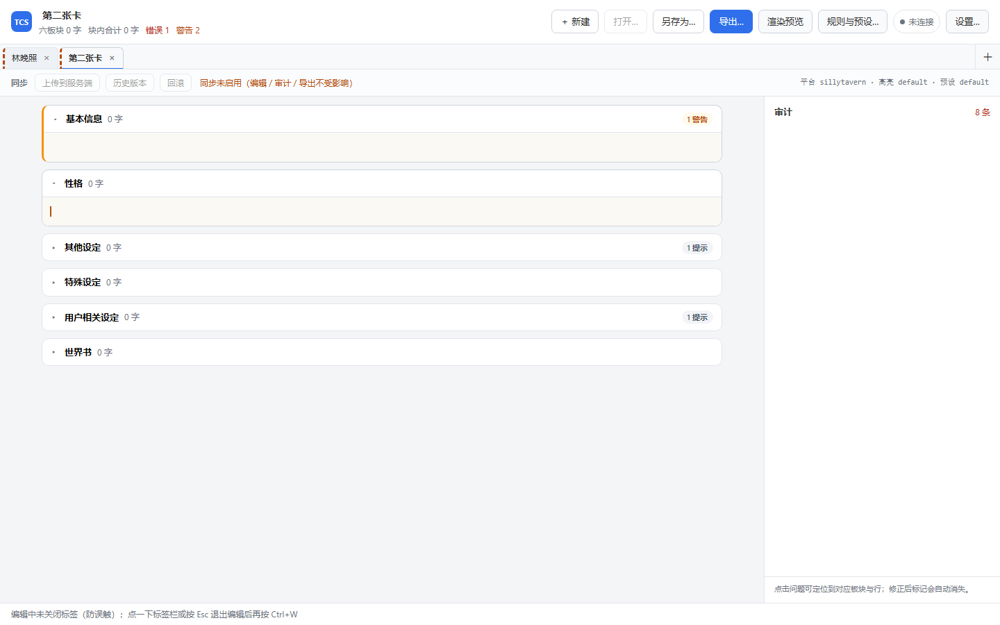

### 6. 同步、历史与回滚

「同步」面板里，上传目标显示为**角色名 + 卡片 ID**，不会上传到不确定的位置。  
如果别人在你上次上传之后也提交过这张卡，会出现**常驻黄色警告条**说明差异。
分叉不阻止你上传（各改各的很正常），但必须让你看见：

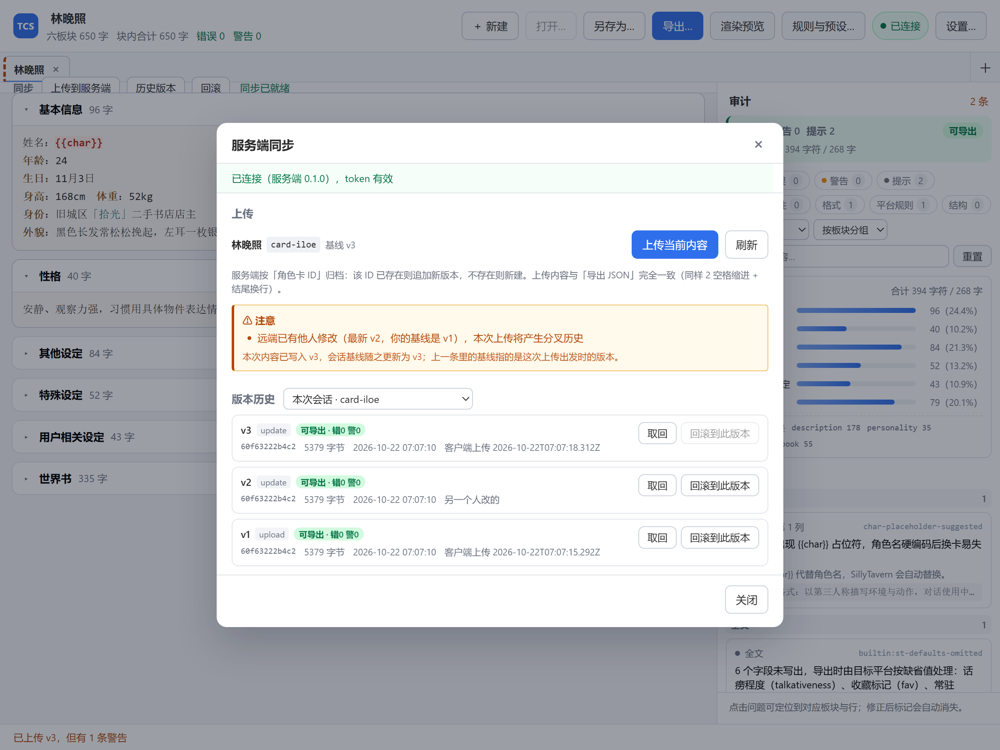

版本列表按 ID 寻址，能看每次提交的审计徽标、三层 diff，并回滚到任一版本  
（回滚本身是新建一次提交，历史不丢）。

#### 没开标签也能取回

一个标签都没开的时候点「取回」或「回滚…」，不再只丢一句"请先打开卡片"，而是  
**直接建一张卡并把这一版载入**。三条规则值得知道：

- **卡片 ID 用服务端那张的**，不按角色名重新生成。否则你下一次「上传当前内容」  
  会在服务端**新建一张卡**，而原卡的历史还留在原处。两份历史从此分叉，且没有任何提示。
- **角色名按本地标签去重**：已经有同名标签时自动变成 `名字 (2)`，卡片本身的  
  `name` 也跟着改（导出文件名与标签栏一致）。
- **回滚后的分叉基线记的是"远端最新"**，不是你回滚到的那一版：回滚会在服务端  
  新建一个版本（v5 回滚到 v2，远端变成 v6），基线记成 2 的话下次上传会被判成分叉。

状态栏会说明结果：`已创建卡片「x」并载入 v3 内容` / `已回滚并载入 v2 内容`。  
**已经有标签时行为不变**。那是替换当前卡，仍走原来的确认流程。

### 7. 导出

- **导出 TXT**：按当前预设格式输出八板块，可直接粘回 SillyTavern。
    
  世界书是一个【世界书】段，内容按你在编辑器里写的原文输出。
    
  不擅自改写成 `@@ENTRY`（保守真优先；若面板里是空的才从条目渲染）。
- **导出 JSON**：输出 ST 规范的 V2 卡片。角色名取顶栏那个名字。
    
  世界书写进 `character_book.entries`。
- **导出 PNG 卡**：见 [1. 简介](#客户端)里那段（卡面选择、零重编码）。
- 存在 `error` 级审计问题时先弹窗列清楚，你确认后才导。
- **有一种情况不给导**：世界书有文本却一个条目都没解析出来时，导出按钮直接变灰，
    
  且**不提供"仍要导出"**。原因与处理见
    
  [规则文档的「世界书不会被静默导丢」](docs/custom-rules.md#世界书不会被静默导丢)。
- 三种格式的产物与「另存为」**完全一致**（同一条构建链路）。
    
  同一张卡不会因为"从哪个按钮出去"而内容不同。

### 7b. 推送到本地 SillyTavern

装好 SillyTavern 之后，不用再「导出 → 找目录 → 手动拷」：

顶栏的**「在 SillyTavern 中测试」**（或右键任意卡片标签）会打开一个面板，按面板里的状态走即可。
  
四种状态各有各的处理，不会用一句话糊过去：

判据是**角色列表里能不能看到**，不是「导入」对话框能不能成功。那是另一条代码路径。

| 面板状态      | 它说明了什么                             | 你可以做什么                                      |
| --------- | ---------------------------------- | ------------------------------------------- |
| 未安装       | 用户目录与各盘根下的 `SillyTavern*` 目录都没通过判据 | 按三步自己装；或点**「一键安装」**（见下）              |
| 已安装 · 未运行 | 找到 ST，但 `127.0.0.1:8000` 没有应答      | 点「启动 SillyTavern」。**不会静默启动**，按钮点了才启动      |
| 运行中       | 端口可达                               | 点「推送当前卡」                                    |
| 推送完成      | PNG 卡已落盘                           | 回 SillyTavern 按一次 **F5**，角色列表里就会出现（不需要「导入」） |

**重复推送是「更新」，不是「再加一张」**（v0.1.7 修订一）：

同一张卡再推一次会**覆盖**上次那个文件，SillyTavern 的角色列表里仍然只有一个角色，
  
设定换成新版。文件名跟着**卡片 ID** 走而不是角色名，所以：

- **改角色名后推送，文件名不变**。SillyTavern 用文件名当角色身份，
    
  于是改名不会丢聊天记录；
- 只有目标文件名被**另一张卡**占用时才会加序号（`西奥 (2).png`），
    
  避免覆盖别人的卡；发生时会明确告诉你；
- 在 SillyTavern 里**删掉**那个角色文件后再推，会当作首次推送重新占名。

> **改设定请回客户端。**
>   
> TCS 是卡片数据的唯一事实源。在 SillyTavern 里直接改角色设定，下一次推送会把它覆盖掉
>   
> 但**聊天记录不受影响**（记录存在 `chats/<文件名>.jsonl`，与角色卡是两个文件）。
>   
> 换句话说：设定只能在 TCS 里改，聊天随便怎么聊都不会丢。

几条要知道的细节：

- **"在不在跑"由客户端自己连一次端口来判，不看网页那层的请求**：
    
  面板会直接连 `127.0.0.1:8000`，能连上就算在跑。这一步刻意绕开了网页层的网络设置
    
  （系统代理、安全软件、浏览器的本地网络权限都可能挡住网页发出的请求，而它们**不影响**
    
  客户端自己连端口）。所以"ST 明明开着，面板却说没运行"这类情况不会再出现；
    
  万一真的连不上，面板会写清楚是"没人应答"还是"等超时了"，并把原始错误一并列出。
- **怎么算"装了"**：目录里有 `package.json`，且（`scripts.start` 非空 **或** 有 `server.js`）。
    
  两条判据是为了覆盖 ST 1.12 与 1.13 两代目录结构差异。
    
  找的位置有两类：**用户目录**（`%USERPROFILE%\SillyTavern` 及同层的 `SillyTavern-*`）与
    
  **各盘根目录**（如 `D:\SillyTavern`、`F:\SillyTavern`）。装在这些地方都会自动发现。
    
  装在其它更深的自定义目录时，点面板里的「换一个…」指定一次，之后**记住**（重启仍在）。
- **推送的是什么**：**PNG 角色卡**，卡数据（含世界书 `character_book`）写在图片里，
    
  V3 卡写 `ccv3` 块、V2 卡写 `chara` 块，文件名是 `<角色名>.png`。
    
  落点是 `<ST>\data\default-user\characters\`。
    
  **为什么不是 JSON**：实测（SillyTavern 1.18）把导出的 PNG 放进 `characters` 目录、刷新，
    
  角色直接出现；而同样内容的 `.json` 放在同一目录里，刷新、重启都不出现。
    
  ST 的**角色目录扫描只认 PNG**，JSON 只有走界面上的「导入角色卡」那条路才有效。
    
  所以这里选 PNG：落盘即见，不需要你再点一次导入。
- **封面用的是这张卡自己的图**，顺序固定：PNG 卡导入时的原图 → 上次记住的图库封面 →
    
  内置默认卡面。推送面板**不再问你选封面**（想换封面就去「导出」里挑，那是它的职责）。
    
  用的哪一张会写在推送完成后的面板上。
- **图像本身不会被重新编码**：像素与你原来那张逐字节相同，卡数据是额外挂上去的一块。
- **不覆盖同名文件**：同名时自动加序号（`西奥 (2).png`），大小写不同也算同名
    
  （Windows 上本来就是同一个文件）。写完会**回读自证**，校验不过不会报成功。
- **不碰 ST 的其它配置**：这个功能只读写 `characters` 目录、只启动 ST 进程本身。
- **启动失败会显示 ST 自己的报错**：面板里贴出日志末尾若干行（`<配置目录>\logs\st-launch.log`），
    
  再给三条最常见的原因（端口 8000 被占用 / Node 版本不足 / 权限）。
    
  如果那个目录里既没有 `start.bat`、系统里又找不到 `node.exe`，面板会直接把这句话说出来。
    
  不用你去猜"点了为什么没反应"。
- **启动成功后会自动接着走**：面板自己重新检测一次，状态切到「运行中」，推送按钮当场可用；
    
  不会再让你点一次「重新检测」。已经跑着的 ST 不会被重复启动（点「启动」只会提示它已在运行）。
- **一键安装不会替你装 Node.js**：装 Node 需要管理员权限，这一步必须你自己点
    
  （客户端不以管理员身份运行，也不会伪装能绕过去）。它做的是：检查 Node 在不在 →
    
  下载官方 release 包（可填镜像前缀，进度可见）→ 解压到 `%USERPROFILE%\SillyTavern`
    
  （已存在则用 `SillyTavern-2`，绝不覆盖）→ 回到上面的流程。
- **服务器上跑 ST 的人**：这个功能只连本机 `127.0.0.1:8000`，不支持远程地址。

### 7c. 设置：SillyTavern 地址

「设置…」里有一项 **SillyTavern 地址**，默认 `127.0.0.1:8000`。

- **什么时候需要改**：你改过 ST 的 `config.yaml` 里的 `listenPort`、同时开了两份 ST、
    
  或者想确认客户端连的到底是哪一个。
- **格式**：`主机:端口`。也可以直接粘贴 ST 控制台里那行
    
  `Go to: http://127.0.0.1:8000/`（会自动去掉 `http://` 与末尾斜杠）。
- **只支持本机**：`127.0.0.1` / `localhost` / `::1`。填内网或外网地址会被拒绝。
    
  推送与内嵌面板都由客户端转发到**本机**，远程 ST 请用「打开 SillyTavern」在浏览器里访问。
- **保存前会真的连一次**（TCP，不经过网页那层，见 [7b](#7b-推送到本地-sillytavern)）：
  - 连上 → 提示「检测到 SillyTavern 在运行」，保存成功；
  - 连不上 → **不保存**，并说清是哪一种：端口上没有服务（ST 没启动 / 端口填错）、
      
    连接超时（多半被系统代理、防火墙或安全软件拦住）、其它（附原始错误）。
- **ST 现在没开？** 勾选「ST 没开，先保存地址再说（跳过检测）」就能先存下来。
    
  下次打开面板会按"未运行"处理，不会报错。这是一种显式选择，不是默认行为。
- **一处生效、处处生效**：推送面板的"运行中"判定、「打开 SillyTavern」跳转、
    
  F15 的端口探测都读这一个值；代码里不会再有第二份写死的地址（有静态断言守着）。

### 7d. 边写卡边看：右侧 SillyTavern 面板

顶栏 **「在 SillyTavern 中测试」** 打开右侧常驻面板。它把本机 SillyTavern 的页面
  
嵌在客户端里，写卡与看效果在同一屏，不用来回切浏览器。

面板与 [7b](#7b-推送到本地-sillytavern) 那个四状态向导是一对：向导管"ST 装在哪、
  
要不要装、要不要启动"（一次性配置），面板管"现在这张卡在 ST 里长什么样"（常驻）。
  
面板底部的 **「安装 / 启动向导」** 就是回到向导。

- **关闭即停**：面板收起或关掉，本地代理端口立刻释放；客户端退出也会回收。
    
  不会留一个没人管的本机监听端口在后台。
- **宽度是你的**：拖左边框调宽（双击复位），宽度会记住，下次打开还是这个宽度。
- **收起之后点「⟨」就展开**，宽度回到你拖的那个值（v0.1.6 修：以前收起后点它没反应）。
- **推送就在面板里**：底部的「推送当前卡」与向导里的推送是同一条链路（同名加序号、
    
  原子写、回读自证），推完面板自己刷新一次，ST 的角色列表里就能看到新卡。

#### 它是怎么连上的（以及为什么不是直接用 iframe）

客户端在**本机**起一个只绑 `127.0.0.1` 的转发端口（端口由系统分配），面板加载的是这个
  
端口，它再把每个请求原样转给「设置 → SillyTavern 地址」里的 ST。

这么绕一圈是为了解决 F15 那次实测的问题：**ST 明明在跑，webview 里的请求却发不出去**
  
（系统代理 / 安全文件 / 本地网络权限都可能拦它）。转发让请求从客户端的 TCP 栈发出，
  
不经过浏览器那条链路。

- **只转发，不改写**：路径、请求头、响应体都原样走，ST 的页面不需要做任何适配；
    
  WebSocket（聊天用的那条）也是字节透传，不解析帧。
- **ST 没起来时不是白屏**：会显示一张说明页（连的是哪个地址、为什么连不上），
    
  每 2 秒自动重试，ST 启动完成后自动回到原页面。ST 启动时 webpack 要编译十几到几十秒。
- **只连本机**：代理的目标只能是 `127.0.0.1` / `localhost` / `::1`（见 [7c](#7c-设置sillytavern-地址)）。
- **面板里 ST 能显示但卡在「正在初始化…」/「设置无法加载」**（v0.1.6 已修）：
    
  ST 的会话 cookie 是 `SameSite=Lax`，而面板的 iframe 与客户端顶层页面
    
  （`tauri.localhost`）属于**不同站点**，浏览器因此从不发送这个 cookie。
    
  ST 每个请求都被当成新会话，CSRF token 对不上，`/api/settings/get` 返回 403。
    
  代理现在会把 ST 下发的 cookie 改写成 `SameSite=None; Secure`（回环地址被视为
    
  可信源，https 不是必需的），面板里的 ST 于是能完整初始化。
- **面板打不开时不要再往"网络"方向想**（v0.1.6，这条是踩过坑才写下的）：
    
  SillyTavern 的响应里带 `X-Frame-Options: SAMEORIGIN`，浏览器据此**拒绝把 ST 显示在
    
  面板的 iframe 里**，错误页写的是「`127.0.0.1` 拒绝连接」：看起来像连不上，其实
    
  请求和响应都完全正常（代理转发 734 837 字节，与直连逐字节相同）。代理现在会剥掉
    
  这个头（以及 CSP 里的 `frame-ancestors`），所以面板能正常显示。
    
  同类还有 `Cross-Origin-Resource-Policy: same-origin`：它会让浏览器里对 ST 的
    
  `no-cors` 读取一律失败，也不代表网络不通。
- **真的被安全软件拦回环时**（少数机器）：面板不会只给一句「拒绝连接」，而是显示
    
  「本机回环被拦截：把 `msedgewebview2.exe` 与 `127.0.0.1` 加入安全软件/代理工具的
    
  直连白名单，再点「重新加载」」。判据是**面板自检探测有没有到达壳**（专用路径
    
  `/__tcs_probe__`，增量计数）：增量 0 才说明请求没离开浏览器网络层。
    
  这一条会写进诊断日志（`verdict=webview-blocked`），发给维护者即可定位。
- **换页之前先确认代理还活着**（v0.1.6）：点「重新加载」、推送后自动刷新、关掉再打开。
    
  这些动作在把地址交给面板之前都会先探一次那个端口。代理没了就先拉起来再换；
    
  拉不起来就**不换**，面板上显示「本地代理未启动，点「重新加载」重试」并写一条
    
  `client-error.log`，而不是给你一个浏览器的「拒绝连接」页面。
    
  顺手修掉的一个时序问题：关面板与开面板几乎同时发生时，迟到的"停止"以前会把
    
  刚起来的代理杀掉（表现为面板开着、页面打不开），现在停止请求带着端口，
    
  对不上就不动。

聊天是否可发取决于 ST 自己有没有配好模型 API。那是 ST 那边的设置，这里不代配。

### 8. 凭证安全

三类凭证的范围不同（0.1.2 起）：

| 凭证                         | 范围                        | 存在哪                 |
| -------------------------- | ------------------------- | ------------------- |
| **账户令牌**（登录换取，2 小时 + 自动续期） | 该账户的全部仓库                  | 客户端配置里，登出即清         |
| **仓库令牌**（`tcr_…`）          | 单个仓库，读 / 写 / 回滚可分别授权，可设过期 | 服务端只存哈希，原文只显示一次     |
| **全局令牌**（legacy）           | **只有尚未归属账户的卡片**           | 客户端「设置 → 高级 · 兼容模式」 |

- **登录的密码不会存盘**；存的是可续期的账户令牌，登出或到期即失效。
- 「全局令牌」已被降权为运维凭证：**迁移到账户后它看不到任何卡片**。  
  它只用于还没升级账户体系的服务端（≤v0.1.1）。
- 共用机器上用完请「退出登录」（设置 → 账户 → 退出登录）；怀疑泄露就在面板轮换全局令牌，  
  或让管理员重置该账户密码（会让该账户的会话全部失效）。

#### 两条凭证路径怎么选

账户登录和仓库令牌**不是"两种登录方式"，而是两种不同性质的东西**：

|          | 账户登录                  | 仓库令牌                                 |
| -------- | --------------------- | ------------------------------------ |
| 回答的问题    | **你是谁**               | **你能对这个仓库做什么**                       |
| 适用场景     | 本机常用：全权管理自己名下的全部仓库与卡片 | 把令牌交给**其他设备 / 脚本 / 他人**使用此仓库，不暴露账户密码 |
| 能做什么     | 全部                    | 只有令牌范围允许的（读 / 写 / 回滚），且仅限绑定的那一个仓库    |
| 能不能管仓库本身 | 能                     | **不能**（仓库令牌不能再签发令牌，防止一次泄露自我续期）       |
| 有效期      | 2 小时自动续期，退出登录即失效      | 签发时可选到期时间，永不过期也可以                    |

**用仓库令牌连接**（在另一台设备上）：


1. 在**有账户的那台设备**上打开「同步 → 仓库与令牌…」，选中仓库，勾选权限，点「签发令牌」。
2. 立刻复制，**原文只显示这一次**，服务端只存哈希，关掉面板就取不回来了。
3. 到另一台设备：点顶栏「登录…」→ 选**「使用仓库令牌连接」**→ 粘贴 → 点「连接」。
4. 连上之后顶栏会显示「仓库令牌模式 · <仓库名>」，仓库选择器隐藏（只有一个仓库），
     
   按钮按令牌范围置灰：只有「读」时不能上传；没有「回滚」时回滚按钮是灰的。
5. 用完点「退出令牌模式」。这只影响本机，**不会吊销那把令牌**（它可能还在别处用）。

> 两条路径**互斥**：连接仓库令牌会退出当前账户登录，反之亦然。
>   
> 这样令牌模式才真的"不含账户密码"。

#### 注销账户（不可恢复）

两条路都能走，**都要求输入用户名二次确认**，都不是单点确定：

- **自己注销**：客户端「设置 → 账户 → 注销账户…」。弹窗会先列出将被删除的数量，
    
  再要求你手打自己的用户名（填了密码会一并校验）。
- **管理员注销**：WebUI「全站治理 → 账户」每行的「注销…」。

注销会把这个账户连同**下面这些一起从磁盘上删除**，没有回收站：

| 被删除的      | 说明                          |
| --------- | --------------------------- |
| 账户行       | 用户名随即释放，可以重新注册              |
| 全部仓库      | 包括默认仓库                      |
| 全部卡片与历史版本 | **含回收站里的卡**，连同 git 仓库目录与内容块 |
| 仓库令牌      | 其他设备上用这些令牌的连接会立刻失效          |
| 全部登录会话    | 旧 refresh 立即失效，不等 2 小时自然过期  |

保护规则：

- **最后一名启用中的管理员不能注销**（否则没人能再管理服务端）；
- **管理员不能在治理页注销自己**。但要删自己的账户，用上面第一条自助路径即可。

注销后用户名可以重新注册，但会拿到**新的 uid**（旧 uid 随账户一起销毁）。
  
审计日志**保留 90 天**，记录操作者、目标 uid、动作、时间与来源 IP，
  
在「全站治理 → 账户注销审计」里可查，账户没了，记录还在。

### 8b. 出问题时：导出诊断日志

客户端会**自动记录**渲染层的异常（`window.onerror` 与未处理的 Promise 拒绝），
  
写在应用配置目录的 `logs\client-error.log`。每条含时间、堆栈、以及"当时开了几个标签、
  
活动卡是哪张"。**不含角色卡正文**。

出问题时点「设置 → 诊断 → 导出诊断日志…」，得到一个 txt：版本号、连接状态、
  
登录状态、会话摘要，加上完整的错误日志。把它发出来就能定位问题，不需要你复述现象。

日志本身也防失控：每分钟最多写 20 条（渲染循环里的错误一秒能触发 60 次，
  
不限速几秒钟就能写满磁盘），文件超过 1 MiB 自动轮转成 `.1`。

### 9. 开启 HTTPS（可选）

默认是**明文 HTTP**。跨网络使用前请打开 HTTPS。否则登录密码与访问令牌  
都会以明文经过网络。

**推荐用面板改**：管理面板 → 参数配置 → **传输安全**。三态单选、证书指纹、  
剩余天数、重新生成、自定义证书的即时校验都在那里，**保存即生效，不用重启服务**  
（监听层热重载；热更失败会自动回滚到修改前的设置并说明原因）。

也可以直接改 `config.json` 里的 `tls.mode`（相对路径按数据目录解析）：

```json
"tls": {
  "mode": "selfsigned",     // off（默认） | selfsigned | custom
  "httpsPort": 8443,
  "certPath": "",           // custom 模式：证书 PEM 路径
  "keyPath": ""             // custom 模式：私钥 PEM 路径
}
```

手改文件后 worker 会在几秒内自己发现并热重载；想立刻生效可以到面板保存一次，  
或重启服务（两种方式都行）。

**HTTP 与 HTTPS 会同时可用**，所以你可以先在客户端把地址改成  
`https://…:8443` 验证通了，再决定要不要把 HTTP 关掉（暂时没有单独的开关，  
保持 `off` 之外的任何模式，HTTP 都会继续服务）。

#### selfsigned 模式：自签证书

首次启动会自动生成一张 ECDSA P-256 证书，有效期 365 天，存放在  
`C:\ProgramData\TavernCardStudio\store\tls\`（`server.crt` + `server.key`）。  
私钥文件的权限会被收紧到只有 `SYSTEM`、`Administrators` 和当前账户可读。  
收紧失败**不会**阻断启动。服务照常起来，只在日志里告警一次（同一个问题不刷屏），  
并说明是哪个账户的令牌没能应用；真遇到时按告警里给出的账户名手工确认一次即可。

**浏览器会警告「不安全」。** 这是正常的。自签证书不在系统的信任库里，  
浏览器无法确认"这张证书是不是真的来自那台服务器"。绕过方式：

- Chrome / Edge：点「高级」→「继续前往」（每次会话有效）
- 或把 `server.crt` 导入到「受信任的根证书颁发机构」（长期有效，但**只应  
  在你确认这台服务器就是你的那台之后做**）

**核对指纹再信任。** 面板「传输安全」里显示的 SHA-256 指纹（`/api/stats` 也有），形如：

```
14:5E:07:D0:77:9B:3D:22:C7:D5:D5:E4:81:DE:00:33:8D:36:7E:C3:7C:A5:82:A7:41:6D:20:54:A9:DA:F8:21
```

点「继续前往」之前先比对这个指纹（浏览器证书详情里也有），能排除"连到了  
中间人"这种可能。自签证书的意义是**加密传输**，不是**证明身份**。
这一点必须清楚。

#### 桌面客户端怎么处理自签证书

**会弹一次确认，确认后记住。** 客户端第一次连自签服务时会说清"这个服务器的证书
没通过系统校验（多半是自签证书）"，问你要不要继续：

- 点「继续」→ 记住这个地址（按 `https://主机:端口` 记，不是按整条 URL），
  同一个服务以后不再问
- 点「取消」→ 同步不可用，但**编辑、审计、导出照常能用**（它们不依赖服务端）

**为什么不能静默跳过。** 自签证书意味着"无法确认对面是谁"，中间人可以冒充它
看到你的账号和令牌。所以这个决定必须由你做一次，而不是程序替你默认通过。

**"连不上"和"证书不对"是两件事。** 客户端会先按正常校验试一次，失败后再跳过
校验试一次：第二次能成就说明确实是证书问题，第二次也不成就是真的连不上
（地址错、端口没开、服务没起）。所以端口填错时**不会**弹证书确认框。
这一条以前是反的 —— 证书问题被报成"端口未开"，把人引去查防火墙。

证书**在过期前 30 天会自动续期**。旧证书（连同私钥）会被移到  
`data\certs-backup\`，文件名带时间戳（`2026-10-25T10-05-41-435Z-server.crt`）。  
所以正常运维下你不需要手动换证书；如果启动日志出现  
`自签证书将在 N 天后过期`，说明自动续期没成功，看一眼日志。

也可以在面板点「重新生成证书」立刻换一张（同样会备份旧的）。注意**换证书后  
指纹会变**，客户端下次连接会看到"证书变了"的提示。这是预期行为，  
拿面板上的新指纹核对一下即可。

#### custom 模式：用自己的证书

```json
"tls": { "mode": "custom", "httpsPort": 8443,
         "certPath": "C:\\certs\\fullchain.pem",
         "keyPath": "C:\\certs\\privkey.pem" }
```

服务**在保存时与启动时都会**校验证书与私钥是否匹配（用私钥签一段挑战、用证书  
公钥验签）。不匹配、文件缺失、已过期、格式不对。任何一种都会**拒绝保存**  
（手改配置文件则是启动失败）并打印原因，**不会退回明文模式**。  
这是刻意的：静默降级会让你以为在用 HTTPS。

面板里填完两个路径会**即时显示校验结果**，不匹配时「保存配置」按钮直接禁用。

公网部署建议用 Caddy / nginx 做反向代理并自动申请 Let's Encrypt 证书，  
把 `tls.mode` 留在 `off`、只让代理走回环连本机。这样证书续期由代理负责，  
比把私钥交给本服务更省心。

### 10. 公网部署（多用户）

只想自己或内网几个人用，跳过这一节。要让**别人**通过公网登录各自账户，按下面三步，  
不要直接把 8730 端口开到公网。

**第一步：决定谁来做 HTTPS。** 有域名就用反向代理（Caddy / nginx）申请  
Let's Encrypt 证书，服务端 `tls.mode` 留在 `off`、只监听 `127.0.0.1`。
证书续期由代理负责，私钥也不落在数据目录里。没有域名、只有 IP 才用  
`selfsigned` 或 `custom`（后者可配 mkcert / 企业 CA 签发的证书）。

**第二步：定下注册策略。** 管理面板「参数配置 → 注册策略」**四档**可选：  
关闭自助注册（默认）/ 仅管理员创建 / 开放自助注册 / **邀请码注册**。
  
**改完点保存立即生效，不用重启服务**；
  
切到「开放」会先弹确认框列出风险，开放期间面板还会显示「最近注册账户」并支持一键禁用。  
`open` 只适合公开社区服务。API 监听非回环地址时，启动日志会同时给出警告。

### 邀请码注册（v0.1.7）

四档里最新的一档，填的是 `open` 与 `closed` 之间的空档：**注册入口对所有人可见，
  
但要进来必须有邀请码**。

- 选中「邀请码注册」后，下方会出现邀请码管理区：选有效期 → 生成 → 自动复制到剪贴板，
    
  列表里能看到每张码的**剩余次数、到期时间、状态**（可用 / 已用完 / 已过期 / 已作废）。
- **每张码最多注册 3 个账户**，**有效期最长 15 天**（可选 1 小时 / 6 小时 / 1 天 / 3 天 / 7 天 / 15 天）。
    
  这两个上限是固定的，不能逐张调整。一张码泄露的损失因此是有限的。
- 随时可以「作废」：作废后旧码立刻失效，但**已用它注册的账户不受影响**。
- 客户端那边，用户在注册框里会多一个「邀请码」输入框，填错/过期会得到具体原因
    
  （而不是笼统的"注册失败"）。

> 邀请码**就是凭证**：发给谁就等于允许谁注册。建议在「备注」里写清给了谁。
>
> 码的字母表刻意去掉了 `0/O`、`1/I/L`（与账户 uid 同理），
>   
> 手抄、口头念都不会认错；输入时带空格、连字符、小写都能识别。

第一个管理员只能用命令行建（这条路不经过 HTTP，所以不受注册开关限制）：

> ⚠ 不能用「仅管理员创建」引导首账户：那个模式要求调用者**已经是**管理员，
>   
> 而空库里还没有任何账户。空库请用命令行，或临时 `open` 建出首管理员后立刻改回。

```bat
cd "C:\Program Files\Tavern Card Studio Server"
node.exe app\server\dist\index.js user add alice --config "C:\ProgramData\TavernCardStudio\config.json"
```

提示时输入密码（最短 8 位）。**第一个账户自动是管理员**，之后在面板里加人即可。

**第三步：防火墙只放 443（和签证书时的 80）。** 8730 / 8731 / 8443 一律不要  
从公网可达，开了 TLS 之后 HTTP 端口仍然在服务（见 §9），它不会自己关门。

| 部署形态                     | 对外端口       | `tls.mode`   | 客户端填的地址                   |
| ------------------------ | ---------- | ------------ | ------------------------- |
| 反向代理 + Let's Encrypt（推荐） | 443        | `off`        | `https://你的域名`            |
| 服务端自持证书（只有 IP）           | `https` 端口 | `custom`     | `https://IP:8443`         |
| 服务端自签证书                  | `https` 端口 | `selfsigned` | `https://IP:8443`（首次核对指纹） |

**放在反向代理后面时，必须登记代理地址**（否则服务端看不见真实用户）：

```jsonc
// config.json
"trustProxy": ["127.0.0.1"]      // 同机反代；跨机填代理的内网地址，支持 CIDR 如 10.0.0.0/8
```

默认是**空数组，即完全不信任任何代理头**。不登记会出现两个症状：

- **「一键连接（取令牌）」经反代一律 403**：它只允许本机取令牌，而反代让所有请求  
  看起来都来自代理。远程请手工填令牌，或在服务器上  
  `node.exe app\server\dist\index.js token show`。（登记代理后，本机经代理访问  
  可以取到，远程仍然 403。这是对的，令牌不该发给远程。）
- **登录失败 5 次会把所有人一起锁 10 分钟**：限速按来源 IP 计，未登记代理时所有人  
  都是同一个来源。登记后按真实 IP 分桶，只锁那一个人。

面板「总览」页有「可信代理」一行（含已生效代理数）。**访问过几次后它还是 0，就说明地址写错了**。

其它两点：**上传大卡片可能 413**（nginx 默认只允许 1 MiB，要调到略大于 32 MiB）；  
**不要把 `trustProxy` 填成 `0.0.0.0/0`**（等于信任所有来源，服务会拒绝启动）。

完整手册（含 Caddyfile / nginx 配置、备份升级、故障排查表、上线自查清单）  
随源码本地存放，不随仓库分发。

### 11. 规则与预设

内置五套平台规则（SillyTavern 原生、Character Card V2 / V3、JanitorAI、Chub）、  
三套高亮方案、三套 TXT 预设，开箱即用，不需要下载任何东西。

另有三份**格式预设**各管一处：世界书（标准世界书 v1.0）、初始场景、对话示例。  
它们只决定"怎么写"，不评价"写什么"。想改就按下一节自己写。

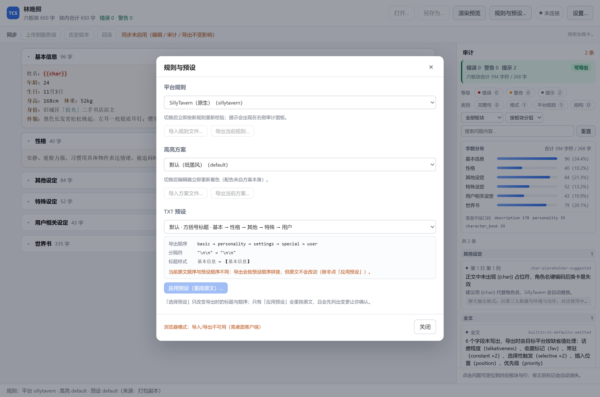

---

## 四、规则文件编写指南

五类文件（平台规则、高亮方案、TXT 预设、世界书格式、初始场景与对话示例格式）都是
JSON，**都可以自定义**：放在程序规则目录下改完重启生效，也可以在面板里导入，
导入即保存、下次打开还在。

**完整规范写成了一份独立文档：[自定义规则与预设编写指南](docs/custom-rules.md)。**

那里有每一类文件的骨架、10 种检查类型、`scope` 选择器、`when` 条件、
六类预设分别配错时会出现什么症状，以及一张「症状 → 该改哪里」的排查表。
下面只留三句最常用的：

- **规则管"怎么判"，预设管"怎么排版"。** 想让文本变成平台要的样子，改预设；
  想判断对错，改平台规则。两者混用会白费功夫 —— 规则只报错，不会替你改文本。
- **关掉某条内置判据**：用同一个 `id`（如 `builtin:worldbook-no-trigger`）覆盖，
  写 `"enabled": false`。只改 severity 不会生效。
- **外部平台方言**（`用户：` / `【初始场景：】` / 条目名写在 `comment` 里）
  靠预设声明，代码里没有硬编码 —— 具体三个键见文档的「实战：三处最常见的方言问题」。

---

## 许可证

本项目自己的代码以 [MIT](LICENSE) 发布。

**第三方组件另有其许可**，详见 [第三方组件声明](THIRD-PARTY-NOTICES.md) 与
[完整清单](THIRD-PARTY-NOTICES-APPENDIX.md)；16 份许可全文放在仓库根目录的
`LICENSES/` 下，索引见第三方组件声明的第 6 节。

其中最需要留意的一条：**安卓 APK 内置了 SillyTavern 1.19.0，它是 AGPL-3.0**。
未修改原样分发，对应源码即
[SillyTavern v1.19.0](https://github.com/SillyTavern/SillyTavern/tree/1.19.0)。
也就是说 —— **源码仓库是 MIT，但安卓 APK 作为一个整体包含 AGPL-3.0 组件**。
如果你要再分发 APK，请同时保留 `THIRD-PARTY-NOTICES.md` 与 `LICENSES/` 目录。

桌面端 / 服务端安装包不含 AGPL 组件（只有 Node.js 与 MIT/Apache-2.0 依赖）。

### 下载与源码获取

每个版本的 Release 页面顶部都会给出说明：APK 内含 AGPL-3.0 组件，
并列出**对应源码**的下载地址（同页资产里的 `sillytavern-<版本>-source.zip`）。

App 内也能看到同样的信息：

| 平台 | 位置 |
|---|---|
| 桌面端 | 设置 › 最底部 ›「关于」 |
| 安卓端 | 「我的」› 最底部 ›「关于」 |

两端的说明**不一样**，这是有意的：桌面端**没有内置** SillyTavern
（需要你自己装一个，再在设置里填地址），所以那里不提它的源码；
只有安卓端内置了它，才会给出对应源码的地址。

如果你要再分发 APK，请一并保留源码获取说明。
