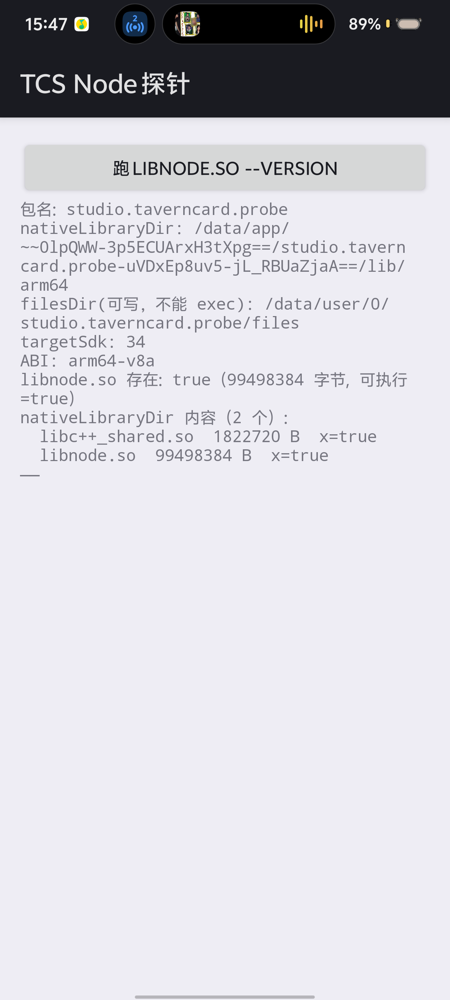
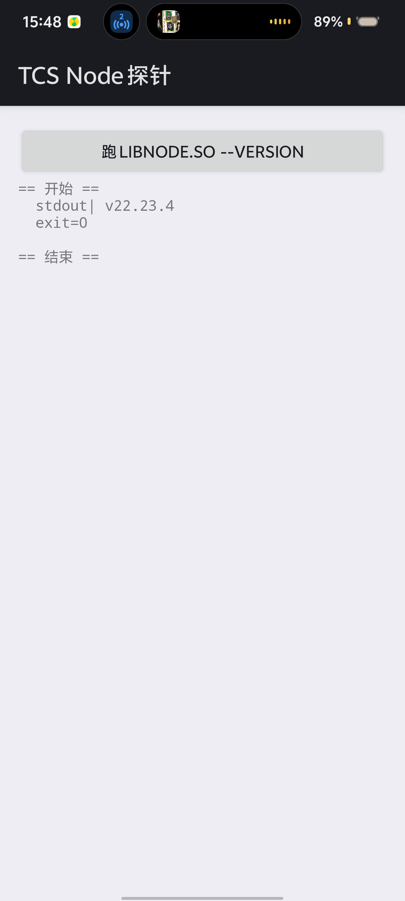

# T15.3 生死项：最小验证 APK

> 目的**只有一个**：确认 `libnode.so` 能被装上、能被 `exec`、能跑起来。
> 不通就**不动 T15.3 主体代码**（决策 #297）。

## 它验的是什么（不是"能不能编译"）

Android 10（API 29）起有 **W^X** 限制：应用**不能 exec 自己可写目录里的文件**。
`libnode.so` 是可执行文件，所以它落在哪里决定了能不能跑：

| 放置方式 | 落点 | 能 exec 吗 |
|---|---|---|
| 放 `filesDir/`（可写） | `/data/data/<pkg>/files/` | ✗ 被 W^X 拒绝（`EACCES`） |
| 放 `assets/` 再自己解压到 `filesDir/` | 同上 | ✗ 同一原因 |
| **放 `jniLibs/arm64-v8a/` + `extractNativeLibs=true`** | **`nativeLibraryDir`（只读、系统解出）** | **✓** |
| 放 `jniLibs/` 但 `extractNativeLibs=false` | 不落地（直接从 APK 内 mmap） | ✗ `nativeLibraryDir` 里没有文件可 exec |

所以这个 APK 的全部意义就是验证**第三种**那条路成立。

## 三个必须同时成立的条件

1. `libnode.so` 放进 `app/src/main/jniLibs/arm64-v8a/libnode.so`
   （Gradle 才会把它打进 APK 的 `lib/arm64-v8a/`）；
2. `AndroidManifest.xml` 里 `android:extractNativeLibs="true"`
   （否则系统不把 `.so` 解到 `nativeLibraryDir`）；
3. Gradle 打包时**不能**加 `useLegacyPackaging = false` 的反向配置
   （AGP 4.2+ 对 `minSdk >= 23` 默认 `extractNativeLibs=false`，
   靠 manifest 的 `extractNativeLibs="true"` 覆盖；两者**同在时以 manifest 为准**，
   但要确认最终 APK 里 `lib/arm64-v8a/libnode.so` 是**压缩存放**的）。

## ✅ 结论（2026-10-30 真机实测：**通过**）

vivo V2507A / Android 16 / arm64-v8a / targetSdk 34：

```text
== 开始 ==
  stdout| v22.23.4
  exit=0
== 结束 ==
```

**W^X 不挡这条路的**。`nativeLibraryDir` 里的 `libnode.so` 能被 exec，Node 真跑起来了。

证据截图（同一次实测）：

| 环境报告 | 执行结果 |
|---|---|
|  |  |

环境那张值得看一眼：`nativeLibraryDir 内容（2 个）` 里
`libc++_shared.so` 与 `libnode.so` **都带 `x=true`** —— 这一行就是
`extractNativeLibs=true` 确实生效的直接证据。

### 5 个必须同时成立的条件（少一条就失败，且报错各不相同）

| # | 条件 | 漏了会怎样 |
|---|---|---|
| 1 | `libnode.so` 进 `jniLibs/arm64-v8a/` | `lib/arm64-v8a` 里没有它，`nativeLibraryDir` 空 |
| 2 | manifest 的 `extractNativeLibs="true"`（**且** `useLegacyPackaging = true`） | .so 不落地，`nativeLibraryDir` 里没文件 |
| 3 | `libc++_shared.so` **也**进 `jniLibs/arm64-v8a/` | `CANNOT LINK EXECUTABLE: library "libc++_shared.so" not found` |
| 4 | 启动时设 `LD_LIBRARY_PATH=<nativeLibraryDir>` | 同上 —— **库在邻居目录也不够**，链接器只按 RUNPATH/LD_LIBRARY_PATH/系统路径找 |
| 5 | targetSdk = 34（不是低版本） | 低 targetSdk 进兼容模式、放宽 W^X，"能跑"是假绿 |

第 3、4 条是最容易踩的一对：**"我把库也放进 jniLibs 了"不等于"链接器能找到它"**。
实测第一次就是只做了 3、没做 4，报错与"库没放"一模一样。

`libc++_shared.so` 从 NDK 取（1,822,720 字节，sha256 `8dfbd800…`）：

```bash
$ANDROID_NDK/toolchains/llvm/prebuilt/linux-x86_64/sysroot/usr/lib/aarch64-linux-android/libc++_shared.so
```

### 一个不显眼但会卡住流程的坑

**锁屏时装包**会报 `INSTALL_FAILED_ABORTED: User rejected permissions` ——
看起来像用户点了拒绝，其实**屏幕黑着、根本没弹窗**。
先唤醒并解锁再装（`run-probe.sh` 里已处理并会明确提示）。

### 复查就一条命令

```bash
bash android/probe/run-probe.sh            # 全流程：打包→验结构→装→跑→判
bash android/probe/run-probe.sh --no-build # APK 已存在时
```

---

## 判据（逐条核，缺一不算通）

- [ ] APK 里存在 `lib/arm64-v8a/libnode.so`（`unzip -l` 可见）
- [ ] 装机后 `adb shell run-as <pkg> ls -l <nativeLibraryDir>` 能看到 `libnode.so`
      且权限含 `x`
- [ ] 点按钮后屏上打印出 `v22.x.x`（**从 stdout 读，不是猜**）
- [ ] `adb logcat` 里无 `avc: denied`（否则是 SELinux 拦的，不是 W^X）
- [ ] 换成 `targetSdk 34` 仍然通过（低 targetSdk 能跑是**假绿**：
      兼容模式会放宽 W^X，那正是线上会踩的坑）

## 怎么用

```bash
# 1. 环境（JDK 17 + Android SDK，全在普通目录，不需要管理员）
bash ../vendor/android-env/install-android-env-win.sh

# 2. 放 .so
cp ../vendor/node-android/bin/libnode-arm64-22.23.4.so app/src/main/jniLibs/arm64-v8a/libnode.so

# 3. 签名参数（仓库外）
#    内容见 ../vendor/android-env/gen-release-keystore.sh 生成的 keystore.properties
export TCS_KEYSTORE=D:/tcs-release-keys/tcs-release.jks
export TCS_KEYSTORE_PASSWORD=...
export TCS_KEY_ALIAS=tcs-release

# 4. 打包
./gradlew assembleRelease

# 5. 验（三条都要）
unzip -l app/build/outputs/apk/release/app-release.apk | grep libnode
adb install -r app/build/outputs/apk/release/app-release.apk
adb logcat -c && adb shell am start -n studio.taverncard.probe/.MainActivity
```

## 为什么用 release 签名

debug 签名与 release 不兼容，先用 debug 装 = 以后换 release 必须卸载重装，
而卸载会清掉用户数据。所以**从第一个测试包起就用 release 签名**
（详见 `docs/t15.3-apk-design.md` §7.5）。
