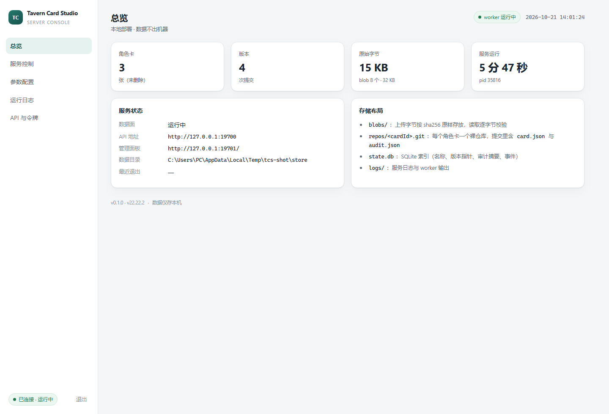

# 服务端部署与运维（阶段 5 · T5.4 / T5.5）

> 适用：Windows 10/11、Windows Server 2019+（x64）。服务端是本地部署的单机服务，默认只监听回环地址。
> API 细节见 [docs/08-server-api.md](08-server-api.md)。

---

## 1. 三种运行形态

| 形态 | 适用场景 | 启动方式 |
|---|---|---|
| 源码开发 | 开发调试 | `npm run server`（内部 `node server/dist/index.js serve`） |
| 绿色目录 | 免安装、U 盘携带、临时演示 | `release\server\start-server.cmd` |
| MSI 安装 | 正式本地部署 | 安装后由 Windows 服务管理器托管，开机自启 |

三种形态跑的是同一份代码，区别只在 Node 运行时来源与数据目录位置：

| 形态 | Node | 配置 / 数据目录 |
|---|---|---|
| 源码 | 本机 Node ≥ 20.11 | 默认 `./data/config.json` + `./data/store`（可用 `--config` / `--data-dir` 改） |
| 绿色包 | 自带 `node.exe` | 默认 `release\server\data\config.json` |
| MSI | 安装目录内 `node.exe` | `C:\ProgramData\TavernCardStudio\config.json`，数据在 `…\TavernCardStudio\store` |

---

## 2. 首次启动

### 2.1 源码

```bash
npm install
npm run build            # shared + server
npm run server           # 等价：node server/dist/index.js serve
```

首次启动会创建 `data/config.json`，并在控制台打印一次完整令牌：

```
已创建配置文件：D:\…\data\config.json
数据目录：D:\…\data\store
访问令牌：<32 字符 base64url；此处省略真值>
（文档不贴真实令牌。首次启动只打印这一行，从控制台或服务日志自行复制）
管理面板：http://127.0.0.1:8731
API：http://127.0.0.1:8730/api
```

### 2.2 绿色包

```bash
npm run pack:server        # 生成 release\server（自带 node.exe + 生产依赖）
release\server\start-server.cmd
```

`start-server.cmd` 会把配置放到 `release\server\data\config.json`，其余参数（`--port` 等）原样透传：

```bat
release\server\start-server.cmd --port 9000 --host 127.0.0.1
```

**实测（模拟服务场景）**：故意把 cwd 设成 `C:\`、配置文件放在无关目录启动绿色包 ——

```
OK  green-bundle smoke
OK  cwd=C:\  config=…\cfg\config.json
OK  dataDir=…\cfg\store            ← 跟着配置文件走，没落到 C:\
OK  worker.state=running
OK  health={"status":"ok","role":"worker",…}
OK  panel=200 cards=200 no-token=401
```

这条同时证明：打包后的 `better_sqlite3.node` 能正常加载（否则 `state.db` 建不出来）、
面板与数据面分离可用、无 token 的请求被拒。

### 2.3 打开管理面板

浏览器访问 `http://127.0.0.1:8731/`，粘贴令牌（`data/config.json` 的 `auth.token`，或 `tcs-server token show`）。
面板把令牌保存在本机 `localStorage`，所有请求走 `Authorization: Bearer`。



---

## 3. 配置项

配置文件是普通 JSON（`config.json`），面板「参数配置」页与 `PUT /control/config` 修改同一份文件。

| 字段 | 默认 | 说明 |
|---|---|---|
| `port` | `8730` | API（worker）端口 |
| `controlPort` | `port + 1`（8731） | 管理面板 / 控制面端口，不能与 `port` 相同 |
| `host` | `127.0.0.1` | **API（worker）监听地址**。给局域网用填 `0.0.0.0`，此时必须开启鉴权 |
| `controlHost` | `127.0.0.1` | **管理面板（控制面）监听地址**，**独立于 `host`**。默认只回环；缺省值不跟随 `host`，所以老配置升级后会自动收回本机 |
| `dataDir` | 见 §1 | 数据根目录（`store` 子目录放 blob/repo/db） |
| `rulesDir` | `./rules` | 平台规则 / 预设 / 高亮规则目录（只读） |
| `defaultPlatformRule` | `sillytavern` | 上传与审计默认使用的平台规则 id |
| `defaultPreset` | `default` | 默认 TXT 预设 id |
| `maxUploadBytes` | `33554432`（32 MiB） | 单次上传上限 |
| `logLevel` | `info` | `debug` / `info` / `warn` / `error` |
| `auth.token` | 首次随机生成 | 访问令牌（base64url，24 字节） |
| `auth.require` | `true` | 是否强制鉴权；非回环监听时必须为 true |
| `auth.publicPaths` | `["/api/health"]` | 免鉴权路径 |
| `service.mode` | `process` | `process` / `windows-service`（仅元数据，供运维识别） |
| `service.name` | `TavernCardStudioServer` | Windows 服务名 |
| `service.displayName` | `Tavern Card Studio Server` | 服务显示名 |
| `service.autoStart` | `true` | 安装服务时是否 `start= auto` |
| `createdAt` / `updatedAt` | 自动 | 配置创建/更新时间 |

> ⚠️ **令牌即全权凭证**：`auth.token` 持有者可以调用全部 API（上传、覆盖、回滚、删除），
> 服务端不做细粒度授权。客户端（T6.8）会把它**明文**存储在应用配置目录的
> `client-config.json` 中，**请勿在不信任的机器上保存令牌**；共用机器用完请在客户端设置面板清空。
> 泄露后的处置：`token rotate` 或管理面板「API 与令牌 → 轮换」，旧令牌立即失效。

修改生效规则：

- 改 `port` / `host` / `dataDir` / `rulesDir` / 默认规则 / `maxUploadBytes` / `logLevel` → **重启 worker**（面板「重启」按钮）；
- 改 `controlPort` / `controlHost` → **重启 supervisor**（Windows 服务：`sc.exe stop/start TavernCardStudioServer`）；
  ⚠️ 改 `controlHost` 会改变面板的访问地址：从 `127.0.0.1` 改成 `0.0.0.0` 后，面板才对局域网可见；
  反过来从 `0.0.0.0` 改回 `127.0.0.1` 后，**远程访问会立即断开**，只能在本机继续操作。
- 改 `auth.token` → 建议用「轮换令牌」，会自动重启 worker 并让旧令牌立即失效。

---

## 4. 管理面板

| 页面 | 能做什么 |
|---|---|
| 总览 | 卡片数 / 版本数 / 原始字节量 / worker 运行时长；存储布局说明 |
| 服务控制 | 启动、停止、重启 worker；查看 pid、启动时间、自动拉起次数、健康检查 |
| 参数配置 | 端口、**API 监听地址**、**管理面板监听地址**、路径、默认规则、日志级别、上传上限、服务名、鉴权开关；保存后提示是否需要重启 |
| 运行日志 | worker stdout/stderr 尾部（自动刷新），完整日志路径 |
| API 与令牌 | 显示/复制令牌、轮换令牌、常用接口速查 |

关键设计：**worker 停止时面板仍可用**。因为面板由 supervisor 提供，`/api/*` 是反向代理：

```
POST /control/service/stop  → worker.state = "stopped"
GET  /                      → 200（面板在线）
GET  /api/cards             → 503 {"error":{"code":"SERVICE_UNAVAILABLE",…}}
POST /control/service/start → worker.state = "running"
```

---

## 5. Windows 服务注册（T5.5）

### 5.1 方式 A：MSI 安装（推荐）

```powershell
msiexec /i "TavernCardStudioServer-0.1.0.msi" /qn
```

MSI 做了三件事：

1. 把 `node.exe`、**服务宿主 `tcs-service-host.exe` + `tcs-service-host.xml`** 与 `app\`
   （dist / public / rules / node_modules）安装到 `C:\Program Files\Tavern Card Studio Server\`；
2. 创建数据目录 `C:\ProgramData\TavernCardStudio\`；
3. 注册并启动服务 `TavernCardStudioServer`（LocalSystem，`Start=auto`），`ServiceControl` 在安装后启动、卸载前停止并删除。

> ⚠️ **服务二进制必须是宿主，不能是 `node.exe`。**
> `node.exe` 从不调用 `StartServiceCtrlDispatcher`，SCM 永远收不到 `SERVICE_RUNNING`，
> 服务会停在 `Start Pending`；而 `ServiceControl/@Wait="yes"` 又在等 SCM 回话 ——
> 两边互等，安装界面永久卡在 `Please wait while Windows configures ...`，`Time remaining: 2 seconds` 不动。
> **2026-10-21 实际踩过**，最迷惑的是进程活着、8730/8731 都在 `LISTENING`，看起来一切正常。
> 根因分析与修复见 [docs/18](18-server-service-fix.md)。
>
> 修复后已在真机验证：服务 `State=Running`、`PathName` 指向 `tcs-service-host.exe`、
> 8730/8731 监听、面板 HTTP 200、`/api/health` 返回 ok。

服务命令行（可用 `sc.exe qc TavernCardStudioServer` 查看）现在只有宿主，没有任何参数：

```
"C:\Program Files\Tavern Card Studio Server\tcs-service-host.exe"
```

真正的 node 命令行在 `tcs-service-host.xml` 里，由 WinSW 读取：

```
%BASE%\node.exe  %BASE%\app\server\dist\index.js  serve
  --config  C:\ProgramData\TavernCardStudio\config.json
  --rules-dir  %BASE%\app\rules
```

`%BASE%` 由 WinSW 替换成宿主 exe 所在目录。

**文件名必须严格配对**：WinSW v2 只在自己所在目录找 `<exe名>.xml`，
不接受命令行传配置路径（否则报 `Unable to locate WinSW.NET4.[xml|yml] file`）。
所以 `tcs-service-host.exe` 与 `tcs-service-host.xml` 改一个不改另一个会静默失效。

#### 首次启动与令牌

MSI 只创建目录、不预生成配置（避免在安装包里固化 token）。服务第一次启动时：

1. 发现 `C:\ProgramData\TavernCardStudio\config.json` 不存在 → 按默认值创建；
2. 生成随机访问令牌；
3. **数据目录取「配置文件同级的 `store` 子目录」** = `C:\ProgramData\TavernCardStudio\store`。

第 3 点不是随手定的：Windows 服务以 LocalSystem 启动时 **cwd 是 `C:\Windows\System32`**。
如果默认数据目录跟随 cwd，卡片 blob 和 Git 仓库会落进 System32 底下，卸载后既找不到也删不干净。
这条规则在 `server/src/config.ts` 的 `loadConfig` 与 CLI 的参数解析里各有一份，并有回归测试钉住
（`test/server.test.mjs` 的「新建配置：dataDir 由配置文件位置推导，不随 cwd 漂移」）。

服务没有控制台，但 **WinSW 会把子进程的 stdout/stderr 收进日志**，所以首次启动那一行令牌会落在
`C:\ProgramData\TavernCardStudio\logs\`（`tcs-service-host.out.log`）。两种取法：

**① 从服务日志里捞**（首次启动后立刻可见）：

```powershell
Get-Content "C:\ProgramData\TavernCardStudio\logs\tcs-service-host.out.log" |
  Select-String -Pattern "令牌" | Select-Object -Last 5
```

**② 直接问 CLI**（任何时候都能重取，最可靠）：

```powershell
& "C:\Program Files\Tavern Card Studio Server\node.exe" `
  "C:\Program Files\Tavern Card Studio Server\app\server\dist\index.js" `
  token show --config "C:\ProgramData\TavernCardStudio\config.json"
```

或打开面板 `http://127.0.0.1:8731/` 用该令牌登录后，在「API 与令牌」页查看/轮换。

卸载：

```powershell
msiexec /x "TavernCardStudioServer-0.1.0.msi" /qn
```

> 卸载**不会**删除 `C:\ProgramData\TavernCardStudio`：里面有全部版本历史、blob 与审计快照。
> 确认不再需要后手动删除该目录。

**验证安装包确实带服务表**（构建机可复现）：

```powershell
wix msi decompile release\TavernCardStudioServer-0.1.0.msi -o decompiled.wxs
Select-String -Path decompiled.wxs -Pattern "ServiceInstall|ServiceControl"
```

```xml
<ServiceInstall Id="ServerServiceInstaller" Name="TavernCardStudioServer" DisplayName="Tavern Card Studio Server"
  Account="LocalSystem" Type="ownProcess" Start="auto" ErrorControl="normal" />
<ServiceControl Id="ServerServiceControl" Name="TavernCardStudioServer" Start="install" Stop="both" Remove="uninstall" Wait="yes" />
```

**`ServiceInstall` 没有 `Arguments` 是正确的**，别"补"上去：WinSW 按文件名找配置，
带参数会以 `Unable to locate WinSW.NET4.[xml|yml] file within executable directory` 启动失败。

同时确认宿主真的进包了（应各命中一次）：

```powershell
Select-String -Path decompiled.wxs -Pattern "tcs-service-host"
```

### 5.2 方式 B：PowerShell 脚本（绿色包 / 源码目录）

`installer/tcs-service.ps1` 用 `New-Service` 注册，`SupportsShouldProcess`，支持 `-WhatIf` 预演。

```powershell
# 以管理员身份运行
.\installer\tcs-service.ps1 -Action install `
    -InstallDir "D:\apps\tavern-server" `
    -DataDir "D:\TavernData"

# 只预演，不改系统
.\installer\tcs-service.ps1 -Action install -WhatIf

# 状态 / 停止 / 卸载（卸载默认保留数据）
.\installer\tcs-service.ps1 -Action status
.\installer\tcs-service.ps1 -Action stop
.\installer\tcs-service.ps1 -Action uninstall
```

**前置条件**：`-InstallDir` 下必须有 `tcs-service-host.exe` 与 `tcs-service-host.xml`。
`npm run pack:server` 生成的 `release\server` 已自带这两个文件；
若用自定义目录，请从 `vendor\winsw\WinSW.NET4.exe` 与 `installer\ServiceHost.xml` 拷过去并改成同名。

脚本**拒绝**把 `node.exe` 直接注册为服务，缺宿主会直接报错并给出补齐指引 ——
因为那会得到一个永久停在 `Start Pending` 的服务（见 §5.1 的警告框）。
`installer/install-service.ps1` 同理。

脚本会先调用一次 `config show` 生成配置与令牌（避免服务以 LocalSystem 启动后无人知道 token）。
数据目录需要 LocalSystem 可写；自定义到 `D:\` 时请确认 NTFS 权限。

### 5.3 方式 C：CLI（等价 `sc.exe`）

```bash
tcs-server service install --config "C:\ProgramData\TavernCardStudio\config.json" --dry-run
tcs-server service install --config "C:\ProgramData\TavernCardStudio\config.json"
tcs-server service status
tcs-server service uninstall
```

`--dry-run` 实际输出（本机验证，宿主位于 `release\server\`）：

```console
$ node server/dist/index.js service install --dry-run --config .\release\server\data\config.json
[dry-run] sc.exe create TavernCardStudioServer "binPath= ...\release\server\tcs-service-host.exe" "start= auto" "DisplayName= Tavern Card Studio Server"
[dry-run] sc.exe description TavernCardStudioServer "Tavern Card Studio 角色卡审计与版本控制服务"
[dry-run] sc.exe start TavernCardStudioServer
```

`binPath` 指向的是宿主而不是 `node.exe`。找不到宿主时 CLI 会**拒绝执行并退出码 2**：

```console
$ node server/dist/index.js service install --config ...\config.json
拒绝注册服务：找不到服务宿主。
  期望：...\tcs-service-host.exe
  期望：...\tcs-service-host.xml
```

这条拒绝是刻意的：静默退回直挂 `node.exe` 会造出装不上也停不掉的僵尸服务。

> 需要管理员权限；`sc.exe create` 的 `binPath=`、`start=` 后面必须有空格。

### 5.4 服务账号与权限

- MSI 默认 **LocalSystem**：可读写 `C:\Program Files` 之外任意本地路径，适合默认数据目录。
- 如需降权，用「服务」管理器把登录账号改为专用用户，并授予：
  - 数据目录「修改」；
  - 安装目录「读取和执行」；
  - 若数据目录在 `C:\ProgramData`，安装时已创建，专用账号需额外授权。
- 服务不监听公网时无需防火墙规则；改成 `0.0.0.0` 前请先读 §8。

> 改账号要在 `tcs-service-host.xml` 与服务的登录身份**两处**保持一致，
> 因为宿主以 LocalSystem 拉起子进程时，子进程继承的是宿主的身份。

### 5.5 服务日志（排障第一入口）

WinSW 把 node 的 stdout/stderr 全部转存，这就是排查服务启动失败的第一手材料：

| 文件 | 内容 |
|---|---|
| `C:\ProgramData\TavernCardStudio\logs\tcs-service-host.out.log` | 服务端正常输出（含首次启动的访问令牌） |
| `C:\ProgramData\TavernCardStudio\logs\tcs-service-host.err.log` | 错误输出（端口占用、配置损坏等） |
| `C:\ProgramData\TavernCardStudio\logs\tcs-service-host.wrapper.log` | WinSW 自身的动作：启动/停止/重启记录 |

按大小滚动，保留 4 份（`log mode="roll-by-size"`，10 MB 阈值）。

**服务起不来的标准排查顺序**：

```powershell
# 1. SCM 认为它是什么状态（StartPending 说明宿主没报 RUNNING）
Get-Service TavernCardStudioServer | Format-List Name, Status

# 2. 服务实际指向哪个二进制（应指向 tcs-service-host.exe）
Get-CimInstance Win32_Service -Filter "Name='TavernCardStudioServer'" |
  Select-Object State, ExitCode, ProcessId, PathName

# 3. 端口有没有起来
Get-NetTCPConnection -LocalPort 8730,8731 -State Listen -ErrorAction SilentlyContinue

# 4. 看日志
Get-Content "C:\ProgramData\TavernCardStudio\logs\tcs-service-host.err.log" -Tail 30
```

若第 2 步的 `PathName` 指向 `node.exe`，说明服务是用旧方式注册的 ——
先卸载服务再用新方式装（见 [docs/18 §5](18-server-service-fix.md) 的 `repair-stuck-install.ps1`）。

再补一条更快的判据：**`logs` 目录是否存在**。

- 生成了 → WinSW 加载配置成功，问题在 node 子进程，看 `tcs-service-host.err.log`
- 没生成 → WinSW 死在**加载配置**阶段，XML 本身不合法

### 5.6 服务配置 XML 必须是良构 XML

`tcs-service-host.xml` 由 `installer/ServiceHost.xml` 打包而来，WinSW 用标准 XML 解析器读它。
**XML 注释里不能出现两个连续连字符**，也不能以单个连字符结尾 —— 也就是说，
**不能用破折号画分隔线**：

```xml
<!-- 错误写法：这行会让整份配置非法 -->
  Why this file exists
  --------------------

<!-- 正确写法：用等号 -->
  Why this file exists
  ====================
```

这条限制看起来琐碎，但它的失败表现极具误导性：WinSW 报

```
The configuration file cound not be loaded.
XML 注释中不能包含"--"，并且"-"不能是最后一个字符。
```

（`cound` 是 WinSW 自己的拼写错误。）作为服务运行时没有控制台，这条信息**完全看不到**，
日志目录也不会生成 —— 表面上只剩事件 7009「等待服务连接超时」和 MSI 回滚 1920。
2026-10-21 因此失败了两次。

**已加两道防护**：

1. `installer/build-msi.ps1` 在打包前用 .NET XML 解析器校验，非法直接拒绝打包并给出原因；
2. `test/service-host.test.mjs` 覆盖两份配置，并对检查器本身做自测。

自查命令：

```bash
python -c "import xml.etree.ElementTree as ET; ET.parse('installer/ServiceHost.xml'); print('ok')"
```

---

## 6. 构建 MSI

前置：WiX **v4 或 v5**（v3 的 candle/light/heat 三件套在本项目已不使用，因为 `Product.wxs` 用的是 v4 语法）。

```powershell
# 方式 1：dotnet 全局工具
dotnet tool install --global wix
# 方式 2：winget
winget install WiXToolset.WiXToolset
# 方式 3：离线拿 nuget 包（构建机不联网装工具时最省事，本项目实测用这条）
curl -L -o wix.zip https://www.nuget.org/api/v2/package/wix/5.0.2
# 解压后 wix.exe 在 tools\net6.0\any\ 下，把整个包解压到 .tools\wix 即可
```

```powershell
# 一次性完成：打包 → 生成 WiX 文件清单 → 编译
.\installer\build-msi.ps1 -Version 0.1.0
```

脚本按以下顺序找 `wix`：`-WixPath` 显式指定 → `.tools\wix\...\wix.exe` → `PATH`。
找不到时会直接报错并给出离线获取命令，不会退化到 v3 语法。

产物：`release\TavernCardStudioServer-0.1.0.msi`，**实测 32,441,368 字节（约 30.9 MiB）**。
含服务宿主 `tcs-service-host.exe`（WinSW，832 KiB）与其配置 `tcs-service-host.xml`，见 [docs/18](18-server-service-fix.md)。

也可以手工执行（便于 CI 分步缓存）：

```powershell
npm run pack:server
node scripts/gen-wix-fragment.mjs
wix build installer\Product.wxs installer\generated\AppFiles.wxs `
    -arch x64 `
    -d "StageDir=$PWD\release\server" `
    -d "WinSwDir=$PWD\vendor\winsw" `
    -d "ServiceHostConfig=$PWD\installer\ServiceHost.xml" `
    -d "ProductVersion=0.1.0" `
    -o "release\TavernCardStudioServer-0.1.0.msi"
wix msi validate "release\TavernCardStudioServer-0.1.0.msi"
```

> 三个 `-d` 缺一不可：`StageDir`（node.exe 与 app）、`WinSwDir`（服务宿主）、
> `ServiceHostConfig`（宿主配置）。少传会在编译期报未定义变量，而不是打出一个坏包。

说明：

- `installer/Product.wxs` 只写服务、目录、升级策略；
- `installer/generated/AppFiles.wxs` 由脚本按 `release\server` 实际文件生成，**不依赖 Heat**，
  构建机只需核心 WiX。实测 **228 个组件 / 239 个目录 / 1269 个文件**；
- 每个组件用**从相对路径派生的确定性 GUID**（UUID v5）。不能用 `Guid="*"`：WiX 只允许
  「单文件且 KeyPath 是版本化文件」的组件自动生成 GUID，多文件组件会报 `WIX0367`。
  也不能用随机 GUID——组件 GUID 是 MSI 的组件标识，每次构建都变会导致升级时旧文件不被正确替换；
- `MajorUpgrade` 策略：同版本重装会先卸旧版；升级保留 `C:\ProgramData\TavernCardStudio`；
- MSI 为 perMachine（需要管理员），产品码每次构建自动生成，升级码固定。

### 6.1 验证产物（本项目实测输出）

结构核验不依赖安装动作，反编译即可确认服务表与文件清单都在：

```powershell
wix msi decompile release\TavernCardStudioServer-0.1.0.msi -o decompiled.wxs
```

实测结果：

| 检查项 | 结果 |
|---|---|
| `Package` | `Name="Tavern Card Studio Server"` `Version="0.1.0"` `Manufacturer="Tavern Card Studio"` |
| `UpgradeCode` | `{7F1D6F2C-4B7E-4C1A-9F3E-2D6C5A8B1E90}`（固定） |
| `ProductCode` | `{209D2A25-…}`（每次构建重新生成，这是 2026-10-21 那次构建的值） |
| `File` 数 | 1269（与 `release\server` 实际文件数一致） |
| `Component` 数 | 230（228 个 AppFiles + ServiceComponent + DataFolderComponent） |
| 原生模块 | `better_sqlite3.node` 在包内（缺它会直接跑不起来） |
| `ServiceInstall` | `Name="TavernCardStudioServer" Type="ownProcess" Start="auto" Account="LocalSystem"` |
| `ServiceControl` | `Start="install" Stop="both" Remove="uninstall" Wait="yes"` |
| 数据目录 | `CommonAppDataFolder\TavernCardStudio` + `CreateFolder`（卸载不删） |

> 只看 MSI 体积不能判断产物正确。本项目就踩过一次：打包脚本中途失败，`release\server`
> 被删成半截（1125 个文件、`better_sqlite3.node` 被改名成 `.bak`），而 MSI 仍照常构建成功。
> 所以打包脚本现在**删除失败就整体改名让路**而不是半删退出，构建后请以上表核对文件数。

`build-msi.ps1` 本身也实跑过端到端（不是只写不跑）：

```
$ powershell -ExecutionPolicy Bypass -File installer\build-msi.ps1 -Version 0.1.0 -WixPath <wix.exe>
  WiX: …\wix.exe
  5.0.2+aa65968c
  [1/4] Reusing existing bundle: …\release\server
  [2/4] Generating file manifest (scripts/gen-wix-fragment.mjs)...
  ✔ 已生成 installer\generated\AppFiles.wxs（228 个组件，239 个目录）
  [3/4] Building MSI...
  [4/4] Done.
  MSI: …\release\TavernCardStudioServer-0.1.0.msi (30.7 MB)
  EXIT=0
```

错误路径同样验证过，都是**可操作提示而非静默失败**：`-WixPath` 指向不存在的文件、
`.tools\wix` 缺失时的自动探测、`node` 不在 PATH。

实测中修掉的两个脚本级缺陷（都会让文档里的命令直接不可用）：

| 缺陷 | 现象 | 修法 |
|---|---|---|
| `param()` 默认值里用 `$PSScriptRoot` | `powershell -File installer\install-service.ps1` 报 `Cannot bind argument to parameter 'Path'`，因为参数绑定阶段 `$PSScriptRoot` 为空 | 默认值留空，正文里 `$PSScriptRoot` → 退回 `$MyInvocation.MyCommand.Path` 再解析 |
| `-d "StageDir=$(Resolve-Path …).Path"` | 双引号里 `.Path` 是字面量，路径变成 `…\release\server.Path`，wix 报一屏 `WIX0103` | 先 `$stageResolved = (Resolve-Path …).Path`，再 `"StageDir=$stageResolved"` |


---

## 7. 备份、升级与迁移

### 7.1 备份

```powershell
Stop-Service TavernCardStudioServer
Copy-Item C:\ProgramData\TavernCardStudio D:\backup\TavernCardStudio-20261021 -Recurse
Start-Service TavernCardStudioServer
```

需要一起备份的：

| 路径 | 内容 |
|---|---|
| `store\blobs\` | 卡片与审计报告的原始字节（内容寻址） |
| `store\repos\` | 每张卡的 Git 裸仓库（版本图 + `card.json` + `audit.json`） |
| `store\state.db`（含 `-wal`/`-shm`） | 索引：名称、版本指针、审计摘要、事件 |
| `config.json` | 端口、token、服务名 |

只备份 `state.db` 是不够的，它不存正文；只备份 `blobs` 也恢复不了版本关系。

### 7.2 升级

1. `msiexec /i` 安装新版本 MSI（MajorUpgrade 自动停旧服务、卸旧文件、装新文件、启新服务）；
2. 数据目录不变，配置不变；
3. 升级后打开面板确认 `worker.state = running`，抽查一张卡的版本历史与审计快照。

### 7.3 迁移到另一台机器

1. 停服务，复制整个 `C:\ProgramData\TavernCardStudio`；
2. 新机安装同版本 MSI；
3. 把目录放回同路径（或改 `config.json` 的 `dataDir` 后重启服务）；
4. `config.json` 里的 token 一并迁移，客户端无需改配置。

---

## 8. 安全清单

- 默认只监听 `127.0.0.1`；**不要**在没有反向代理与鉴权的情况下改成 `0.0.0.0`。
- 配置校验会在「非回环 + `auth.require=false`」时直接拒绝启动。
- 令牌等同管理员权限：不要提交到 Git、不要贴到群里；怀疑泄露立即「轮换令牌」。
- 服务以 LocalSystem 运行时权限较高；多人共用机器建议改为专用低权限账号。
- 远程访问请用 Caddy/Nginx 终止 TLS，并只暴露 `/api/*`（管理面板建议仅本机访问）。
- 日志里不会打印完整 token；`/control/status` 只返回掩码。

---

## 9. 故障排查

| 现象 | 排查 |
|---|---|
| 面板打不开 | supervisor 是否在跑：`Get-Service TavernCardStudioServer`；端口占用：`netstat -ano \| findstr 8731` |
| 面板能开，API 503 | worker 未运行：看「运行日志」或 `logs\worker.out.log`；常见原因是 API 端口被占用 |
| 启动即退出，日志 `EADDRINUSE` | 改 `port` / `controlPort`，或结束占用进程 |
| 401 一直失败 | token 是否被轮换；`tcs-server token show`；面板「退出」后重新粘贴 |
| 上传 422 | 文件不是 UTF-8 JSON 或不是角色卡；`details.line/column` 指向语法错误 |
| 上传 413 | 超过 `maxUploadBytes`；面板「参数配置」调大后重启 worker |
| 审计报「规则加载失败」 | `rulesDir` 下 JSON 损坏；`GET /api/stats` 的 `rules.errors` 有文件名 |
| 原生模块报 ABI 错 | 打包机的 Node 版本与 `better-sqlite3` 预编译不匹配：在目标架构 `npm rebuild better-sqlite3` 后重新 `pack:server` |
| 服务启动后立刻停止 | 查看 Windows 事件查看器 + `logs\server.log`；多为数据目录无写权限或端口冲突 |
| 版本历史「少了一个」 | 回滚不会删除历史；确认是否用了 `?hard=true` 硬删（不可恢复） |

日志位置：

- `%ProgramData%\TavernCardStudio\logs\server.log`（supervisor + worker 结构化日志，一行一条 JSON）
- `%ProgramData%\TavernCardStudio\logs\worker.out.log`（worker stdout/stderr 原样）

---

## 10. 交付物对照

| 需求 | 落地 |
|---|---|
| T5.1 CRUD | `POST/GET/DELETE /api/cards`、`GET /api/cards/:id/raw`，原始字节直存 |
| T5.2 版本控制 | Git 裸仓库 + `seq` 版本号；`/versions`、`/diff`（字节/行/JSON）、`/rollback`（新增提交） |
| T5.3 服务端审计 | `POST /api/audit`、`GET /api/cards/:id/audit`；报告随版本快照存储 |
| T5.4 管理面板 | supervisor 提供面板；`/control/service/*` 启停重启、配置读写、日志 |
| T5.5 MSI | `installer/Product.wxs` + `build-msi.ps1` + `AppFiles.wxs` 生成器；服务注册见 §5 |
| T5.6 鉴权 | Bearer token、常量时间比较、失败限速、非回环强制开启 |
