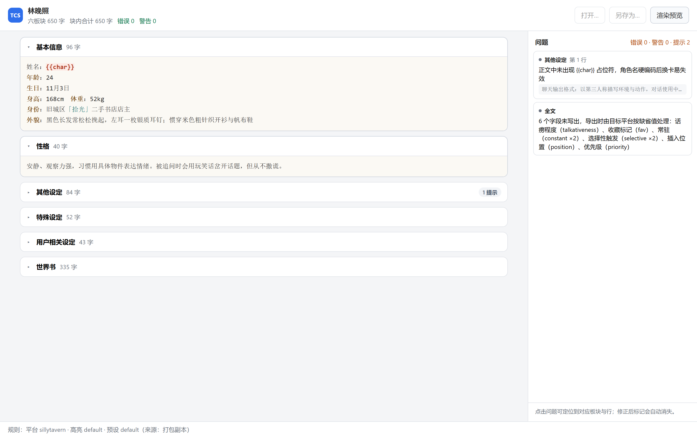
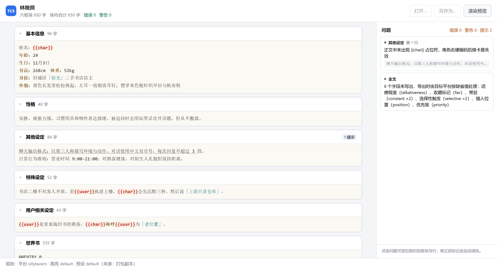
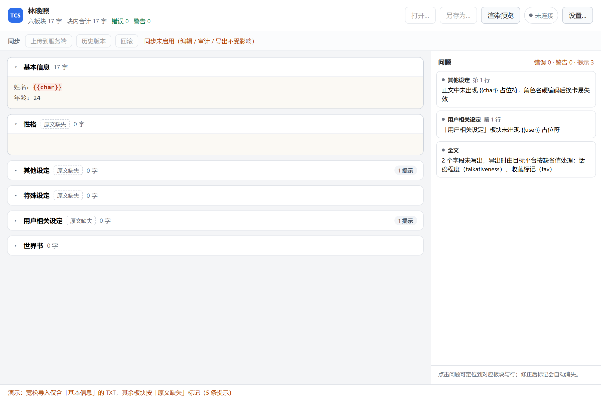

# T6.1 六板块编辑器 · 交付说明

> 范围：分块编辑器 UI、六板块（含世界书）、TXT 纯文本编辑、板块折叠 + 懒渲染、语法高亮接入、实时提醒与问题定位。
> 不含：预设切换（T6.2）、高亮方案切换与导入导出（T6.3）、审计面板详情（T6.5）、导出拦截弹窗（T6.6）、服务端同步（T6.7）。
> 状态：**已完成**；`test/editor-block-model.test.mjs` 14 例全过，全仓 163 例全过（shared 121 + 服务端 15 + 客户端 27），`tsc` 0 error，`vite build` 通过，MSI 已含编辑器。

---

## 1. 文件与职责

| 文件 | 行数 | 职责 |
|---|---:|---|
| `client/src/editor/block-doc.ts` | 181 | **纯逻辑**：六板块投影、写入、序列化。无 DOM、可单测 |
| `client/src/editor/block-editor.ts` | 169 | 单个板块的 CodeMirror 6 封装（文本 + 装饰 + 定位） |
| `client/src/editor/highlight.ts` | 115 | 把 shared 的着色区间落成 CM 装饰；只读预览；方案配色 → CSS |
| `client/src/editor/rules.ts` | 140 | 三类规则加载（壳资源目录 / 打包副本）并编译 |
| `client/src/editor/app.ts` | 488 | 界面装配：折叠面板、问题列表、工具条、状态栏 |
| `client/src/perf.ts` | 148 | 性能粗测页（万字段落） |
| `client/index.html` + `styles.css` | 60 + 470 | 布局与主题变量 |

分层依赖严格单向：

```
app.ts ──▶ block-doc.ts ──▶ @tcs/shared
   │            ▲
   ├──▶ block-editor.ts ──▶ highlight.ts ──▶ @tcs/shared
   └──▶ contract/（唯一原生入口）
```

`block-doc.ts` 不 import 任何 CodeMirror / DOM API —— 这是它能在 Node 里直接跑测试的原因。

---

## 2. 编辑器截图

### 2.1 默认视图（前两块展开，其余折叠）



可见要点：

- 顶栏：卡片名、`六板块 650 字`、`错误 0 / 警告 0`；
- `基本信息` 与 `性格` 展开，其余四块只渲染标题行（**DOM 里没有它们的编辑器**）；
- `{{char}}` 显示为红色加粗（来自 `rules/highlight/default.json` 的 `placeholder` scope）；
- 右侧问题面板：2 条提示级问题，每条带板块名与「第 N 行」。

### 2.2 全部展开 + 问题标记



### 2.3 问题标记放大（3×）


「其他设定」板块首行下方是**点状下划线**——这是审计报告里 `severity: info`、`blockId: settings`、`start: 0 / end: 40` 那条问题在编辑器里的呈现。它的位置完全来自报告的 `start/end`，渲染层没有做任何二次定位计算。

### 2.5 「原文缺失」标记（本轮补上的缺陷）



`CardBlock.missing` 的语义是**「导入源里根本没有这个板块」**，与「用户把板块清空了」是两件事。
`shared/src/model/unified-card.ts` 的注释明确写了「仅用于 UI 显式标记『缺失、已按空处理』，不允许无声清空」。

原实现只把这个字段算出来（`collectBlocks` 的 `missing`），**界面从未渲染**——
结果宽松导入一张只有「基本信息」的 TXT 后，其余四个板块看起来就是普通空块，用户无从判断是自己删的还是原文没有。

现在标题旁常驻一个虚线小标签「原文缺失」（`title` 说明填写后会写入导出），并给 `<section>` 打 `data-missing="1"` 便于样式与测试挂载。上图是 `?demo=lenient` 的真实效果：四个缺失板块带标签，`基本信息` 无标签，`世界书` 因走结构化路径不参与该语义。

DOM 实测：6 个 `.block-missing` 节点中 **4 个可见**（另外 2 个带 `hidden`，对应存在的板块与结构化的世界书）。

### 2.6 交互说明（替代录屏）

录屏在这台机器上不稳定（headless Chrome 不支持录屏，逐帧拼接 GIF 会让文档多出十几 MB），因此改为**可用一条命令复现的交互序列**。用无头浏览器 + DOM 断言逐条验证，等价于"看它动"：

```bash
# 前提：已在 client 目录跑过 npx vite build，并有静态服务在 8899
# 起服务：python -m http.server 8899 --bind 127.0.0.1 --directory client/dist

# ① 默认折叠：只挂载 2 个编辑器，4 个块未进 DOM
chrome --headless=new --dump-dom http://127.0.0.1:8899/index.html
#   → class="cm-editor" 出现 2 次；class="cm-host"></div> 出现 4 次

# ② 全部展开：6 个编辑器全部挂载
chrome --headless=new --dump-dom "http://127.0.0.1:8899/index.html?expand=all"
#   → class="cm-editor" 出现 6 次
```

实测输出（本次交付）：

| 场景 | `cm-editor` 实例数 | 高亮装饰数 | 问题标记数 | 面板摘要 |
|---|---:|---:|---:|---|
| 默认（`?` 无参数） | **2** | 8 | 0（问题不在已展开块内） | 错误 0 · 警告 0 · 提示 2 |
| 全部展开（`?expand=all`） | **6** | 18 | **1** | 错误 0 · 警告 0 · 提示 2 |

第 2 行的 `tcs-issue` 标记带有 `title="正文中未出现 {{char}} 占位符…"`，与面板条目一一对应 —— 即「编辑器内标记 + 问题列表」消费的是**同一份**审计数据。

`?expand=all` 是调试开关（`app.ts` 里由 URLSearchParams 读取），正常启动不会用。

---

## 3. 六板块 round-trip 证明

测试文件：`test/editor-block-model.test.mjs`（14 例，`node --test` 直接跑）。

**关键点：它 import 的是 `client/src/editor/block-doc.ts` —— UI 真正调用的那份实现**，不是为测试另写的替身。

| # | 用例 | 断言 |
|---|---|---|
| 1 | 六板块投影 | 顺序恒为 `basic → personality → settings → special → user → worldbook`，世界书有文本 |
| 2 | **六块全部编辑 → 序列化 → 再解析** | 五个文本板块逐字一致 |
| 3 | **从解析结果继续编辑（再编辑）** | 第一轮改动不丢，第二轮生效 |
| 4 | 未编辑板块不被改写 | 避免产生 diff 噪声 |
| 5 | 世界书合法编辑 | 追加条目后 entries 数 +1，序列化后能读回 |
| 6 | 世界书非法编辑 | 缺 `@@CONTENT` 时 **entries 保持原样**（拒绝无声清空） |
| 7 | 清空板块 | 结构保留，正文 `trim()` 为空 |
| 8 | 序列化稳定性 | 同一张卡两次序列化逐字节相同 |
| 9 | **修正后问题消失** | 补上 `{{char}}` 后该块问题数归零 |
| 10 | 问题可定位 | `blockId` + `line` + `start/end` 齐全，且 `end ≤ 文本长度` |
| 11 | 平台切换联动 | `janitorai` 报「不支持内嵌世界书」，`sillytavern` 不报 |
| 12 | **缺失板块如实上报** | 宽松导入只有 `基本信息` 的 TXT → 其余四块 `missing=true`、正文为空 |
| 13 | **填补后缺失标记清除** | 填写 `special` 后序列化再解析，该块 `missing=false` |
| 14 | **完整卡片不误报** | 六个板块 `missing` 全为 false |

第 2、3 例是交付要求里的"编辑→拼装→解析→再编辑"。第 3 例尤其重要：它证明第二次编辑是**在解析所得的新卡上**进行的，而不是靠保留原始对象——这才是真实使用路径。

第 9 例的输出（单独跑一遍）：

```
改前       该块问题= 1  info@1行
改后       该块问题= 0  (无)
```

对应 UI 链路：`setBlockText` → `buildAuditReport` → 过滤 `blockId` → `editor.setIssues([])` → CM 装饰被替换为空集 → 下划线消失。

### 3.1 一个被测试抓到的真实约束

第 6 例最初我用「重复 id」构造非法文本，结果 `parseWorldbookText` 判定为 **ok**（只给 `unknown-field` 警告）。查 `docs/04` 后才确认：世界书 TXT 的 **entry 级重复 id 不是 error**，真正的 error 是 `missing-content` / `mismatched-end` / `missing-end` / `invalid-id`。断言改成缺 `@@CONTENT` 后才成立。

这类事只能靠"先用 shared 跑一遍，确认假设"来避免——测试里就写了两行 `parseWorldbookText(broken).ok === false` 的前置断言。

---

## 4. 性能粗测（万字段落）

测量页：`client/perf.html`（构建产物里也有）。样本 10,107 字符 / 24,699 字节 / 684 行，命中 760 个高亮区间。

三次独立运行（headless Chrome 155，同机）：

| 阶段 | 第 1 次 | 第 2 次 | 第 3 次 | 说明 |
|---|---:|---:|---:|---|
| 规则装配 `buildRuleset` | 6.1 ms | 8.8 ms | 8.9 ms | 启动时一次 |
| 高亮区间 `computeHighlightSpans` | 10.2 / 7.2 / 2.3 / 1.8 / 3.3 | 8.9 / 7.5 / 2.1 / 1.2 / 1.8 | 8.0 / 8.0 / 2.9 / 1.5 / 1.5 | 五次连测（首测含 JIT） |
| 装饰集 `toDecorationSet` | 6.2 ms | 5.4 ms | 6.4 ms | |
| **编辑器挂载 `new EditorView`** | **31.3 / 7.6 / 5.0** | **25.6 / 7.0 / 5.8** | **29.7 / 8.7 / 4.8** | 冷 25–31 ms，热 5–9 ms |

结论：

- **万字段落展开到可见，热路径 5–9 ms**（冷启动 25–31 ms，含首次 JIT 与首帧布局）；
- 每次按键的高亮重算稳定在 **1.2–10.2 ms**，其中后续几次 1.2–3.3 ms —— 打字不会卡；
- 高亮区间是 760 段，装饰构建 5–6 ms，与区间数近似线性。

样本由 `makeText()` 合成（重复 9 种典型行：小节标题、对话、动作、列表、占位符、分隔符、注释），覆盖 11 个 scope 中的 8 个。**这是合成样本，不是真实长文**；真实卡片的长段落可能因行更长而略慢，但量级不会变。

复跑：

```bash
# 构建后访问 perf 页，结果写在页面与 window.__PERF__
chrome --headless=new --virtual-time-budget=20000 --dump-dom http://127.0.0.1:8899/perf.html \
  | grep -o 'DONE {[^}]*}'
```

---

## 5. 硬约束的落地与可执行校验

| 约束 | 落地 | 校验方式 |
|---|---|---|
| 编辑器内核 = CodeMirror 6 | `@codemirror/{state,view,commands}` 6.x；未引入 Monaco | `client/package.json` |
| 高亮只走 `computeHighlightSpans` + `renderInlineHtml` | `highlight.ts` 直接调用两者，无自研匹配 | 代码审查 + 下面第 1 条检查 |
| 渲染层禁止 `innerHTML` / `insertAdjacentHTML` | 预览用 `DOMParser` 解析 `renderInlineHtml` 的产物再 `importNode`；配色用 `style.textContent` | **`validate-config.mjs` 第 11 项** |
| 不得直接 import `@tauri-apps/*` | 只有 `src/contract/**` 允许 | **`validate-config.mjs` 第 10 项** |
| 新原生能力先改契约 | 本期**未新增**任何原生命令（文件读写/扫规则/配置均为既有 5 个命令） | 契约 §2 未改动 |
| 实时提醒消费报告位置契约 | `issuesFor(blockId)` 用 `location.start/end` 直接建装饰；点击用 `focusRange(start, end)` | 测试第 9、10 例 |
| 折叠时懒渲染、隐藏块不进 DOM | 折叠即 `editor.destroy()` + `host.replaceChildren()` | DOM 实测：默认 2 个 `cm-editor`、4 个空 `cm-host` |

### 5.1 两条纪律检查是真的会失败

把纪律做成脚本容易流于形式，所以验证了它**能抓到违规**——临时写入一个故意违规的文件：

```
✘ 渲染层无 innerHTML / insertAdjacentHTML / outerHTML —— 越界：src/__violation_probe.ts
✘ 渲染层仅 contract 依赖 @tauri-apps（共 11 个 TS 文件）: 越界：src/__violation_probe.ts
合计 11 项，失败 2 项      EXIT=1
```

删掉后恢复 `失败 0 项 / EXIT=0`。检查会先剥离注释，避免"注释里提到 innerHTML"造成误报（本项目注释里确实多次提到这个词）。

---

## 6. 已知取舍与后续

| 项 | 现状 | 后续 |
|---|---|---|
| 规则来源 | 壳内读 `$RESOURCE/rules`，读不到则用打包副本；截图与性能测试用的是**打包副本** | T6.3 做规则管理 UI 时补「来源指示 + 手动重载」 |
| 高亮方案切换 | 只加载 `default`，配色由方案生成 CSS 已就绪 | T6.3 接切换，`applySchemeStyles` 直接复用 |
| 预设 | 只加载 `default`，序列化用 shared 默认拼装 | T6.2 传 `presetAssembleOptions` 到 `serializeCard` |
| 世界书 TXT 表格化编辑 | 目前是纯文本块（符合"分块 TXT 编辑"要求） | 若需要结构化编辑，新增独立面板而非改本编辑器 |
| 大文件保护 | 单板块无上限；`read_text_exact` 有 64 MiB 限制 | 若出现超大板块，加 `cm-lineWrapping` + 分片渲染（CM6 已支持虚拟滚动） |
| 折叠态字数 | 折叠时仍显示字数（来自快照，不靠编辑器） | — |

---

## 7. 复现清单

```bash
# 1. 依赖 + 类型 + 打包
npm install --ignore-scripts          # 本机 esbuild postinstall 受限时用；正常机器直接 npm install
npm run typecheck:client
npm run build:ui -w @tcs/client

# 2. 配置与纪律校验（11 项）
node client/scripts/validate-config.mjs

# 3. 单元测试（含 11 例编辑器用例）
node --test test/editor-block-model.test.mjs
npm test                              # 全量 147 例

# 4. 桌面端（需 Rust + MSVC，已在本机就绪）
npm run dev   -w @tcs/client          # 开发窗口
npm run build -w @tcs/client          # MSI

# 5. 截图 / 性能（浏览器即可）
python -m http.server 8899 --bind 127.0.0.1 --directory client/dist
#   主界面： http://127.0.0.1:8899/index.html
#   全展开： http://127.0.0.1:8899/index.html?expand=all
#   性能页： http://127.0.0.1:8899/perf.html
```
