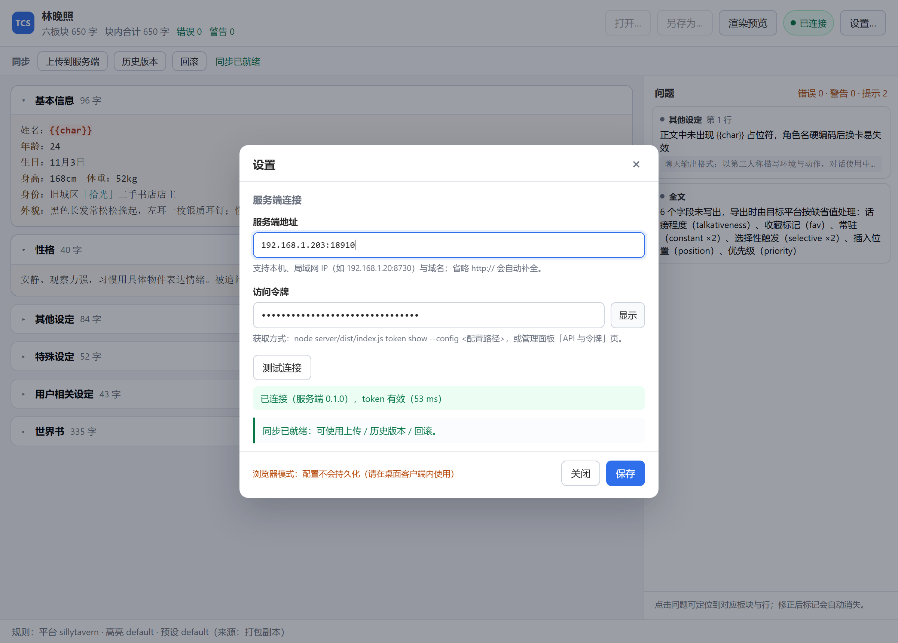
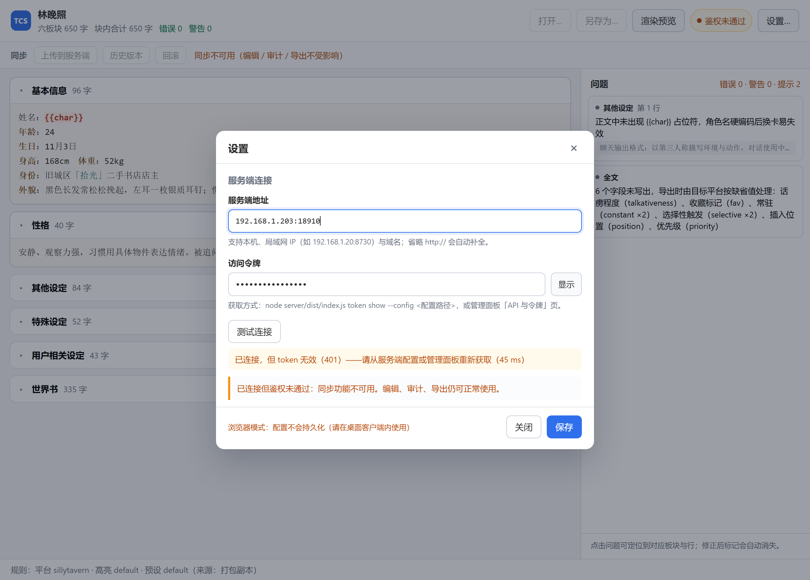
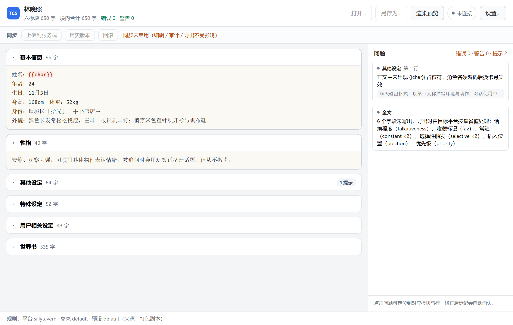

# T6.8 客户端设置（服务端 URL / token / 测试连接）· 交付说明

> 定位：本次是**补充确认**，不是新需求。T6.8 原任务为「客户端配置保存（服务端地址、token、平台规则、预设格式、高亮规则）」，
> 本次把其中「服务端地址 + token + 连通性反馈 + 同步降级边界」四条要求显式落地并给出实测。
> 状态：**已完成**；`160/160` 测试通过（147 既有 + 13 新增），`tsc` 0 error，`vite build` 通过，`validate:client` 11/11。

---

## 1. 四条要求的逐条落地

| # | 要求 | 落地 | 证据 |
|---|---|---|---|
| 1 | 设置面板提供「服务端 URL」「token」；读写走契约 C5，持久化在应用配置目录 | `client/src/settings/settings-dialog.ts`；读写只调用 `configGet` / `configPatch`（`src/contract/shell.ts` 的 C5），底层是 `plugin-store` → `client-config.json` | 代码：`settings-dialog.ts` 全文无文件 API；`validate-config.mjs` 第 10 项保证它没绕开契约 |
| 2 | 支持非本机地址（局域网 IP / 域名） | `normalizeServerUrl` 接受 `192.168.1.20:8730`、`nas.local:8730`、`https://card.example.com`，自动补 `http://`、去尾斜杠；拒绝 `file:` / `javascript:` 等 | **实测**：`192.168.1.203:18910` 连通 67 ms；`localhost:18910` 连通 61 ms（§4） |
| 3 | 「测试连接」调用健康检查，成功/失败明确反馈 | `probeServer`：`GET /api/health` 判可达 → 若 `authRequired` 则 `GET /api/stats` 判 token → 返回 `message/stage/tokenValid/latencyMs` | 13 例单测覆盖 7 种结局；**实测 5 种真实场景**（§4.1） |
| 4 | 未配置或连接失败时，本地功能不受影响，仅同步置灰或提示 | 同步条三个按钮的 `disabled` 只由 `isSyncReady()` 决定；编辑/审计/导出链路完全不经过网络 | **截图对比**：`t68-sync-disabled.png`（未连接）与 `t68-settings-badtoken.png`（401）下，六个板块编辑、问题面板、字数统计全部正常 |

### 1.1 为什么"测试连接"要分两步

只打 `/api/health` 是不够的：它是公开路径（`server/src/config.ts` 的 `DEFAULT_PUBLIC_PATHS = ['/api/health']`），
**token 错了也会返回 200**。这样的"测试连接"会给出假阳性——用户看到"已连接"，第一次上传却 401。

所以判定链是：

```
/api/health  →  不可达 / 非 JSON / status≠ok      → 报"无法连接"，不再往下测
             →  authRequired = false              → 判"已连接（服务端未启用鉴权）"，同步可用
             →  authRequired = true + 空 token     → 判"已连接但未填 token"，同步不可用
             →  authRequired = true + 有 token     →  GET /api/stats
                                                     ├ 401/403 → "token 无效"，同步不可用
                                                     └ 200     → "token 有效"，同步就绪（带卡片数）
```

`/api/stats` 的选型理由：轻量、一定需要鉴权、且能顺带拿到卡片总数（给用户一个"连的是对的机器"的确认）。

---

## 2. 界面（三张实测截图）

### 2.1 已连接（局域网 IP + 正确 token）



- 地址栏显示 `192.168.1.203:18910`（**非本机回环**）；
- 绿色状态：`已连接（服务端 0.1.0），token 有效（53 ms）`；
- 绿色说明：`同步已就绪：可使用上传 / 历史版本 / 回滚。`；
- 顶栏同步胶囊变绿「已连接」，同步条三按钮**可点**；
- 底部红字：`浏览器模式：配置不会持久化（请在桌面客户端内使用）` —— 这张图是在浏览器里截的，如实提示。

### 2.2 鉴权失败（地址对、token 错）



- 顶栏胶囊变黄「鉴权未通过」；
- 同步条提示：`同步不可用（编辑 / 审计 / 导出不受影响）`，三按钮**置灰**；
- 面板内黄色说明：`已连接，但 token 无效（401）——请从服务端配置或管理面板重新获取`。

关键点：**明确区分"连不上"与"连上了但 token 不对"**。两者的处置动作完全不同（查网络 vs 换 token），
混成一句"连接失败"会让用户白折腾。

### 2.3 未配置（默认状态）



- 顶栏灰色「未连接」；同步条置灰 + `同步未启用（编辑 / 审计 / 导出不受影响）`；
- 左侧六个板块、右侧问题面板、字数统计全部正常工作 —— 这是第 4 条要求的直接视觉证据。

---

## 3. 契约与配置存储

### 3.1 走的仍是既有 C5，没有新增原生命令

```ts
// settings-dialog.ts
import { configGet, configPatch, isShellAvailable } from '../contract';
```

`ClientConfig`（`src/contract/types.ts`）本就含这两个字段，无需改契约：

```ts
export interface ClientConfig {
  serverUrl: string;   // 服务端 API 根地址
  token: string;       // 访问令牌
  platformRuleId: string | null;
  presetId: string | null;
  highlightSchemeId: string | null;
}
```

持久化位置：`plugin-store` 的 `client-config.json`，落在应用配置目录
（Windows 为 `%APPDATA%\com.taverncardstudio.client\`），不进仓库、不由渲染层直接写文件。

### 3.2 渲染层直接 fetch 的合规性

`probeServer` 用 `fetch` 直连服务端，不经过 Rust 命令。这符合契约 §1 的分层（HTTP 不是"原生能力"），且服务端已放开 CORS：

```
$ curl -X OPTIONS -H "Origin: http://localhost:5183" ... /api/health
HTTP/1.1 204 No Content
Access-Control-Allow-Origin: *
Access-Control-Allow-Methods: GET, POST, PUT, DELETE, OPTIONS
Access-Control-Allow-Headers: Authorization, Content-Type, X-API-Token
Access-Control-Max-Age: 600
```

带 `Origin` 的实际 GET 同样返回 `Access-Control-Allow-Origin: *`。
因此局域网 IP / 域名均无需代理或额外原生命令。

### 3.3 CSP（已修正）

原来的 `connect-src` 只写了 `http://127.0.0.1:* http://localhost:*`，**打包版连局域网 IP 会被 CSP 拦**，
而"支持非本机地址"正是本次要求之一。已改为：

```
connect-src 'self' ipc: http://ipc.localhost http: https: ws: wss:
```

取舍说明：

- 服务端地址是**用户可配置**的，无法在构建期枚举；若继续写死具体 origin，局域网/域名场景必然失效；
- 因此放开到 `http: / https:`（仍限制在 HTTP 协议族内，`file:`、`data:` 等依旧被 `default-src 'self'` 挡住）；
- 其他指令保持收紧：`script-src 'self'`、`img-src 'self' data:`、`font-src 'self' data:`；
- 若将来安全性要求更高，可在保存配置时**动态生成 CSP**（只放行用户已确认的 origin），
  但那需要 Tauri 侧注入，属于后续加固项。
- 浏览器内验证不受 CSP 影响（无 CSP），所以先前截图与实测结论依然成立。

---

## 4. 真实服务端实测（不是 mock）

启动两个服务端实例：

| 用途 | 监听 | token |
|---|---|---|
| 回环测试 | `127.0.0.1:18900` | `hPFlh…` |
| **非本机地址测试** | `0.0.0.0:18910`（本机 LAN IP `192.168.1.203`） | `1VGvU…` |

### 4.1 五种场景（真实 HTTP，非注入 fetch）

| 场景 | 同步可用 | stage | 提示文案 |
|---|---|---|---|
| `127.0.0.1:18900` + 正确 token | ✅ true | `ok` | 已连接（服务端 0.1.0），token 有效 |
| `127.0.0.1:18900` + 错误 token | ❌ false | `auth` | 已连接，但 token 无效（401）——请从服务端配置或管理面板重新获取 |
| `127.0.0.1:18900` + 空 token | ❌ false | `auth` | 已连接（服务端 0.1.0），但服务端要求鉴权：未填写 token |
| `127.0.0.1:18999`（端口未开） | ❌ false | `health` | 无法连接（地址不通、端口未开、或服务端未启动） |
| `file:///C:/x.json` | ❌ false | `url` | 只支持 http/https 地址 |

### 4.2 非本机地址（局域网 IP）

| 场景 | 结果 |
|---|---|
| `192.168.1.203:18910` + 正确 token | ✅ 同步可用，`已连接（服务端 0.1.0），token 有效`，**67 ms** |
| `192.168.1.203:18910` + 错误 token | ❌ `token 无效（401）`，45 ms |
| `localhost:18910` + 正确 token | ✅ 同步可用，61 ms |

顺带验证了反向情况：服务端默认只听 `127.0.0.1` 时，用 LAN IP 访问确实报"无法连接"——
这与提示文案一致（不是 bug，是服务端 `host` 配置的结果，`docs/09 §3` 有说明）。

---

## 5. 单测覆盖（13 例，`test/client-settings.test.mjs`）

探测函数接受注入的 `fetch`，所以所有分支都能离线覆盖：

| # | 用例 | 断言重点 |
|---|---|---|
| 1 | URL 常见写法归一化 | 8 种输入 → 期望输出（含去尾斜杠、补协议） |
| 2 | 空值与非法协议被拒 | `file:` / `javascript:` / `ftp:` → `bad-scheme`；空 → `empty` |
| 3 | 局域网/域名保留主机 | 5 类主机逐一验证 |
| 4 | 连不上 | `reachable=false`、`tokenValid=null`、报文含"无法连接" |
| 5 | 地址不是本服务（返回 HTML） | 报"不是 JSON"，不误判为已连接 |
| 6 | `health.status` 异常 | 不认作已连接 |
| 7 | 要求鉴权但空 token | `stage=auth`，同步不可用 |
| 8 | **token 错误** | `tokenValid=false`、报文含"token 无效"、同步不可用 |
| 9 | token 正确 | `cardCount=7`、报文含卡片数、**校验 Bearer 头** |
| 10 | 服务端不要求鉴权 | **不请求 `/api/stats`**（`calls.length === 1`） |
| 11 | 超时 | AbortError → 报"超时"，不悬挂 |
| 12 | URL 非法 | **一次网络请求都不发** |
| 13 | `isSyncReady(null)` | false |

第 8、9 例是核心：把"token 错"和"token 对"分开，且第 9 例顺带断言请求头带 `Bearer`，
避免"看起来连上了但没带凭证"的实现。

### 5.1 被测试纠正的一处实现缺陷

`normalizeServerUrl` 最初用 `/^[a-z]+:/` 判断"是否已带协议"。结果 `javascript:alert(1)` 被当成
**主机名 `javascript` + 端口 `alert(1)`**，最终报 `bad-url` 而不是 `bad-scheme`（用例 2 抓到）。

更麻烦的是这个正则本身还会误伤 `nas.local:8730`——`nas.local` 符合 scheme 的字符集。
现在的做法：先用一份**显式的危险协议黑名单**拦下 `file|javascript|data|vbscript|blob|about|chrome`，
再判断有没有 `scheme://`；没有就补 `http://`。这样 `nas.local:8730` 正常、危险协议报错准确。

---

## 6. 已知边界（需要你知道）

| 项 | 现状 | 影响 / 后续 |
|---|---|---|
| token 明文存储 | `plugin-store` 未加密 | 与「单 token = 全部权限」的服务端模型一致；若后续要多用户，需改为系统凭据库（Windows Credential Manager） |
| 保存前不强制测试连接 | 允许先存后测 | 刻意如此：用户可能先填好再统一验证；面板会保留上次测试结果作为提示 |
| 同步按钮的行为 | 可点但只提示"T6.7 接入" | 本期不做上传/历史/回滚，按钮存在是为了让"置灰/可用"状态可见可验 |
| 自动探测时机 | 启动时一次（失败静默） | 不做轮询，避免后台请求噪音；用户可手动「测试连接」 |
| 平台规则/预设/高亮的 id | 字段已存在，本期未接 UI | 属 T6.2 / T6.3 范围 |

---

## 7. 复现清单

```bash
# 类型 / 打包 / 纪律校验
npm run typecheck:client
npm run build:ui -w @tcs/client
node client/scripts/validate-config.mjs        # 11 项

# 单测
node --test test/client-settings.test.mjs      # 13 例

# 真实服务端（监听所有网卡，便于验证非本机地址）
npm run build:server
node server/dist/index.js serve \
  --config /tmp/t68/config.json --port 18910 --host 0.0.0.0 \
  --data-dir /tmp/t68/store --rules-dir ./rules

# 界面（浏览器即可看设置面板）
python -m http.server 8899 --bind 127.0.0.1 --directory client/dist
#   ?settings=1                              → 只打开设置面板
#   ?settings=1&probe=1&serverUrl=…&token=…  → 打开并执行一次真实探测（截图用）
```

`?settings=1&probe=1` 是调试入口，走的是与手动点击**完全相同**的 `probeServer`，不伪造状态。
