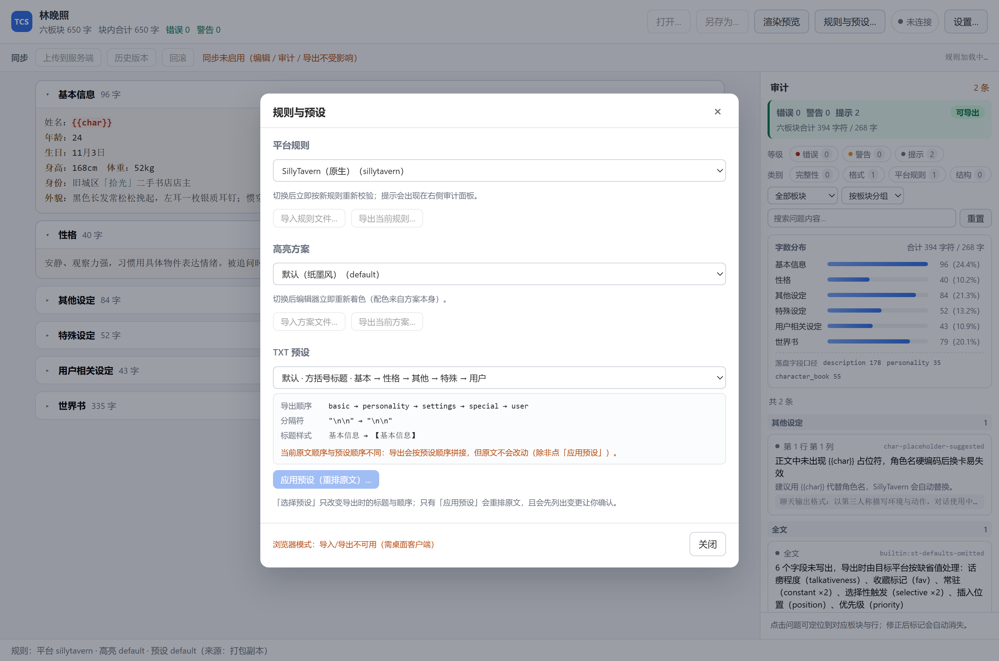
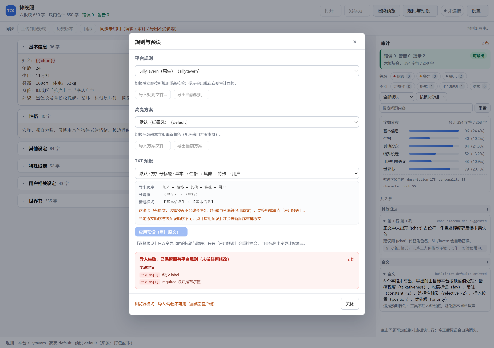

# T6.2 预设格式切换 + T6.3 规则/高亮管理 · 交付说明

> 状态：**已完成**；`test/preset-rules.test.mjs` 25 例全过，`tsc` 0 error，`validate:client` 12/12。
> 交付物：规则面板（截图 3 张）、导入原子回退证明、切换前后对比、validate 全绿记录。

---

## 1. 一个必须先讲清的语义（本轮最重要的发现）

我最初以为"选择预设"会改变导出格式。**实测下来，对已有原文的卡片，它几乎什么都不改。**

| 卡片状态 | 「选择预设」是否影响导出 | 实测 |
|---|---|---|
| **无原文**（新建卡） | **会** —— 装配参数决定标题与顺序 | default → `【基本信息】`；markdown → `## 基本信息` |
| **已有原文** | **不会** —— 标题行与分隔符沿用原文 | default / divider / markdown 三种装配参数导出**逐字节相同** |

原因在 `serializeStCard`：已有 `description.raw` 时，它只替换 **dirty 板块的正文**，
标题行与分隔符一律保留原文。所以"选了 markdown 就导出 markdown"是错的——
**只有「应用预设」会重排原文**。

面板里现在如实说明这一点（截图 2 的黄色提示）：

> 这张卡已有原文：选择预设不会改变导出（标题与分隔符沿用原文），要换格式请点「应用预设」。

这条已固化为两个测试（`语义：已有原文时…` / `语义：空卡时…`），防止以后又被误解。

---

## 2. 截图验收

### 2.1 规则与预设面板



三个分区，每个都能看到「影响说明 + 当前值 + 操作按钮」：

- **平台规则**：`切换后立即按新规则重新校验；提示会出现在右侧审计面板`
- **高亮方案**：`切换后编辑器立即重新着色（配色来自方案本身）`
- **TXT 预设**：预览区列出导出顺序、分隔符、标题样式，并说明选择 vs 应用的差别

> 截图里的"浏览器模式：导入/导出不可用"是真实提示：浏览器没有文件对话框，
> 这两条路径只在桌面客户端可用（契约层 `pickRuleFile` 依赖 Tauri）。

### 2.2 切换预设：选择 vs 应用（编辑区对比）

**只选择 divider（原文不动）** — `assets/t62-before.png`

- 编辑区：板块标题仍是 `【基本信息】`，块间无 `---`
- 右下角提示：`导出格式已切换为「分隔线·方括号标题」：原文未改动（要重排请点「应用预设」）`
- 审计：出现「板块间分隔符与预设不一致」警告 —— **这是正确的**，因为当前原文确实还是 default 格式

**应用 divider（原文重排）** — `assets/t62-after-apply.png`

- 预设下拉已同步为 `分隔线·方括号标题`（此前有 bug，见 §6.1）
- 审计从 3 条降到 2 条：分隔符一致性警告消失
- 状态栏：`已应用预设「分隔线·方括号标题」：分隔符… · 已按新格式重检`

### 2.3 导入坏规则：失败 + 原子回退



- 红色标题：**`导入失败，已保留原有平台规则（未做任何修改）`**
- 错误带字段位置，按组归并：
  - `字段定义` 组 → `fields[0]` `缺少 label`；`fields[1]` `required 必须是布尔值`
- 右上角规则标签仍是 `平台 sillytavern` —— **原规则未被污染**

---

## 3. 导入坏文件的原子回退证明

代码里不是"失败后手动回滚"，而是**失败分支根本不返回新值**：

```ts
// rule-library.ts
if (!result.rule) {
  return { ok: false, value: [...current], issues: ... };  // 原样返回
}
```

5 种坏输入 + 1 种坏正则的实测（`.verify/atomic-proof.mjs`，已清理）：

```
=== 平台规则：5 种坏输入 ===
空字符串            ok=false 原列表未变=true  错误数=1
截断 JSON          ok=false 原列表未变=true  错误数=1
非对象             ok=false 原列表未变=true  错误数=1
缺 schemaVersion   ok=false 原列表未变=true  错误数=6
id 非法            ok=false 原列表未变=true  错误数=1

=== 高亮方案：坏正则必须被拒 ===
坏正则 ok=false  原方案未变=true  compiled=null OK
  错误: rules[0].match: 正则无法编译 — Unterminated character class
```

两处设计要点：

1. **高亮方案多一道"必须能编译"**。只过 schema 但正则编不过的方案，
   导入后会让整个编辑器高亮失效 —— 所以编译失败也算导入失败。
2. **平台规则验证继承链**。`extends` 指向不存在的父规则时，若放行，会在**切换时**才炸；
   这里用「现有 + 新规则」试 resolve 一次，当场拒绝。

---

## 4. 切换即重检（阶段 3 语义）

DOM 实测两条命令的差异：

| URL | 规则标签 | 审计结论 |
|---|---|---|
| `?platform=sillytavern` | `平台 sillytavern · …` | 2 条（错误 0 警告 0 提示 2） |
| `?platform=janitorai` | `平台 janitorai · …` | **3 条（错误 0 警告 1 提示 2）** |

多出来的那条是 janitorai 的「不支持内嵌世界书」。切换后**同步**重新校验（不走 260ms 防抖），
状态栏直接给一句 `已切换到「JanitorAI」：错误 0 · 警告 1 · 提示 2`。

**预设切换也重检**（本轮补的）：预设参与格式检查（分隔符一致性），
不重检会让面板停在旧口径上，与实际导出格式不符。

---

## 5. 自定义规则的错误分级与位置

复用了既有错误形态，未新建体系：

| 规则类型 | 错误来源 | 位置形态 | 示例 |
|---|---|---|---|
| 平台规则 | `parsePlatformRule` | `where: message` | `fields[0].path: 缺少 path` |
| 高亮方案 | `parseHighlightRule` | 同上 | `rules[0].match: 正则无法编译 — …` |
| 继承 | `resolvePlatformRule` | 本次新增包装 | `extends: 继承链无法解析：平台规则 "x" 不存在` |
| JSON | `JSON.parse` | 文件级 | `JSON 解析失败：Unexpected end of JSON input` |

`splitRuleError()` 把 `where` 拆成 `{ where, message, group, index }`，
UI 按 `group` 归并成「字段定义 / 内容规则 / 继承 / 文件级」，每条显示 `where` 徽标。

---

## 6. 本轮修掉的三个真 bug

截图验收逐张看过之后发现，DOM 断言全绿时它们都存在。

### 6.1 应用预设后，下拉仍停在旧预设

**后果比表面严重**：重排是按 divider 写的，但 `rules.preset` 还是 default，
于是"刚重排成 divider，导出却按 default 拼装"——两边不一致。

修法：抽出 `commitPresetApply(preset, plan)`，**先设当前预设再重排**，UI 回调与调试入口共用这一条路径。

### 6.2 预览里"原文标题"看不出去别

原来用 `anchor.headingText`，它只存标题内文（`基本信息`），不含装饰符；
于是"原文标题 `基本信息` → 预设标题 `【基本信息】`"看起来像是没变化。

改为取 `headingSpan` 的原文切片（`【基本信息】`），这才是用户实际看到的那一行。
已加隔离测试：`before` 必须不等于 `headingText`。

### 6.3 预览显示内部 id 与 JSON 转义串

`basic → personality → settings` 和 `"\n\n" → "\n\n---\n\n"` 都不是人话。
改为 `基本 → 性格 → 其他 → 特殊 → 用户` 与 `（空行） → ---`。

---

## 7. 单测覆盖（25 例）

| 组 | 数量 | 要点 |
|---|---:|---|
| 预设描述与选择 | 4 | 三套预设可读摘要；`selectPreset` 不改卡片 |
| 应用预设 | 4 | noop / confirm 判定；重排后可再解析且**幂等**；性格字段不动 |
| **语义（关键）** | 2 | 已有原文时选择预设**不改变导出**；空卡时**确实改变** |
| 预览可读性 | 3 | 原文标题含 `【】`、分隔符无转义串、顺序无内部 id |
| 错误解析 | 2 | 拆出 where/group/index；按组归并 |
| 平台规则导入 | 5 | 成功入库；坏 JSON/schema/断链**原子回退**；同 id 是替换 |
| 高亮导入 | 4 | 可编译才算成功；坏 JSON/schema/坏正则均回退 |
| 基线自检 | 1 | 真实规则文件全部仍能加载（防 fixture 漂移） |

---

## 8. validate 全绿记录

```
✔ tauri.conf.json 是合法 JSON
✔ tauri.conf.json 通过官方 schema 校验（2.12.4）
✔ capabilities 至少一份 —— default.json
✔ default.json 有 identifier / windows / permissions
✔ default.json 权限标识格式合法（7 项）
✔ default.json 未授予任意路径 fs 写/删权限
✔ bundle.icon 引用的 4 个图标都存在
✔ frontendDist 目录存在（../dist）
✔ bundle.resources 的 1 个源路径都存在
✔ 渲染层仅 contract 依赖 @tauri-apps（共 15 个 TS 文件）
✔ 渲染层无 innerHTML / insertAdjacentHTML / outerHTML
✔ README 决策表序号严格递增且无缺号 —— 共 22 条（#1–#22）

合计 12 项，失败 0 项
```

---

## 9. 已知边界

| 项 | 现状 | 说明 |
|---|---|---|
| 导入只走契约文件对话框 | 浏览器模式禁用（截图里可见） | 正常，桌面端可用 |
| 内置规则不可删除 | 只支持导入/覆盖/导出 | 删除属破坏性操作，需单独设计确认流程 |
| 平台规则导入不自动切换 | 导入成功后需手动切换到新 id | 刻意：避免误导入即生效 |
| 高亮导入会自动切换 | 导入成功即切到新方案 | 与平台规则不同：着色是"看得见"的，立刻生效便于确认 |
| 预设应用不可撤销 | 依赖"先另存" | 确认框已提示；完整撤销栈属 T6.6 之后 |
