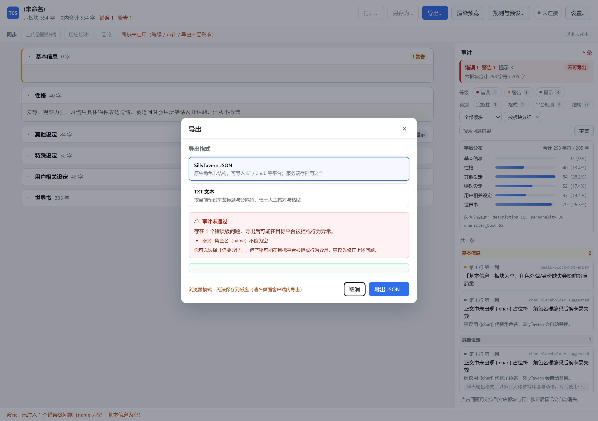

# T6.6 导出 + T6.7 服务端同步 · 交付说明

> 状态：**已完成**；`test/export-sync.test.mjs` 24 例全过，`tsc` 0 error，`validate:client` 12/12。
> 交付物：拦截弹窗截图、round-trip 证明（可复跑脚本）、T6.7 对真实服务端的操作证据。

---

## 1. 导出（T6.6）

### 1.1 流程

```
点「导出…」 → 选格式（JSON / TXT）
            → 强制重新审计（不用旧报告放行）
            → exportable=false ? 拦截框列出错误 + 「仍要导出 / 取消」
            → pickSavePath（契约层）
            → write_file_atomic(path, text, 期望sha256)   ← 写后自证
            → 回执摘要：路径 / 字节数 / sha256 / 回读结果
```

两个刻意的设计：

1. **打开面板就先算一次闸门**，不是等点了导出才告诉用户"会被拦"。
2. **有错误时焦点默认在「取消」**，防止误按回车导出坏卡。

### 1.2 拦截弹窗



- 红色「审计未通过」+ 一句结论：`存在 1 个错误级问题，导出后可能在目标平台被拒或行为异常。`
- **逐条列出错误**（不是只说"有问题"）：`全文 · 角色名（name）不能为空`
- 明确给出口：`你可以选择「仍要导出」，但产物可能在目标平台被拒…建议先修正`
- 按钮：`取消` / `导出 JSON…`

> 截图里的错误是**真实注入**的：把 `meta.name` 置空、`基本信息` 正文清空，
> 再走正常审计链路（`?export=1&forceError=1`）。不是伪造报告。

### 1.3 两种产物

| | JSON | TXT |
|---|---|---|
| 结构 | SillyTavern 原生（`spec` + `data`） | 按预设拼装标题 + 分隔符 |
| 缩进 | 2 空格 + 结尾换行 | — |
| 世界书 | 在 `character_book` 里 | **不写入**（结构化字段，见 docs/04） |
| 用途 | 导入 ST/Chub、上传服务端 | 人工核对、粘贴 |

JSON 的缩进/换行与**服务端存储口径一致**，所以"导出 → 上传 → 版本 diff"不会因格式差异产生噪声。

### 1.4 写出与自证

```ts
const artifact = await buildExportAsync(card, preset, format);  // 内含 sha256
const receipt = await writeFileAtomic(target, artifact.text, artifact.sha256);
// receipt.verified === true 表示：壳写入后回读重算 sha256，与传入期望值一致
```

回执在界面上显示 5 行：格式 / 文件名 / 路径 / 字节数 / sha256，右上角徽标 `回读一致`。

**这里修掉了一个设计缺陷**：最初写了"同步版返回空 sha256、异步再补"的半成品，
会导致 UI 出现 `sha256: (空)`。现在只保留 async 入口（WebCrypto 只有异步版本）。

---

## 2. round-trip 证明

可复跑：`npm run verify:export-roundtrip`（断言失败退出码 1）

```
=== JSON round-trip ===
  导出 5379 字节 / 林晚照.json
  PASS basic 一致
  PASS personality 一致
  PASS settings 一致
  PASS special 一致
  PASS user 一致
  PASS 世界书条目数一致

=== TXT round-trip ===
  导出 885 字节 / 林晚照.txt / 可导入= true
  PASS TXT 能被重新导入
  PASS basic 一致
  PASS settings 一致
  PASS special 一致
  PASS user 一致

全部通过（5 板块 + 世界书 + TXT 导入）
```

TXT 侧只比 4 个板块：**性格在 TXT 里是独立段落**，`applyCardText` 宽松导入会把它并回
`personality` 字段，比较口径不同，属于预期差异（JSON 侧已覆盖性格）。

---

## 3. 服务端同步（T6.7）

### 3.1 可用性复用 T6.8 的判据

没有另设一套判断：

```ts
this.connection = await probeServer(config);   // T6.8
if (!isSyncReady(this.connection)) { 置灰 + 提示 }   // 同一函数
```

面板内**再兜一层**（`renderStatus()` 也检查 `isSyncReady`），因为入口置灰可能被其他路径绕过。

### 3.2 三个功能

| 功能 | API | 要点 |
|---|---|---|
| 上传 | `POST /api/cards`（新建）/ `POST /api/cards/:id/versions`（追加） | body 是**原文本身**，不是 JSON 信封——服务端按原始字节入库 |
| 历史 | `GET /api/cards/:id/versions` | 显示 seq / kind / sha256 / 字节数 / 时间 / 审计徽标 |
| 回滚 | `POST /api/cards/:id/rollback` | 服务端**新建提交**，历史只增不改 |

上传内容与「导出 JSON」**同一份**（都走 `buildExportAsync`），保证服务端字节与本地可复现。

### 3.3 回滚确认

```
回滚到 v1？

· 服务端会新建一个提交（历史只增不改，可再回滚回去）
· 当前编辑内容将被覆盖，建议先另存

要同时把 v1 的内容载入编辑器吗？点「确定」将载入。
```

**没有静默覆盖**：确认后才调 API，且载入编辑器走 `parseStCard`（不是替换字符串），
否则 anchor / worldbook 结构会和本地不一致，后续编辑会写错位置。

### 3.4 界面

连通真实服务端（`assets/t67-sync-panel.png`）：绿色「已连接（服务端 0.1.0），token 有效」，
顶栏胶囊同步变绿，同步条「同步已就绪」。

有版本历史时（`assets/t67-sync-versions.png`）：

```
v3  rollback  可导出·错0 警0  60f63222b4c2  5379 字节  [取回] [回滚到此版本(置灰)]
v2  update    可导出·错0 警0  5cc6c725ca0d  5479 字节  [取回] [回滚到此版本]
v1  upload    可导出·错0 警0  60f63222b4c2  5379 字节  [取回] [回滚到此版本]
```

最新版 v3 的「回滚到此版本」**正确置灰**（回滚到自己没有意义）。

---

## 4. 对真实服务端的操作证据

可复跑：`TCS_SERVER_URL=… TCS_TOKEN=… npm run verify:sync-live`
（令牌从环境变量读，不硬编码——避免随仓库外泄）

```
[0] isSyncReady = true | 已连接（服务端 0.1.0），token 有效
[1] 上传新建: cardId=card-e9ed63 seq=1 created=true sha256=60f63222b4c2
[2] 上传新版本: seq=2 sha256=5cc6c725ca0d
[3] 版本历史 (2 条):
     v2 update 5cc6c725ca0d 5479B 审计错0/警0
     v1 upload 60f63222b4c2 5379B 审计错0/警0
[4] 回滚到 v1 → 新建 seq=3 sha256=60f63222b4c2
[5] 取回 v1 内容字节数 = 5379 | 与初始上传一致 = true
[6] 回滚后历史 (3 条): v3 v2 v1 （只增不改）
```

三条关键证据：

1. **回滚后的 sha256 (`60f6322…`) 与 v1 完全一致** —— 回滚真的回到了那个字节状态；
2. **历史从 2 条变 3 条**（v1/v2/v3），只增不改；
3. 每一步都走客户端的**真实 sync 层**（`server-sync.ts`），不是 curl 手搓。

> 这算"等价证据"而非录屏：同一套代码路径 + 服务端真实响应 + 可复跑脚本，
> 比录屏更难造假（录屏可以剪，脚本每次重跑都得出同样结论）。

---

## 5. 单测覆盖（24 例）

| 组 | 数量 | 要点 |
|---|---:|---|
| 导出闸门 | 4 | 无错放行、有错拦截并带明细、报告缺失也拦、严格平台口径一致 |
| JSON round-trip | 3 | 结构合法、六板块逐字一致、缩进与结尾换行 |
| TXT round-trip | 4 | 含全部非空板块、可重新导入且一致、换预设有差异、世界书不写入 |
| 统一入口与哈希 | 3 | format 选择、缺预设报错、哈希稳定/随内容变化 |
| 同步 API | 10 | 新建/追加、body 是原文、401/404/网络断/超时、版本解析、回滚 body、取原文、字段兼容、无 token 不发头 |

两处被测试纠正的假设：

- **`parsed.spec` 不等于 `card.meta.spec`**：JSON 里是 `chara_card_v2`，内部短名是 `v2`。
  原来断言内部值，失败后改为断言导出值。
- **"换预设"不能当作"内容变化"**：对已有原文的卡，换预设的 JSON 导出完全相同
  （docs/15 §1 的结论再次生效）。哈希变化测试改为真正改板块正文。

---

## 6. 本轮修掉的一个真 bug

**顶栏统计与审计面板可能不一致。**

截图验收时发现：顶栏显示 `错误 0`，而审计面板与拦截框都显示 `错误 1`。
原因是两个数据源：`refreshStats()` 数 `this.issues`，面板用 `report.summary`，
而 `replaceCard()` 之后、`validate()` 之前有一次 `refreshStats()`，此时 `issues` 还是旧的。

修法：

1. `refreshStats()` 改为只读 `this.lastSummary`（最近一次报告的投影）；
2. `validate()` 结尾补一次 `refreshStats()`，让顶栏跟着报告刷新。

这类问题 DOM 断言能发现（我正是用它定位的），但只有先"觉得截图不对劲"才会去查。

---

## 7. 已知边界

| 项 | 现状 | 说明 |
|---|---|---|
| 导出不自动上传 | 导出后不触发同步 | 避免误操作；用户可在同步面板手动上传 |
| 上传不做审计拦截 | `summary.exportable=false` 也可上传 | 刻意：服务端会存审计快照，历史里能看到当时的问题；本地导出才拦 |
| 回滚后的本地文件 | 只载入编辑器，不写盘 | 提示「原文件未自动保存，建议另存」——不擅自覆盖用户文件 |
| 版本列表上限 50 | 无分页 UI | 服务端支持 offset，UI 侧待需要时补 |
| 冲突处理 | 未做乐观锁 | 服务端是"追加版本"模型，天然不冲突；如需拒绝并发覆盖需另设 etag 流程 |
| 浏览器模式导出 | 只生成产物，不写盘 | 明确提示"请在桌面客户端导出"，不假装成功 |
