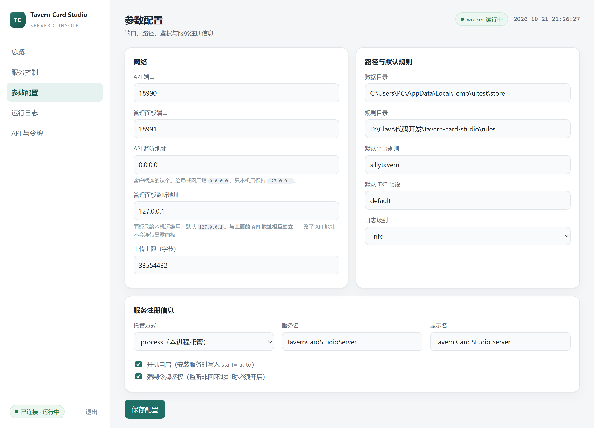

# 监听地址分离：API 与管理员面板（安全修复）

> 发现时间：2026-10-21 21:14
> 修复版本：服务端 `0.1.0`（源码 `server/src/config.ts` 新增 `controlHost`）
> 关联决策：[README 决策 #24](../README.md)
> 关联回归：`test/server-host-separation.test.mjs`（11 例）

## 1. 问题

参数配置页只有一个「监听地址」，它同时决定两个端口的绑定：

| 端口 | 用途 |
|---|---|
| `8730`（`port`） | API 数据面 worker |
| `8731`（`controlPort`） | 管理面板 / 控制面 supervisor |

于是「把 API 开给局域网」这一个动作，会**连带把管理面板也暴露出去**。

用户当时正要这么改，问了关键的一句：*「这个地方应该是只改 API 的 ip 地址而不是一起修改后台访问 IP」*。
核查后确认：**确实是一起改的，这是个真实缺陷。**

## 2. 实测证据（修复前）

以 `--host 0.0.0.0` 启动，从局域网 IP `192.168.1.203` 发起请求：

```
netstat:  0.0.0.0:18971  LISTENING     ← 面板也绑到了所有网卡（修复前行为）

无 token 的请求：
  GET http://192.168.1.203:18971/         → HTTP 200   ← 管理面板页面
  GET http://192.168.1.203:18971/app.js   → HTTP 200   ← 面板脚本
  GET http://192.168.1.203:18971/control/status → HTTP 401  ← 控制接口受保护
```

关键在第三行对比前两行：**token 挡住了真正的操作，但面板页面本身就是公开的**。
原因在 `PANEL_PUBLIC_PATHS`：

```js
const PANEL_PUBLIC_PATHS = ['/', '/index.html', '/app.js', '/styles.css',
                            '/favicon.ico', '/healthz', '/api/health'];
```

这些路径不经过 `TokenGate`（登录页需要能加载出来，否则无法输入 token）。
所以局域网内任何人都能看到：服务存在、版本、面板界面结构、字段名称。
虽然改不了东西，但「管理界面出现在局域网」这件事本身违背设计意图。

用户的原话总结得准确：

> 正常应该是回环地址用于访问后台，而 API 用于暴露在局域网或者公网。

## 3. 修复

新增 `controlHost`，与 `host` 彻底分离：

| 字段 | 绑定端口 | 默认值 | 说明 |
|---|---|---|---|
| `host` | `port`（8730，worker） | `127.0.0.1` | API，可开到 `0.0.0.0` 给局域网 |
| `controlHost` | `controlPort`（8731，supervisor） | `127.0.0.1` | 管理面板，只给本机 |

### 3.1 缺省值刻意不跟随 host

这是修复里最关键的一个决定。`normalizeConfig` 的兜底是：

```ts
controlHost: str(raw['controlHost'], base.controlHost),   // base.controlHost = '127.0.0.1'
```

**不是** `str(raw['controlHost'], str(raw['host'], ...))`。

原因：已有用户的配置文件里 `host` 可能早就是 `0.0.0.0`，而文件里没有 `controlHost` 这个键。
若兜底跟随 `host`，那么升级之后面板**仍然是暴露的** —— 修复等于没做。
现在的行为是：升级后面板自动落回 `127.0.0.1`，用户什么都不用改。

这一条有专门的回归测试：
`老配置文件（无 controlHost，host 已是 0.0.0.0）升级后面板自动收回回环`。
我把兜底改回跟随 `host` 验证过它确实会红。

### 3.2 面板保存时不会把已设的面板地址重置

`applyConfigPatch` 里 `controlHost` 的兜底是 `current.controlHost`，不是默认值：

```ts
controlHost: str(patch['controlHost'], current.controlHost),
```

场景：用户特意把面板开到 `192.168.1.5` 做远程运维，之后某次只想改 API 端口，
请求体里没有 `controlHost`。若用默认值兜底，面板地址会被悄悄改回 `127.0.0.1`，
**远程运维当场断掉且没有任何提示**。

### 3.3 reachableHost：监听地址 ≠ 可访问地址

顺手修了一个既有缺陷：`supervisor.ts` 里调用了 `reachableHost()`，但这个函数
**从来没被定义过**。之前能跑是因为 `dist` 是旧版本编译产物；一旦重新编译，
`tsc` 直接报 `TS2304: Cannot find name 'reachableHost'`。

现在补上（`server/src/config.ts`）：

```ts
export function reachableHost(host: string): string {
  if (host === '0.0.0.0') return '127.0.0.1';
  if (host === '::' || host === '[::]') return '[::1]';
  return host;
}
```

用途：**给人看的 URL**（日志、CLI 输出、面板地址）要过这个函数；
**实际 bind 时用原始地址**，不能替换，否则就只监听回环了。
`0.0.0.0` 表示「所有网卡」，但它本身不是可连接目标 —— 浏览器打不开
`http://0.0.0.0:8731/`，打印出来用户会以为服务坏了。

### 3.4 面板开到非回环时的额外约束

`assertSafeConfig` 增加一条：`controlHost` 非回环时必须开启鉴权。

```ts
if (!isLoopbackHost(config.controlHost) && !config.auth.require) {
  throw new ConfigError('管理面板监听地址 … 非回环，必须开启鉴权（面板静态资源本身免鉴权…）');
}
```

不硬性禁止（有人确实需要远程运维），但不允许「裸面板」——
因为面板静态资源免鉴权这一点无法绕过（登录页必须能加载）。

## 3.5 构建期发现的问题：MSI 曾打进旧代码

修好配置后重打 MSI，解包做**内容级检查**时发现包里没有本次修复（`controlHost` 命中 0 处），
而源码 dist 里有 6 处。根因：`build-msi.ps1` 只要看到 `release/server/node.exe` 存在就
"复用已有绿色包"，但 `npm run build:server` 不会自动同步进绿色包。

已加固为两道检查（详见 [docs/18 §3.0.1](18-server-service-fix.md)）：

1. **时间链**：绿色包 `dist/index.js` 早于 `server/src/**/*.ts` 最新文件 → 强制重打；
2. **内容级**：`server/dist/config.js` 与包内副本的 sha256 必须相等，否则抛错。

这属于同一类教训：**构建/验证必须针对将被打包的那一份产物**。

## 4. 修复后实测

```
启动：--host 0.0.0.0 --port 18980 --control-port 18981

netstat:
  TCP  0.0.0.0:18980    LISTENING   ← API 绑所有网卡
  TCP  127.0.0.1:18981  LISTENING   ← 面板只绑回环

从局域网 192.168.1.203 访问（curl --noproxy '*'）:
  GET http://192.168.1.203:18980/api/health  → HTTP 200        ← 客户端能连
  GET http://192.168.1.203:18981/            → 无法连接        ← 面板不可达
```

> **注意 curl 的坑**：本机环境有 `HTTP_PROXY=http://127.0.0.1:53491`，
> 不加 `--noproxy '*'` 时请求会走代理，返回 `502` —— 看起来像「面板被拒绝了」，
> 其实代理的报错，与绑定地址无关。我第一次就被这个假象误导过。
> 验证绑定地址一律用 `netstat` + `curl --noproxy '*'`。

`/control/config` 与 `/control/status` 也确认返回新字段与正确 URL：

```json
{ "host": "0.0.0.0", "controlHost": "127.0.0.1", "port": 18990, "controlPort": 18991 }
{ "urls": { "panel": "http://127.0.0.1:18991/", "api": "http://127.0.0.1:18990" } }
```

## 5. 界面



- 「监听地址」改名为 **「API 监听地址」**，并注明「客户端连的这个」
- 新增 **「管理面板监听地址」**，注明「与上面的 API 地址相互独立——改了 API 地址不会连带暴露面板」
- 截图里正是本次验证实例：API `0.0.0.0`、面板 `127.0.0.1`

## 6. 升级说明

**不需要改配置。** 老配置文件里没有 `controlHost`，读进来自动落 `127.0.0.1`。

若之前为了局域网把 `host` 设成 `0.0.0.0`，升级后行为变化如下：

| | 升级前 | 升级后 |
|---|---|---|
| API `:8730` | 局域网可访问 | 局域网可访问（不变） |
| 面板 `:8731` | **局域网可访问** | **只有本机能开** |

如果你确实在用远程面板，需要显式把「管理面板监听地址」也设成 `0.0.0.0`（或具体网卡 IP），
保存后会提示需要重启 supervisor。

## 7. 相关改动清单

| 文件 | 改动 |
|---|---|
| `server/src/config.ts` | 新增 `controlHost` 字段与 `DEFAULT_CONTROL_HOST`；新增 `isLoopbackHost` / `reachableHost`；`assertSafeConfig` 增加面板规则 |
| `server/src/supervisor.ts` | 控制面 `bind` / 端口占用检查 / 面板 URL 全部改用 `controlHost`；`supervisorRestartRequired` 只比 `controlHost`（改 API 地址不再误触发面板重启）；`applyConfigPatch` 接受 `controlHost` |
| `server/src/cli.ts` | 新增 `--control-host`；`config show` 与启动提示输出 `controlHost` |
| `server/src/context.ts` | `configSummary` 下发 `controlHost`（否则面板表单回显为空，一保存就改坏） |
| `server/public/index.html` | 两个独立输入框 + 行内说明 |
| `server/public/app.js` | 读写 `controlHost` |
| `server/public/styles.css` | `.field > small.hint` 行内提示样式 |
| `test/server-host-separation.test.mjs` | 新增 11 例 |
| `docs/08` §9.3 | 接口字段 + 「为什么必须分开」 |
| `docs/09` §3 | 配置表加 `controlHost`；生效规则补充 controlHost 的副作用 |
| `docs/17` §2.2 / §10 | 安装说明补「只改 API 地址」；已知限制补「面板无 HTTPS」 |
| `README` 决策 #24 | 记录该决策与实测证据 |
